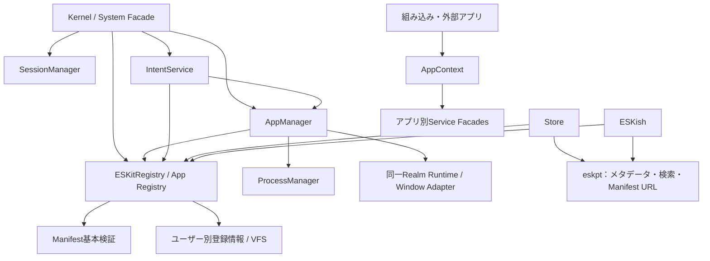
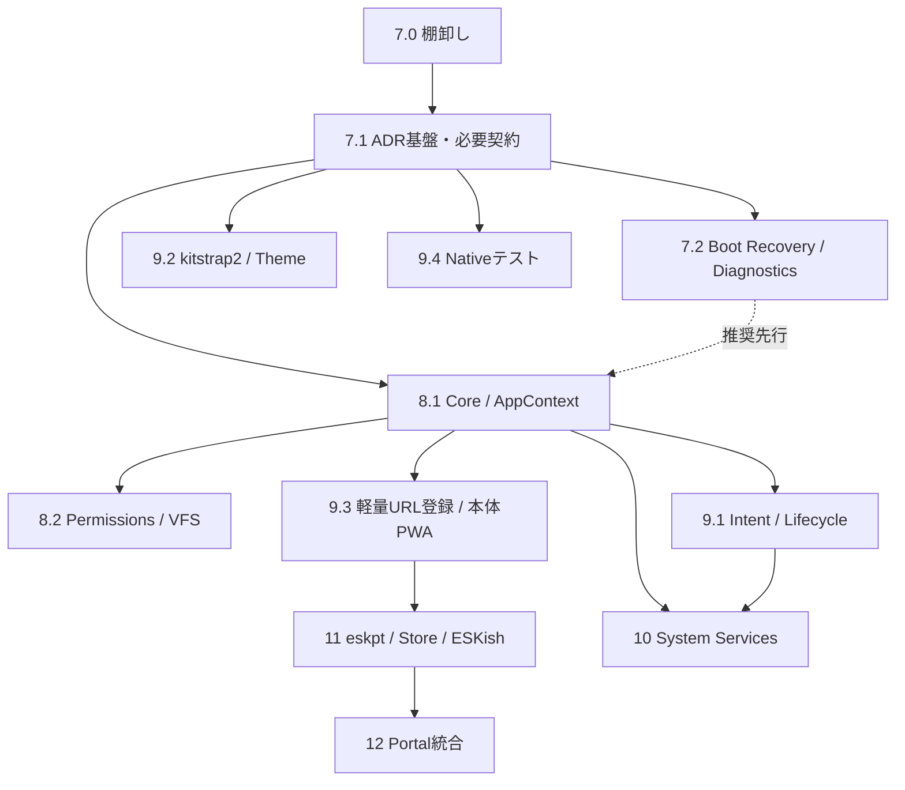

# ESKit 開発計画

> ブラウザ標準技術で動く軽量なWeb OS。アプリはURLから登録して、そのままES Modulesとして実行する。

**調査基準:** `feature/pwa` / `8de2dcf` (2026-10-12)。本更新の変更対象は `PLAN.md` のみ。コード、`README.md`、`API.md` は変更しない。以下の新規API・モジュール名は実装契約を検討するための案であり、現行APIではない。

**状態の読み方:** 「実装済み」は該当コードが存在すること、「部分実装」は契約・処理の一部が不足すること、「未実装」は対象実装が存在しないこと、「提案中」は採用判断前の設計を示す。動作検証の合格とは別に扱う。「採択済み」は方針への合意であり、実装完了を意味しない。既存の ✅ と完了条件は当初の履歴として残し、現状との差異を調査注記で示す。

## コンセプト・決定事項

- **ビルド不要・npm 非依存** — ブラウザネイティブ ES Modules のみ
- **技術スタック:** Vanilla JS + Web Components (Custom Elements v1, Shadow DOM, Constructable StyleSheets)
- **ブラウザ対象:** Evergreen 最新版のみ。最新 Web API を積極採用:
  - Popover API, View Transitions API, CSS Anchor Positioning, `@starting-style`
  - CSS Container Queries, Shadow DOM, `ElementInternals` (Custom State Set)
  - `scheduler.postTask()`, `crypto.randomUUID()`, `Compression Streams` 等
- **永続化:** 現在のテーマ・言語設定と外部アプリ登録情報 → VFS / VFS → IndexedDB (ESKitFileSystem)。ユーザー・セッション・権限情報には `localStorage` も使用
  - IndexedDB スキーマは開発中につき破壊的変更を許可: バージョンは **1 固定** で管理
- **権限モデル:** 2 段階 (Install-time 宣言 + Runtime ユーザー確認)。協調的なアプリのAPI利用を制御する。同一Realmの悪意あるコードに対する隔離・ユーザー間データ保護を保証しない
- **実行・配布:** 組み込み・外部アプリとも同一Realm。HTTPS上のManifest URLを登録し、Native `import()` で起動する。独立した高機能PackageManagerは設けない
- **UI:** Hamonは公式の軽量リアクティブUI選択肢。利用は任意とし、Vanilla JS・Web Components・外部UIフレームワークを許容する
- **ローカルファースト:** ESKit本体のPWAオフライン対応を維持する。外部ホストのアプリのオフライン起動は保証しない
- **ドキュメント:** 日本語で記述。API リファレンスは `API.md` に分離
- **テスト:** Browser Nativeのみを採択。Vanilla JavaScript・Native ES Modules・ブラウザ標準APIで実装し、Node.js・npm・Playwright等の実行時／開発依存、`package.json`、`node_modules` を導入しない (ADR-TEST-001)。当初の「テスト/Lintをオミット」はこの決定で置換
- **エコシステム構成 (マルチリポジトリ):**
  - `eskit`: コアフレームワーク & OS 環境 (PWA, Vanilla JS)
  - `kitstrap2`: 汎用CSSフレームワークの正本。SCSS・Viteによるビルドは独立リポジトリで行い、ESKitは固定した配布CSSだけを取り込む
  - `eskpt`: メタデータ・検索・公開情報・Manifest URLの軽量レジストリ。Void.cloud / Viteは第一候補であり未採択
  - `eskit-docs`: 開発者ポータル & チュートリアル & プレイグラウンド (Blume構想を継承。具体的構成は別ADR)

---

## 現状 (Phase 1～6の実装履歴と改善対象)

指定された `README.md`、`API.md`、`system/system.js`、`app.js`、`manifest.js`、`registry.js`、`permissions.js`、`filesystem.js`、`window.js`、`theme.js`、`kitstrap2.js`、`main.css` と `apps/eskish/` を照合し、PWA・ファイル関連付け・外部アプリ登録も確認した。以下は静的なコード調査結果であり、今回ブラウザ実行による全PASS・オフライン動作確認は行っていない。

| 領域 | 状態 | 根拠・次の改善 |
|------|------|----------------|
| Phase 1～5の基盤・UI・Hamon・ユーザー・テーマ | 実装済み | 下記のファイル一覧と既存Phase履歴。契約更新は8.1・8.2・9.2で段階的に行う |
| Phase 6 PWA | 部分実装 | `sw.js` / `system/pwa.js` / Web Manifestが存在。全組み込みアプリ・Elementの事前キャッシュ、キャッシュ削除範囲、更新時の整合性を9.3で検証・改善 |
| 起動失敗時のRecovery | 未実装 | `index.html` は `main.js` を直接読み込み、mainの静的import後にSystemを生成する。独立recoveryページ・Bootstrapの失敗捕捉・ブートステージ記録は7.2で追加 |
| サンプルアプリ・多言語・ファイル選択 | 実装済み | `apps/notepad` 等、`system/i18n.js`、`elements/file-picker`。再実装せず利用する |
| URL登録・登録解除・保存・復元 | 部分実装 | `registry.registerFromUrl()` はディレクトリURLから `define.json` を取得。管理者は全体用、一般ユーザーはユーザー用VFSに保存。Manifest URL直接受付・明示更新・保存失敗処理・ユーザー別標準化は9.3 |
| 外部ES Modules起動 | 実装済み | `system.loadApp()` のNative `import()`。登録時にコードは実行しない。CORS・entry検証・起動失敗処理は改善対象 |
| Manifest共通契約 | 部分実装 | `manifest.js` は必須フィールド、i18n、icon、permissions、拡張子を正規化。schemaVersion・互換性・window・launch・intentsの正式契約は未実装 |
| ファイル関連付け | 実装済み | `registry.findAppByExtension()` と `System.openFile()` / `onOpenFile()`。最初の候補を起動する方式で、一般Intent・既定Handler選択は未実装 |
| アプリ別API・Lifecycle | 部分実装 | `ESKitApp` にfs・通知・IPC等のラッパーがある。AppContext、Manager分離、非同期初期化待機・終了キャンセルは未実装 |
| 権限とVFS ACL | 部分実装 | 宣言・Runtime確認、user/app別保存、owner/modeは存在。APIラッパーのfs.read/write判定にパススコープを追加する必要がある |
| ESKish | 実装済み | `apps/eskish/` にeval、VFS内CLI拡張、install/uninstall/openFile連携がある。eskpt検索コマンド・Storeは未実装 |
| 品質保証 | 部分実装 | `apps/test/` のSystemVerifierは存在。独立 `tests/index.html` とNativeハーネスは未実装 |
| Core再編・追加System Services | 未実装 | 現在はESKitSystemと既存Serviceに集中。新規Manager・Serviceの責務は本書で計画する |
| eskpt / Store / Developer Portal | 提案中 | このブランチにStore・eskpt接続・Portal実装はない。独立リポジトリの実装状況をこのブランチの完了扱いにしない |

**コードと旧文書の重要な差異:**

- `loadApp()` は `initialize()` をawaitせず、初期化前にrunning扱いとなる。`closeApp()` は同期処理で、非同期失敗・終了取消・初期化途中のcleanupを統一していない。Windowのフォーカス等とアプリのフックの接続も8.1・9.1で確認する。
- 起動時の `onOpenFile()` とNotepadの初期化経路が重なり、二重配送の可能性がある。Intent移行で一度だけ配送する。
- RegistryはID衝突を上書きし、保存エラーを警告だけで処理する経路がある。確認UIが存在しない場合の確認省略、保存済み定義の無検証復元も改善する。
- `fs.read.all` / `fs.write.all` / `fs.shared` はManifestで受け付けるが、アプリ用fsラッパーのスコープ制御として完成していない。`network` / `clipboard` 宣言もNative APIを強制的に遮断するものではない。
- テーマ・言語は現在ユーザーのVFS設定。旧Phase 5のlocalStorage案は履歴。ESKishの現行Manifestは `user.info` を宣言し、`user.manage` は宣言していない。
- `sw.js` は事前取得の失敗を許容し、activateで自分以外のOrigin内キャッシュを削除する。HTTPエラー時と通信例外時の扱い、即時skipWaiting、動的キャッシュ保存の寿命も9.3の対象。
- `README.md` の進捗・起動説明、`API.md` の登録時コード実行・保存先・network権限・picker・Lifecycle説明には実コードとの差異がある。各契約の実装時に更新する作業として残す。

| ファイル | 実装内容 |
|----------|---------|
| `system/util.js` | `css` / `html` タグ関数 (補間対応) |
| `system/event-bus.js` | ESKitEventBus — pub/sub |
| `system/filesystem.js` | ESKitFileSystem — IndexedDB VFS (Uint8Array, バイナリ対応) |
| `system/manifest.js` | ESKitManifest — `define.json` を fetch・バリデーション (fileAssociations 対応) |
| `system/permissions.js` | ESKitPermissions — 2 段階権限管理 + ダイアログ |
| `system/registry.js` | ESKitRegistry — アプリ登録・検索・URL インストール・拡張子関連付け検索 |
| `system/shell-mode.js` | ESKitShellMode — desktop/mobile モード管理 |
| `system/app.js` | ESKitApp — ライフサイクルフック・開発者 API (`this.fs`, `this.sendMessage`, `this.listProcesses`, `this.showNotification`, `this.t`, `this.onOpenFile`) |
| `system/system.js` | ESKitSystem — カーネル (boot, loadApp, openFile, IPC, notify, theme, i18n, dialog, notifications) |
| `system/window.js` | ESKitWindowSystem — モード対応ウィンドウ管理 |
| `system/elements/desktop/` | `eskit-desktop` — デスクトップルート要素 |
| `system/elements/window/` | `eskit-window` — アプリウィンドウ (desktop/mobile 対応) |
| `system/elements/launcher/` | `eskit-launcher` — デスクトップモード用ランチャー (グリッド UI + 検索) |
| `system/elements/taskbar/` | `eskit-taskbar` — デスクトップモード用タスクバー (ランチャーボタン・アプリ一覧・時計) |
| `system/elements/drawer/` | `eskit-drawer` — モバイル用アプリドロワー |
| `system/elements/home-bar/` | `eskit-home-bar` — モバイル用ホームバー |
| `system/elements/permission-dialog/` | `eskit-permission-dialog` — 権限確認ダイアログ (Web Component) |
| `system/elements/login-screen/` | `eskit-login-screen` — ログイン画面 (Phase 4) |
| `apps/test/` | SystemVerifier — システム検証アプリ |
| `apps/welcome/` | WelcomeApp — ようこそ画面 |
| `apps/eskish/` | ESKish — 標準ターミナル環境 (Phase 4.5 / 6) |
| `README.md` | 日本語 README |
| `API.md` | API リファレンス (README から分離) |
| `system/kitstrap2.js` | Singleton CSSStyleSheet — kitstrap2 を Shadow DOM 全体に共有 |
| `system/kitstrap2.css` | kitstrap2配布CSSの取り込み先 (現行ファイルの版・上流成果物との同一性は未確定) |
| `system/main.css` | `--eskit-*` → `var(--kit-*)` CSS 変数ブリッジ |
| `system/elements/context-menu/` | `eskit-context-menu` — 右クリックコンテキストメニュー (Phase 3) |
| `system/elements/beacon/` | `eskit-beacon` — グローバル検索オーバーレイ (Phase 3) |
| `system/elements/quick-settings/` | `eskit-quick-settings` — クイック設定パネル (Phase 3/5) |
| `system/hamon.js` | Hamon — リアクティブテンプレートエンジン (Phase 3.5) |
| `system/users.js` | ESKitUsers — ユーザー管理・認証 (Phase 4) |
| `system/icons.js` | ESKitIcons & `<eskit-icon>` — アイコンシステム (Phase 4.8) |
| `system/theme.js` | ESKitTheme — テーマ & 壁紙管理 (Phase 5) |
| `system/themes/presets.js` | 組み込みテーマ & 壁紙プリセット (Phase 5) |
| `system/i18n.js` | ESKitI18n — 多言語辞書 & リアクティブ翻訳 (Phase 5) |
| `system/elements/dialog/` | `eskit-dialog` — 汎用ダイアログ要素 (Phase 5) |
| `system/elements/file-picker/` | `eskit-file-picker` — 汎用ファイル選択ダイアログ (Phase 5/6) |
| `system/elements/notification/` | `eskit-notification` / `eskit-notification-container` — 通知トースト (Phase 5) |
| `apps/settings/` | SettingsApp — システム設定アプリ (Phase 5) |
| `manifest.webmanifest` | PWA Web App Manifest (Phase 6) |
| `sw.js` | PWA Service Worker (Network-First, Phase 6) |
| `system/pwa.js` | PWA ライフサイクル & アップデート通知 (Phase 6) |
| `icons/icon.svg` | PWA ベクターアイコン (Phase 6) |
| `apps/notepad/` | NotepadApp — テキストエディタ (Phase 6) |
| `apps/calculator/` | CalculatorApp — 電卓 (Phase 6) |
| `apps/clock/` | ClockApp — 時計/ストップウォッチ/タイマー (Phase 6) |
| `apps/filemanager/` | FileManagerApp — 仮想 FS ブラウザ (Phase 6) |

### シェルモード (ESKitShellMode)

- `window.matchMedia("(max-width: 768px)")` で自動検出
- `globalThis.System.setShellMode("mobile")` で手動上書き可能、`.shellMode.unlock()` で自動復帰
- モード変更時 → `"shell:mode-changed"` イベント → 全 Web Components が `mode` 属性を参照して自律的にレイアウト切替

| | desktop モード | mobile モード |
|--|---------------|--------------|
| ウィンドウ | ドラッグ・リサイズ可能な複数ウィンドウ (初期のカード形式から発展) | アクティブのみ全画面 |
| 別アプリ切替 | タスクバーから選択 | ドロワーから選択 |
| アプリを閉じる | カード消去 | ドロワーが自動で開く |
| タスクバー | 固定下部 (ランチャーボタン・アプリ一覧・時計) | 非表示 |
| ランチャー | オーバーレイ (グリッド + 検索) | 非表示 |
| ホームバー | 非表示 | 固定下部 |
| ドロワー | 非表示 | ホームボタンで開閉 |

---

## Phase 2: Window Management — ウィンドウ管理 ✅

**調査注記:** 以下は当初の実装記録。Windowの操作実装は存在するが、ESKitAppのfocus/blur/minimize等へのLifecycle配送は9.1で整理・検証する。

**目的:** デスクトップ OS らしいウィンドウ操作を実現する。  
**完了条件:** 複数ウィンドウのドラッグ・リサイズ・最小化・最大化・復元・スナップ・Z-order が動作する。  
**ステータス:** 実装済み

### `system/elements/window/main.js` — ESKitWindowElement 強化

**状態機械:**
```
normal ↔ minimized
normal ↔ maximized
(snapped は normal の一種、_prevRect で復元)
```

**追加メソッド:**
```js
class ESKitWindowElement extends HTMLElement {
  _state:    "normal" | "minimized" | "maximized"
  _prevRect: { left, top, width, height } | null

  focus(): void        // z-index 最前面 + .focused クラス
  minimize(): void
  maximize(): void
  restore(): void
  snap(side: "left" | "right"): void
}
```

**タイトルバー構造:**
```html
<div class="app-header">
  <span class="app-title">…</span>
  <div class="app-controls">
    <button class="btn-minimize">–</button>
    <button class="btn-maximize">□</button>
    <button class="btn-close">✕</button>
  </div>
</div>
```

**ドラッグ:** `.app-header` の `pointerdown/pointermove/pointerup` + `setPointerCapture`

**リサイズ:** 8 方向ハンドル (`.resize-n/s/e/w/ne/nw/se/sw`) + pointer events。`MIN_W=220, MIN_H=120`

**スナップ:** `pointerup` 時の `clientX/Y` で判定:
- `y <= 8` → `maximize()`
- `x <= 8` → `snap("left")`
- `x >= innerWidth - 8` → `snap("right")`

### `system/window.js` — ESKitWindowSystem 変更

- `open(uuid)`: カスケード配置 (offset `30 + 28 * n`)、`appElement.focus()` で前面に
- `getAllElements()`: 全ウィンドウ要素取得 (タスクバーから利用)

**関連ファイル:** `system/elements/window/main.js`, `system/elements/window/style.js`, `system/window.js`

---

## Phase 3: Desktop Shell — シェル UI ✅

**目的:** コンテキストメニュー・スポットライト検索・クイック設定・ウィンドウアニメーションを追加し、モダン OS らしいシェル体験を実現する。  
**完了条件:** 右クリックメニュー・Ctrl+Space 検索・クイック設定パネル・ウィンドウ開閉アニメーションが動作する。  
**ステータス:** 実装済み

> **Note:** タスクバー (`eskit-taskbar`) とランチャー UI 刷新 (`eskit-launcher`) は Phase 1 で実装済み。

### `system/elements/context-menu/` (新規)

**ESKitContextMenuElement:**
```js
show(x: number, y: number, items: MenuItem[]): void
hide(): void
// MenuItem: { label: string, action: () => void } | { separator: true }
```
- デスクトップ右クリックでデフォルトメニューを表示:
  - 「ランチャーを開く」→ `launcher:toggle` 発行
  - 「シェルモード切替」→ `System.setShellMode()`
  - 区切り線 + 将来の拡張 (壁紙変更・設定を開く 等)
- `contextmenu` イベントを `window.js` の `#initContextMenu()` でハンドル
- Popover API で表示 (`popover="manual"`)、画面端でポジション自動補正
- 他クリック (`pointerdown` outside) / Escape キーで `hide()`

### `system/elements/beacon/` (新規)

**ESKitBeaconElement** — グローバル検索オーバーレイ:
```js
show(): void
hide(): void
// Ctrl+Space / Cmd+Space でトグル
```
- `position: fixed; inset: 0; z-index: 20000` のオーバーレイ
- 上部中央に検索バー (`<input>`) を配置。フォーカス自動付与
- `System.registry.search(query)` でアプリ候補をリアルタイム表示
- 候補クリック → `System.loadApp(manifest._dir)` → `hide()`
- Enter キーで最上位候補を起動
- `keydown` を `window` でキャプチャ: `Ctrl+Space` でトグル、`Escape` で閉じる
- 将来的に VFS ファイル検索も統合 (Phase 6)

### `system/elements/quick-settings/` (新規)

**ESKitQuickSettingsElement** — タスクバーのシステムトレイから展開するパネル:
```js
show(anchorEl: HTMLElement): void
hide(): void
toggle(anchorEl: HTMLElement): void
```
- CSS Anchor Positioning で時計ボタンの直上に `position-area: top span-right` 配置
- パネル内容:
  - **シェルモード:** desktop / mobile の切替トグル
  - **明暗テーマ:** OS に連動 (`prefers-color-scheme`) / ライト / ダーク の 3 択 (Phase 5 テーマ実装後に有効化)
  - **システム情報:** 起動中プロセス数、FS 使用量 (Phase 5 連携)
- `ESKitTaskbarElement` が時計要素 (`#clock`) のクリックイベントで `toggle()` を呼ぶ
- 外側クリック / Escape で `hide()`

### ウィンドウ開閉アニメーション

**`system/elements/window/style.js` 追加:**
- `@starting-style` + `transition` でウィンドウのスケール・フェードイン (`scale(0.92)` → `scale(1)`)
- `prefers-reduced-motion: reduce` でアニメーション無効化 (アクセシビリティ)

### `system/system.js` — `initUI()` 実装

- コンテキストメニュー・スポットライト・クイック設定の初期化
- グローバルキーバインド (`Ctrl+Space`) の登録
- `system:ready` イベント後に実行

**関連ファイル:** `system/elements/context-menu/main.js`, `style.js` (新規), `system/elements/beacon/main.js`, `style.js` (新規), `system/elements/quick-settings/main.js`, `style.js` (新規), `system/elements/window/style.js` (変更), `system/elements/desktop/main.js` (変更), `system/elements/taskbar/main.js` (変更), `system/system.js` (変更)

---

## Phase 3.5: Hamon — リアクティブテンプレートエンジン ✅

**目的:** ESKit アプリ開発における以下の課題を解決するリアクティブテンプレートエンジン「Hamon」を導入する。  
**完了条件:** Hamon テンプレートで記述したアプリが、シグナル変更で自動 DOM 更新・イベント自動登録/解除・条件分岐のリアクティブ切替を行える。既存の文字列テンプレートアプリも変更なしで動作する (後方互換)。  
**ステータス:** 実装済み

### 解決する課題

1. **イベントリスナーの手動 add / remove** — `@click` 属性構文で自動登録、スコープ dispose で自動解除
2. **状態変化に合わせた手動 DOM 更新** — シグナルに依存する DOM ノードを直接・最小限に更新
3. **条件分岐・リスト描画の煩雑な命令的記述** — `kit-if` / `kit-else` ディレクティブ、`list()` ヘルパー

### 設計方針・決定事項

- **リアクティビティ:** シグナル方式 (VDOM なし)。各シグナルに依存する DOM ノードを直接更新する (SolidJS に近い方式)
- **テンプレート:** タグ付きテンプレートリテラル `hamon` + `kit-` ディレクティブ
- **イベント:** `@click` 形式 (属性構文)
- **属性バインド:** `:value` 形式
- **条件分岐:** `kit-if` / `kit-else` 属性ディレクティブ
- **リスト描画:** `list(itemsFn, renderFn)` ヘルパー関数
- **単一ファイル:** `system/hamon.js` に全実装を収める (ビルド不要哲学)
- **後方互換:** 文字列テンプレートは従来どおり `innerHTML` でマウント

### `system/hamon.js` — リアクティブプリミティブ (新規)

**signal(initial):**
```js
const count = signal(0);
count.value;      // 0 (get — 実行中 effect があれば依存登録)
count.value = 1;  // set — 依存する effect を再実行
count.peek();     // 依存追跡なしで値を読む
```

**computed(fn):**
```js
const double = computed(() => count.value * 2);
double.value; // 2 (読み取り専用、依存元が変われば自動再計算)
```

**effect(fn):**
```js
const dispose = effect(() => {
  console.log(count.value); // count が変わるたびに再実行
  return () => { /* クリーンアップ */ };
});
dispose(); // 手動解除
```

**HamonScope:**
```js
const scope = new HamonScope();
const s = scope.signal(0);
scope.effect(() => console.log(s.value));
scope.onDispose(() => { /* 任意のクリーンアップ */ });
scope.dispose(); // スコープ内の全 effect を一括解除
```

### `system/hamon.js` — テンプレートエンジン

**`hamon` タグ付きテンプレートリテラル:**
```js
import hamon, { signal } from "system/hamon.js";

const count = signal(0);
const fragment = hamon`
  <button @click=${() => count.value++}>
    Count: ${() => count.value}
  </button>
  <input :value=${() => count.value} :disabled=${() => count.value > 10}>
  <p kit-if=${() => count.value > 5}>High!</p>
  <p kit-else>Low</p>
`;
// fragment: リアクティブな DocumentFragment
// fragment._scope: HamonScope (dispose で全バインディング解除)
```

**テキスト補間:**
- `${value}` — 静的値をそのまま挿入
- `${() => expr}` — 関数: effect で自動更新される Text ノード (戻り値が Node/Fragment なら DOM 挿入)
- `${signal}` — Signal の `.value` をバインド

**イベントバインディング `@event`:**
- `@click=${handler}` → `addEventListener("click", handler)`
- scope dispose 時に自動 `removeEventListener`

**属性バインディング `:attr`:**
- `:value=${signal}` / `:disabled=${() => bool}` / `:class=${() => str}`
- `value`, `checked`, `selected`, `disabled` は DOM プロパティ直接設定
- その他は `setAttribute` / `removeAttribute`

### `system/hamon.js` — ディレクティブ

**`kit-if` / `kit-else`:**
```html
<div kit-if=${() => show.value}>表示</div>
<div kit-else>非表示</div>
```
- Comment ノードをアンカーとして位置を記憶
- 条件の真偽で DOM 挿入/除去 (ノード実体は保持し再生成しない)
- `kit-else` は直前の `kit-if` 要素の兄弟要素として連動

**`list()` リスト描画ヘルパー:**
```js
const items = signal(["A", "B", "C"]);
hamon`
  <ul>
    ${list(() => items.value, (item, i) => hamon`<li>${item}</li>`)}
  </ul>
`;
```
- 配列シグナルの変化に応じてリスト部を再レンダー（現状は全体再構築）
- 将来的には各アイテムの Fragment `_scope` を追跡し、除去時に dispose する差分更新に対応予定

### ESKitApp 統合

**`system/app.js` 変更:**
- `this.hamon` プロパティ: `HamonScope` の遅延生成ゲッター
- テンプレートに `hamon` タグ関数の戻り値 (DocumentFragment) を設定可能

**`system/window.js` 変更:**
- `open()` メソッド内でテンプレートの型判定:
  - `DocumentFragment` → `templateEl.appendChild(fragment)` (Hamon パス)
  - `string` → `templateEl.innerHTML = template` (後方互換パス)
- Hamon テンプレートの `_scope` をアプリインスタンスに紐付け

**`system/system.js` 変更:**
- `closeApp()` 内で `app._hamonScope?.dispose()` を呼び出し、全 effect を一括解除

### Hamon を使ったアプリの例 (before / after)

**Before (手動 DOM 操作):**
```js
export default class CounterApp extends ESKitApp {
  static template = html`<button id="btn">Count: 0</button>`;
  initialize() {
    let count = 0;
    const btn = this.querySelector("#btn");
    btn.addEventListener("click", () => {
      count++;
      btn.textContent = `Count: ${count}`;
    });
  }
}
```

**After (Hamon):**
```js
import hamon, { signal } from "system/hamon.js";
export default class CounterApp extends ESKitApp {
  constructor() {
    super();
    const count = signal(0);
    this.template = hamon`
      <button @click=${() => count.value++}>
        Count: ${() => count.value}
      </button>
    `;
  }
}
```

※ `WindowSystem.open()` は `initialize()` より前に `template` をマウントするため、Hamon テンプレートは constructor（または static `template`）で設定する。`initialize()` はマウント後のイベント購読・初期データ取得などに引き続き利用する。

### 将来の拡張 (Phase 3.5 スコープ外)

- **`kit-model` 双方向バインド:** `:value` + `@input` の頻出パターン用ショートハンド
- **テンプレートキャッシュ:** tagged template の `strings` 参照同一性を利用した WeakMap キャッシュ
- **既存システム要素の Hamon 化:** taskbar, launcher 等の段階的移行 (オプトイン)

**関連ファイル:** `system/hamon.js` (新規), `system/app.js` (変更), `system/window.js` (変更), `system/system.js` (変更)

---

## Phase 4: Multi-User Foundation — ユーザー概念導入 ✅

**調査注記:** 以下の「分離」はESKit API経由の通常操作におけるACLを指す。同一Realm・Originの悪意あるコードからの隔離ではない。現行コードには空パスワードの既定管理者を自動作成・ログインする経路があり、当初の初回ログイン案とは異なる。

**目的:** ユーザー概念を導入し、ログインセッション・ホームディレクトリ分離・所有者/モードに基づくアクセス制御を実現する。  
**完了条件:** 管理者作成・ログイン・ユーザー切替・ユーザーごとの権限分離・`/home/{userId}` 分離が動作し、`/home/user` 依存が除去される。  
**ステータス:** 完了

### 決定事項

- **パス規約:** `/home/user` は廃止し、`/home/{userId}` に統一
- **認証:** ローカル完結のパスワードハッシュ (Web Crypto / PBKDF2)
- **ロール:** 管理者 1 名 + 一般ユーザー
- **共有領域:** `/shared` を導入し、アクセス制御対象に含める
- **権限分離:** 同一アプリでもユーザーごとに runtime 権限を独立管理
- **カーネル API とアプリファサードの分離:** `System.fs` 等の直接呼出しはカーネル・システム内部専用とし、アプリからは `this.fs` (FS), `this.sendMessage` (IPC), `this.listProcesses` (System Info) 等の権限検証ファサードの利用を規約化
- **特権保護:** 管理者作成 (`isAdmin: true`) およびユーザー削除は管理者セッションを必須化
- **ディレクトリ階層整合性:** ディレクトリの `rename` 時に配下の子孫エントリを同一トランザクションで再帰的更新

### `system/users.js` (新規)

**ESKitUsers** — ユーザー管理・セッション管理:
```js
class ESKitUsers {
  async init(): Promise<void>
  list(): User[]
  getCurrent(): User | null
  async create({ id, name, password, isAdmin }): Promise<User>
  async delete(id: string): Promise<void>
  async login(id: string, password: string): Promise<User>
  logout(): void
}
```

**User モデル:**
```ts
type User = {
  id: string;
  name: string;
  isAdmin: boolean;
  passwordHash: string;
  salt: string;
  createdAt: number;
  disabled?: boolean;
};
```

- ストレージ: `localStorage` (ユーザー一覧 / 現在セッション)
- ハッシュ: PBKDF2 (SHA-256) + ランダム salt
- 初回起動時は管理者ユーザー（パスワードなし）を自動作成して自動ログイン
- ユーザー ID: 1〜31 文字の英小文字開始文字列 (`/^[a-z][a-z0-9_-]{0,30}$/`)
- 管理者保護: 初回以降の `isAdmin: true` 作成および `delete()` は管理者セッションを必須化

### `system/system.js` — 起動シーケンス変更

```text
ESKitSystem.constructor()
  └─ #boot() [async]
       ├─ fs.init()
       ├─ users.init()
       ├─ #initBaseDirs()         /home, /shared, /system, /apps
       ├─ #ensureDefaultAdmin()   デフォルト管理者自動作成（自動ログイン）
       ├─ #ensureLogin()          ログイン（初回は自動ログインで通過）
       ├─ #initCurrentUserDirs()  /home/{userId}/desktop など
       ├─ new ESKitWindowSystem
       ├─ #registerBuiltinApps()
       ├─ initUI()
       └─ events.emit("system:ready")
```

### `system/filesystem.js` — owner/mode 導入

**エントリ形式拡張:**
```js
{ path, parent, type, content, owner, mode, createdAt, modifiedAt }
```

- デフォルト mode: ESKit 独自の可読オブジェクト形式
  - file: `{ owner: {read:true, write:true}, others: {read:false, write:false} }`
  - dir:  `{ owner: {read:true, write:true}, others: {read:true, write:false} }`
- `stat()` 返却に `owner`, `mode` を追加
- `read/write/readdir/remove/rename` でアクセス制御を実施
  - 一般ユーザー: 自身のホーム中心
  - 管理者: システムポリシー上許可された範囲で横断アクセス可
- ディレクトリ `rename()` は子孫エントリを再帰的にパス更新

### ログイン UI / 切替 UI

- `system/elements/login-screen/` (新規): ログイン画面
- `system/elements/quick-settings/` (変更): 現在ユーザー表示 / ログアウト / 切替
- `system/elements/drawer/` (変更): モバイル導線の追加

### マイグレーションと互換

- 旧 `/home/user` 依存コードは段階的に `/home/{userId}` へ置換
- 旧権限キーはユーザー単位キーへ移行 (`userId` を含む)
- 破壊的変更を許容する開発方針に従い、必要時は初期化リセットを許容

**関連ファイル:** `system/users.js` (新規), `system/system.js` (変更), `system/filesystem.js` (変更), `system/permissions.js` (変更), `system/app.js` (変更), `system/elements/login-screen/` (新規), `system/elements/quick-settings/` (変更), `system/elements/drawer/` (変更), `apps/test/` (変更)

---

## Phase 4.5: ESKish — ターミナルアプリ ✅

**調査注記:** 以下の権限一覧は当初案。現行define.jsonは `user.info` を含み、`user.manage` は含まない。evalとVFS内CLI拡張は信頼済みコードを実行する開発機能。既存install/uninstall連携をPhase 11で再利用する。

**目的:** ESKit のマルチユーザー・権限モデル・ファイルシステム・プロセス管理をコマンドラインから操作・検証できる標準ターミナルアプリ「ESKish」を導入する。  
**完了条件:** ターミナルウィンドウからファイル操作・プロセス管理・ユーザー確認・JS式評価を実行でき、コマンド履歴・カレントディレクトリ表示が動作する。  
**ステータス:** 完了

> 詳細は [API.md](API.md#eskish--ターミナルアプリ) を参照

### 設計方針・決定事項

- **実行モデル:** Unix 風シェル体系に特化しつつ、コマンド名は **EcmaScript / ESKit API 風の独自命名** (`readFile`, `writeFile`, `readDir`, `makeDir`, `remove`, `rename`, `changeDir`, `listProcesses`, `loadApp`, `closeApp`, `currentUser`, `eval` 等) を採用
- **JavaScript 実行:** `eval <code...>` コマンドに限定し、現在ログイン中のユーザー権限（`this`, `this.fs`, `System`）で実行
- **CWD (作業ディレクトリ):** 初期値は `/home/{userId}`。相対パスおよび `~` (ホーム展開) をサポート
- **プロンプト形式:** `{userId}@eskit:{path}$ ` (ホーム配下は `~` で短縮表示)
- **UI 構造:** プレーンテキスト主体の軽量ターミナル (テキストログ、`↑`/`↓` コマンド履歴、自動スクロール)
- **組み込み登録:** `system/system.js` の `#registerBuiltinApps()` に `"apps/eskish/"` として常備

### `apps/eskish/` (新規)

- `define.json`: マニフェスト (要求権限: `fs.read`, `fs.write`, `system.info`, `notifications`, `ipc`, `user.info`, `user.manage`)
- `main.js`: `ESKishApp` クラス (CWD 管理、パス解決、コマンドパーサー、履歴管理)
- `style.js`: ターミナル UI スタイル (ダークモノスペーステーマ)

**関連ファイル:** `apps/eskish/define.json` (新規), `apps/eskish/main.js` (新規), `apps/eskish/style.js` (新規), `system/system.js` (変更)

---

## Phase 4.8: Icon System — アイコンセットと Lucide Icons 統合

**目的:** 絵文字や記号文字に依存していたシステム UI（ウィンドウ操作、コンテキストメニュー、Beacon、タスクバー、ランチャー、ドロワー、クイック設定、ログイン画面等）およびアプリのアイコン表示を刷新し、**アイコンセット (Icon Set)** の概念に基づいた一貫性のある Lucide Icons 基盤を導入する。  
**完了条件:** `<eskit-icon set="..." name="...">` Web Component および `icon(set, name, options)` ヘルパーが動作し、`System.icons` レジストリによりセット単位でアイコンが管理・描画され、`define.json` マニフェストの `icon` オブジェクト指定が解釈・表示される。  
**ステータス:** 完了

### 設計方針・決定事項

- **アイコンセット (Icon Set) モデル:** アイコンは単一の `name` ではなく、**`set` (アイコンセット名) と `name` (アイコン名)** の 2 つのキーで常に明示的に解決する（`<eskit-icon set="lucide" name="search">`）。
- **ビルド不要・完全ローカル自己完結:** 外部 CDN や npm ビルドに一切依存せず、`system/icons.js` に標準の `"lucide"` アイコンセットの SVG 定義を同期マップとして保持する。
- **Web Component `<eskit-icon>`:**
  - 属性: `set`, `name`, `size`, `stroke-width`, `color`
  - スタイル: `display: inline-flex`, `vertical-align: middle`, `color: currentColor`, デフォルトサイズ `1em`。CSS 変数 `--eskit-icon-size`, `--eskit-icon-stroke-width` によるオーバーライドに対応。
- **ヘルパー関数 `icon(set, name, options)`:**
  - Hamon テンプレートや動的 DOM 生成向けに、`<eskit-icon>` 要素または SVG ノードを返す関数を提供。
- **マニフェスト (`define.json`) 形式:**
  - `icon` フィールドはオブジェクト形式 `{ type: "set" | "image", ... }` で統一:
    - アイコンセット: `{ "type": "set", "set": "lucide", "name": "terminal" }`
    - 画像ファイル: `{ "type": "image", "src": "icon.png" }`

### `system/icons.js` — アイコンレジストリ (新規)

**ESKitIcons:**
```js
class ESKitIcons {
  registerSet(setId: string, icons: Record<string, string>): void
  get(setId: string, name: string): string | null
  has(setId: string, name?: string): boolean
  listSets(): string[]
  listIcons(setId: string): string[]
}
```

- **組み込みセット (`lucide`):**
  - OS 起動時に `system/icons.js` 内の主要 Lucide アイコン（約50〜100種: ウィンドウ制御、検索、設定、ファイル、ターミナル、電源、ユーザー、テーマ、各種状態表示等）を `"lucide"` セットとして同期登録。
- **アプリによる拡張:**
  - アプリやプラグインは `System.icons.registerSet("my-app-set", { icon1: "<svg...>...", ... })` により独自のアイコンセットを登録可能。

### `system/elements/icon/` (新規)

**ESKitIconElement (`eskit-icon`):**
```html
<eskit-icon set="lucide" name="search" size="18"></eskit-icon>
```
- Shadow DOM 内で SVG を描画。`currentColor` に追従。
- `observedAttributes`: `["set", "name", "size", "stroke-width", "color"]`
- `set` または `name` 変更時に `System.icons.get(set, name)` を再取得して描画。存在しない場合はフォールバック表示。

### 既存 UI / アプリの Lucide アイコン置換スコープ

| コンポーネント | 対象箇所 | 置換前 | 置換後 (`set="lucide"`) |
|--------------|---------|-------|------------------------|
| `eskit-window` | タイトルバー操作ボタン | `–`, `□`, `✕` | `minus`, `square` / `maximize-2`, `x` |
| `eskit-context-menu` | デフォルトメニュー項目 | `💠`, `🔍`, `🔄` | `monitor-smartphone`, `search`, `refresh-cw` |
| `eskit-beacon` | 検索バー・結果フォールバック | `🔍`, `🪄` | `search`, `sparkles` |
| `eskit-launcher` | ランチャーボタン・アプリアイコン | `🪄` | マニフェストの `icon` または `sparkles` |
| `eskit-drawer` | ドロワーアプリアイコン | `🪄` | マニフェストの `icon` または `sparkles` |
| `eskit-quick-settings` | モード、テーマ、システム項目 | 文字/記号 | `monitor-smartphone`, `sun`, `moon`, `cpu`, `hard-drive` |
| `eskit-login-screen` | 入力欄・ボタン | 文字 | `user`, `lock`, `arrow-right` |
| `apps/eskish/` | マニフェスト `icon` | `"icon.png"` | `{ "type": "set", "set": "lucide", "name": "terminal" }` |
| `apps/welcome/` | マニフェスト `icon` | `"icon.png"` | `{ "type": "set", "set": "lucide", "name": "sparkles" }` |
| `apps/test/` | 検証状態アイコン | `⏳`, `✅`, `❌` | `clock`, `check-circle-2`, `x-circle` |

**関連ファイル:** `system/icons.js` (新規), `system/elements/icon/main.js` (新規), `system/elements/icon/style.js` (新規), `system/manifest.js` (変更), `system/window.js` (変更), `system/system.js` (変更), 各種既存要素・アプリ (変更)

---

## Phase 5: System Services — システムサービス ✅

**調査注記:** 以下は当初設計の履歴。テーマと言語設定の現在の保存先は `/home/{userId}/.config/theme.json` / `i18n.json` のVFSであり、localStorage案を置換している。組み込みテーマ・壁紙は `system/themes/presets.js`。旧light/darkファイル案とAPI例の差異は9.2と将来のAPI資料更新で整理する。

**目的:** テーマシステム、通知、i18n、設定アプリの基盤サービスを実装する。  
**完了条件:** 組み込み・外部テーマの切替で OS 全体の見た目が即座に変わり、通知が表示・自動消去され、言語切替が反映される。  
**ステータス:** 完了

### `system/theme.js` — テーマエンジン (新規)

**設計基盤:** kitstrap2 の CSS 変数システム上に構築する。`system/main.css` で `--eskit-*` 変数を `var(--kit-*)` にブリッジ済みのため、`--kit-*` 変数を上書きするだけで Shadow DOM を含む全要素に即時反映される。

**テーマオブジェクト形式:**

```json
{
  "id": "catppuccin-mocha",
  "name": "Catppuccin Mocha",
  "dark": true,
  "vars": {
    "--kit-color-primary": "#cba6f7",
    "--kit-fg":            "#cdd6f4",
    "--kit-bg":            "#1e1e2e",
    "--kit-bg-secondary":  "#181825"
  },
  "wallpaper": "linear-gradient(135deg, #1e1e2e, #181825)"
}
```

**API:**

```js
class ESKitTheme {
  get current(): string                // 現在のテーマ ID
  get list(): ThemeMeta[]              // 利用可能なテーマ一覧
  apply(id: string): void              // 組み込みテーマを適用
  applyVars(
    vars: Record<string, string>,
    dark?: boolean
  ): void                              // 変数セットを直接適用 (カスタムテーマ)
  async load(url: string): Promise<ThemeMeta>  // 外部 URL から theme.json を fetch・登録
  reset(): void                        // システムデフォルトに戻す
  setWallpaper(value: string): void    // 壁紙 CSS 値 (url() / gradient)
  export(): string                     // 現在のテーマを JSON 文字列でエクスポート
}
```

- 組み込みテーマ: `system/themes/light.js`, `system/themes/dark.js` という静的 JS モジュールとして定義し、ES Modules の `import` で読み込む（ブート時の fetch を抑え、キャッシュを最大活用）。
- `localStorage` にテーマ ID とカスタム vars を永続化。起動時に自動復元
- 適用時に `system:theme-changed` イベントを発行
- 壁紙: `--eskit-wallpaper` CSS 変数 → `eskit-desktop` の `background` に反映

**外部テーマのインポートフロー (`System.theme.load(url)`):**

1. URL を受け取り `theme.json` を fetch
2. JSON スキーマバリデーション (必須: `id`, `name`, `vars`)
3. ユーザー確認ダイアログ: テーマ名・作者・変更変数数を提示（新設する汎用確認ダイアログ `eskit-dialog` を利用）
4. `applyVars()` で即時適用 → `localStorage` に保存
5. `ThemeMeta` を返却 (リストに追加)

**セキュリティ:**
- HTTPS URL のみ許可 (`http://` は即拒否)
- `vars` のキーは `--kit-*` または `--eskit-*` のみ許可 (任意プロパティ注入を防止)
- 外部テーマ読み込みには設定アプリ経由のユーザー操作を必須とする

### `system/elements/dialog/` (新規)

**ESKitDialogElement (`eskit-dialog`):**
- システム全体で利用できる汎用的な確認・メッセージ用ダイアログ要素。
- Popover API を用いて表示し、テーマのインポート確認やその他のシステム確認処理で再利用する。

### `system/i18n.js` — 多言語対応 (新規)

```js
class ESKitI18n {
  locale: Signal<string>                   // 現在の言語コード（Hamon シグナル）
  async load(lang: string): Promise<void>  // system/i18n/{lang}.json を fetch
  t(key: string, vars?: Record<string, string>): string  // テンプレート補間対応
  get current(): string                    // 現在の言語コード
  get available(): string[]
  extend(appId: string, lang: string, dict: Record<string, string>): void  // アプリ独自辞書マージ
  async loadAppDictionary(appDir: string, appId: string, i18nPath?: string): Promise<void>  // アプリ個別辞書の動的ロード
  getAppName(manifest: Manifest): string   // 多相型マニフェスト名解決
  getAppDescription(manifest: Manifest): string
  getPermissionDescription(permCode: string): string
  formatTime(dateOrTimestamp?: Date|number, options?: Intl.DateTimeFormatOptions): string
  formatDate(dateOrTimestamp?: Date|number, options?: Intl.DateTimeFormatOptions): string
}
```
- コア言語パック: `system/i18n/ja.json`, `system/i18n/en.json` (システム共通・OSメッセージ)
- アプリ個別言語パック: 各アプリの `i18n/{lang}.json` から起動時および言語切替時に動的オンデマンド取得
- `navigator.language` で起動時自動選択 → `localStorage` (`/home/{userId}/.config/i18n.json`) で永続化
- **リアクティブ UI 更新:** `locale` を Hamon のシグナルとして実装し、Hamon テンプレート内の `${() => System.i18n.t('key')}` のように参照することで、言語切替時に依存関係の自動追跡により UI が即座に自動更新される。
- 言語変更完了時には `system:locale-changed` イベントも発行する。

### `system/elements/notification/` (新規)

**ESKitNotificationContainerElement (`eskit-notification-container`):**
- 画面右上固定の通知用コンテナ要素。

**ESKitNotificationElement (`eskit-notification`):**
- `System.events.on("notification:show", handler)` で自動表示され、`eskit-notification-container` 内に順次追加される。
- トーストが縦に積み重なる（スタックする）設計。
- `@starting-style` + `transition` でスライドイン/アウト。
- クリックまたは `duration` 経過で自動的にコンテナから消去される。

### `apps/settings/` — 設定アプリ (新規)

**実装方針:** 新規の Hamon テンプレートエンジンを全面的に使用し、宣言的かつリアクティブに実装する。

タブ構成:
- **外観:** 組み込みテーマ選択グリッド・URL からテーマをインポート (`System.theme.load`)・壁紙グリッド (プリセット + VFS 画像選択 + カスタム壁紙サムネイル)・現在のテーマを JSON でエクスポート
- **言語:** `System.i18n.available` からドロップダウン選択
- **システム:** 実行中プロセス数・登録アプリ数
- **権限:** インストール済みアプリの権限一覧 + 個別取り消し UI

**関連ファイル:** `system/theme.js`, `system/themes/light.js`, `system/themes/dark.js`, `system/i18n.js`, `system/i18n/ja.json`, `system/i18n/en.json`, `system/elements/dialog/`, `system/elements/notification/`, `system/system.js`, `apps/settings/`

---

## Phase 6: PWA & Sample Apps & Base Extensibility — PWA化と拡張基盤 ✅

**調査注記:** ✅・「完了」は当初の記録。コードは存在するが、本体PWAの事前キャッシュ範囲は部分実装で、今回はインストール・冷起動オフライン・SystemVerifier全PASSを確認していない。現行アイコンはSVGであり、下記の192/512画像は当初仕様。外部アプリのオフライン起動は保証しない。9.3・9.4で本体の受入条件を検証する。

**目的:** ESKit 本体を PWA 化してオフライン対応・アプリ化を実現し、外部アプリ/テーマのインストール基盤を完成させ、標準サンプルアプリ 4 種を整備し、全システムおよびアプリの完全な多言語対応 (i18n) 基盤を確立する。  
**完了条件:**
1. PWA としてブラウザにインストール可能でオフラインでも動作する。
2. 外部 URL からのアプリ/テーマ登録 (`registerFromUrl`, `theme.load`) が動作し、確認ダイアログが多言語表示される。
3. マニフェスト (`define.json`) が多相型多言語 (`string | { ja, en }`) および辞書パス宣言 (`i18n`) に対応している。
4. 全サンプルアプリ（Notepad, Calculator, Clock, FileManager）が個別辞書 (`apps/*/i18n/`) を備え、ハードコード文字列なしで動作する。
5. 言語切替時にウィンドウタイトル・タスクバー・アプリ内表示が即座に連動更新される。
6. SystemVerifier (`apps/test`) に Phase 6 テストスイートが追加され、全自動検証が PASS する。  
**ステータス:** 完了

### PWA 化仕様
- **キャッシュ戦略:** Network-First (フォールバックで Cache)
  - オンライン時は常に最新リソースを直接取得（開発時の即時反映・キャッシュ事故防止）
  - 通信不可時は Service Worker のキャッシュからレスポンス
- **構成ファイル:**
  - `manifest.webmanifest`: アプリ名、アイコン定義、`display: "standalone"`, `theme_color`, `background_color`
  - `sw.js`: Service Worker (コアシステム、CSS、アイコン、組み込みアプリ、アプリ個別辞書の事前キャッシュ + 動的フェッチキャッシュ)
  - `system/pwa.js`: Service Worker 登録 & 更新監視
  - `icons/`: PWA 用マニフェストアイコン (192x192, 512x512, maskable)

### マニフェスト (`define.json`) 多言語仕様
- **多相型 (Polymorphic) プロパティ:**
  - `name`: `string` または `{ "en": "...", "ja": "..." }`
  - `description`: `string` または `{ "en": "...", "ja": "..." }`
- **辞書パス宣言 (オプション):**
  - `"i18n": "./i18n/"` (未指定時は `./i18n/` をデフォルト探索)

### アプリ個別辞書 & 動的ローダー (`System.i18n.loadAppDictionary`)
- 各アプリディレクトリ配下に `i18n/ja.json`, `i18n/en.json` を配置。
- `System.loadApp()` 時に自動ロードし `System.i18n.extend()` にマージ。
- 言語切替 (`System.i18n.setLocale()`) 時に登録済み・実行中アプリの該当言語辞書を遅延取得・自動マージし、UI を即座にリアクティブ更新。

### `ESKitApp` ウィンドウタイトル自動同期
- アプリが個別タイトル（編集中ファイル名など）を設定しない限り、`ESKitApp` 基底クラスがマニフェストの多言語名（`System.i18n.getAppName`）を自動追従。
- `setTitle(title)` は文字列に加えて Signal や関数・i18n キーを受け入れ可能。
- `app:opened` イベントに `manifest: app._manifest` を含め、タスクバー側でも言語切替時にアプリ表示名を同期更新。

### サンプルアプリ (新規 4 アプリ)

| アプリ | 機能 | 利用 API | 宣言権限 | i18n 辞書 |
|--------|------|---------|---------|----------|
| `apps/notepad/` | テキストエディタ、仮想 FS へ保存/読込 | `this.fs.writeFile/readFile`, `this.showNotification` | `fs.read`, `fs.write`, `notifications` | `apps/notepad/i18n/{ja,en}.json` |
| `apps/calculator/` | 四則演算電卓 (キーボード入力対応) | `this.querySelector` | (なし) | `apps/calculator/i18n/{ja,en}.json` |
| `apps/clock/` | 時計 / ストップウォッチ / タイマー | `this.showNotification`, `System.i18n.formatDate/formatTime` | `notifications` | `apps/clock/i18n/{ja,en}.json` |
| `apps/filemanager/` | 仮想 FS ブラウザ、ファイル作成・削除・リネーム・PC 入出力 | `this.fs.*` 全 API | `fs.read`, `fs.write`, `notifications` | `apps/filemanager/i18n/{ja,en}.json` |

### システムメッセージ & 初期ファイル多言語化
- `system/registry.js`: 外部 URL インストール確認ダイアログを `System.i18n.t()` 化。
- `system/permissions.js`: 権限要求ダイアログのアプリアイコン・名前解決を多言語対応。
- 初期ユーザーディレクトリ作成: `/home/{userId}/desktop/Welcome.txt` および `documents/GettingStarted.md` を日英併記 (Bilingual) で生成。

**関連ファイル:** `manifest.webmanifest`, `sw.js`, `icons/`, `system/manifest.js`, `system/i18n.js`, `system/app.js`, `system/system.js`, `system/permissions.js`, `system/registry.js`, `apps/notepad/`, `apps/calculator/`, `apps/clock/`, `apps/filemanager/`, `apps/test/`

---

## アーキテクチャ改善の契約と進め方

### Phase履歴と新ロードマップの対応

旧Phase 7・8は将来構想であり、Phase 9より先に完了した基盤ではない。未着手部分を依存順に再編する。旧7・8の本文は新11・12内の履歴欄に保持し、現行の実装依存・完了条件には新計画を用いる。

| 当初のPhase | 更新後 | 扱い |
|-------------|--------|------|
| Phase 1 (現状一覧に含む基盤) | Phase 1 | ES Modules・Web Components・VFS・イベント・アプリ基底の実装履歴 |
| Phase 2 / 3 / 3.5 / 4 / 4.5 / 4.8 / 5 / 6 | 同じ番号 | 機能・設計の履歴を保持。新しい受入条件との差異は調査注記と改善Issueで管理 |
| 旧Phase 7 eskpt / クライアント統合 | Phase 11 | 軽量Manifest URL登録モデルへ更新。旧オフライン保証・多種パッケージ案は当初構想として区別 |
| 旧Phase 8 Blume Portal | Phase 12 | API・URL配布・同一Realmの信頼モデルを反映。埋め込みUI案は隔離Runtimeの実装を意味しない |
| 新規基盤・改善 | Phase 7～10 | 棚卸し・ADR・Boot Recovery、Core / Permissions、既存機能の発展、System Services |

既存Phaseの目的・方針・対象・作業・完了条件は各本文に残す。履歴を扱う際の依存とリスクは次のとおり。

| 履歴 | 主な依存 | 現在のリスク・追加検証先 |
|------|----------|------------------------|
| 1 基盤 | ブラウザ標準API | グローバルSystem依存、ACLとアプリ権限の混同 → 8.1 / 8.2 |
| 2 ウィンドウ | 1 / WindowSystem | Window状態とLifecycleの接続 → 9.1 |
| 3 シェル | 2 / EventBus | フォーカス・モバイル切替・アクセシビリティ → 9.1 / 9.2 |
| 3.5 Hamon | 1 / ESKitApp | effect・list・イベントのcleanupと再接続 → 8.1 / 9.4 |
| 4 ユーザー | 1 / VFS | Origin内部の通常操作に限定したアクセス制御、開発DB破壊 → 8.2 |
| 4.5 ESKish | 1 / 4 / Hamon | eval・直接SystemアクセスとCSPの整合 → 9.3 / 11 |
| 4.8 アイコン | 1 / CSS共有 | 外部画像URL・取得失敗・代替表示 → 9.2 / 9.4 |
| 5 サービス | 3 / 4 | テーマ値検証・ユーザー切替・非同期失敗 → 8.1 / 9.2 |
| 6 PWA・拡張 | 1～5 / Service Worker | 本体オフラインの不足と登録・起動の契約差異 → 9.3 / 9.4 |

### ADR台帳

ADRは「背景 / 決定 / 理由 / 代替案 / 制約・リスク / 影響Issue / 移行 / 検証」を持つ。状態は提案中・採択済み・置換済み・不採用で管理する。今は本書内の台帳とし、7.1で独立ADR文書への分割を検討する。**全アーキテクチャ判断を一括完了するゲートは置かない。** 各Issueは直接必要なADR・成果物が揃えば着手できる。

| ADR | 状態 | 決定・影響 |
|-----|------|------------|
| ADR-INSTALL-001 | **採択済み** | 軽量URL登録方式。高機能PackageManager非採用。Registry再利用 → 9.3 / 11 / 12 |
| ADR-RUNTIME-001 | **採択済み** | 同一Realm実行・隔離Runtime非採用。協調的Permissionsと信頼済み外部コード → 8.1 / 8.2 / 9.3 / 12 |
| ADR-TEST-001 | **採択済み** | Browser Nativeのみ。Node/npm/Playwright非採用 → 9.4 / 全Phase |
| ADR-RECOVERY-001 | **採択済み (基本方針)** | OS非依存のBoot Recovery、読み取り診断、確認付き修復、Core分離前の導入 → 7.2 / 8.1 / 9.3 / 9.4。記録・バックアップ形式等の詳細はIssueで決定 |
| ADR-CORE-001 | 提案中 | Service依存、主体情報、AppContext最小契約、Facade移行 → 8.1 |
| ADR-FS-001 | 提案中 | スコープ形式、共有・特権、許可取消、アプリ保存領域 → 8.2 |
| ADR-MANIFEST-001 | 提案中 | v1正規化、互換性表記、未知フィールド・権限、Handler宣言 → 9.1 / 9.3 |
| ADR-LIFECYCLE-001 | 提案中 | 状態遷移・終了取消・singleInstance・起動引数 → 8.1後半 / 9.1 |
| ADR-CSS-001 | 提案中 | CSS契約刷新、Layers、Reset、tokens、Modifier移行 → 9.2 |
| ADR-URL-001 | 提案中 | Manifest URL / ディレクトリ互換、entry・redirect・URL範囲、衝突・更新・復元 → 9.3 |
| ADR-CSP-001 | 提案中 | 信頼ソース許可方針、eval / blob CLIとの共存、XSS対策 → 9.3 |
| ADR-ESKPT-001 | 提案中 | 軽量Registryの技術構成、認証・データ・公開API → 11 |
| ADR-DOCS-001 | 提案中 | Blume実現性・Portal構成・信頼コードPlayground → 12 |
| 旧固定資産配布・Integrity・署名案 | **置換済み** | ADR-INSTALL-001で置換。履歴としてのみ残し、実装依存・試験・受入条件から除外 |
| 旧隔離Runtime案 | **不採用** | ADR-RUNTIME-001で置換。sandbox iframe / 別Origin / RPC / Service Brokerによる隔離はロードマップ対象外 |

**ADR-INSTALL-001 — 背景・理由・制約:** 初代kptの外部ホスト・中央インデックス思想を、Native ESMで動く軽量OSに合わせる。開発者がHTTPSで `define.json` とModulesをホストし、インストールはURLの登録・基本検証・登録情報の保存とする。独立PackageManager・`System.packages.*` は設けず、既存Registryの登録・一覧・解除を発展させる。versionは表示・変更確認用。自動依存解決、複雑な版選択、自動更新、アーカイブ展開、アプリ資産のハッシュ・署名管理、Verified Asset Store、固定資産Snapshot、原子的更新・ロールバック、独自Module Loader・VFS Modules配信は実装しない。ホストの内容変更、停止、ブラウザModuleキャッシュによる更新遅延を受け入れ、外部オフライン起動・コード安全性・固定版実行を保証しない。

**ADR-RUNTIME-001 — 背景・理由・制約:** ビルド不要・Native ESM・小さい実装を優先し、組み込み・外部アプリとも同一JavaScript Realmで実行する。AppContextはAPI統一・Serviceアクセス・Lifecycle・DXのためであり、セキュリティ境界ではない。FacadeをfreezeしてもNative APIやSystemへのアクセスを防げない。外部コードはESKit Systemと同一OriginのブラウザAPI・ストレージへアクセスでき、Origin内データの読み書き、UI変更、他アプリへの影響が可能。通常操作でのマルチユーザーACL・ローカル認証はホストOS・Originから独立した保護境界ではない。信頼できるソースのみ登録し、登録確認と起動時の説明・再確認条件を設計する。一般的なCSP・URL検証・入力検証・XSS対策は維持するが隔離保証にはしない。強制終了でも任意コードの全副作用・データ変更は戻せない。

**ADR-TEST-001 — 背景・理由・制約:** ビルド不要と自動テスト不要を分け、標準ブラウザだけで再現できるテストを採用する。ESKitにNode.js・npm・Playwright等の実行時／開発依存と `package.json` / `node_modules` を追加しない。SystemVerifierはOS内の対話的診断、`tests/index.html` は独立した反復可能な契約テスト。CIは将来検討し、Node系ツールを前提としない。ブラウザ起動・権限操作・Service Worker更新等の完全自動化を現段階の条件にせず、必要な手動手順と記録を持つ。

**ADR-RECOVERY-001 — 背景・理由・制約:** スキーマ不整合・ストレージアクセス失敗・ブート例外から、通常OSを起動せず診断・修復できる入口を設ける。Recoveryは独立HTML・Vanilla JavaScript・専用CSSだけで成立し、通常VFSの初期化やユーザー認証を要求しない。診断は読み取りを基本とし、削除・初期化は範囲表示と明示確認を必須にする。認証・ユーザー隔離の新たな境界ではなく、同一Originのデータを扱う保守機能である。ブラウザ自体のストレージ故障や未キャッシュの初回オフラインでは復旧を保証せず、診断不能・修復途中・部分失敗を表示する。Core分離前に入口を用意し、詳細契約だけを対象Issueで確定する。

未決定ADRは選択肢・影響・判断者・必要時期を記載してユーザーへ質問する。採択済みの基本方針は再承認を要求しない。未決定のeskpt構成やCSS Layersを理由にCore最小契約・テストハーネスを止めない。

### 改善後の責務と依存方向



図の線は利用方向を示す。Store / ESKishは登録操作をRegistry、起動・終了をAppManagerへ依頼する。AppContextはアプリ・プロセスの主体情報を束縛して必要なServiceを利用し、Kernelを逆参照して全サービスを探索する設計にはしない。

| Service / Manager | 所有する責務 | 依存・公開窓口案 |
|-------------------|--------------|----------------|
| Kernel / System Facade | boot・初期化順・サービス組み立て・旧API委譲 | サービスの注入。アプリ・登録処理自体を追加し続けない |
| SessionManager | 現在ユーザー・ログイン・ログアウト・切替 | 既存Usersを利用。`System.session` |
| AppManager | launch / close / 再利用・引数配送 | Registry、ProcessManager、実行・Window Adapter。`System.apps` |
| ProcessManager | uuid・appId・userId・状態・インスタンス・管理資源 | プロセス状態の唯一の所有者。`System.process`。WindowやRegistryを逆呼出ししない |
| ESKitRegistry / App Registry | 定義参照・検索・軽量URL登録・明示更新・解除・保存復元 | Manifest検証、主体付きVFS、確認UI Adapter。`System.registry`。アプリを起動しない |
| IntentService | Handler解決・既定選択・アクション配送 | Registry、AppManager。`System.intents` |
| Permissions / Filesystem | アプリ同意・パススコープとユーザーACL | 捕捉したuser/app主体を渡す。グローバル現在ユーザーへの暗黙依存を減らす |
| その他Services | テーマ・通知・IPC・Storage・Audio等 | 個別Facadeと管理資源のcleanup。必要になった時に追加 |

Registryの参照側と登録操作側は同じService内の契約として区別し、別のPackageManagerを必須にしない。AppManagerが起動／再利用の方針を決め、ProcessManagerが状態／インスタンス情報を保持する。重複したプロセスMapを作らない。必要な分離だけを行い、既存クラスを一度に全面置換しない。

**初期化順案:** 基本EventBus・エラー型 → VFS・Users → Session確立・ユーザーディレクトリ → ユーザー設定・Permissions → Registryの組み込み登録と保存情報検証・復元 → ProcessManager → Window Adapter・AppManager → IntentService → シェルUI → PWA・任意Service。依存する最小サービスのreadyを待ち、全ての任意Serviceをブート必須にしない。VFS・セッション等の必須障害はブート失敗を表示し、テーマCSS・PWA等の任意障害は縮退・再試行する。

このOS初期化より外側に7.2の最小Bootstrapを置き、entryの動的import・System生成・ready待機を捕捉する。失敗時は独立Recoveryへ案内する。RecoveryからKernelや通常Serviceを初期化して診断する依存は作らない。

**通知・エラー案:** コマンドはPromiseで結果を返し、イベントは状態確定後に既存EventBusへ発行する。イベントでコマンド結果を代用しない。`appId / uuid / userId / operationId` と最小データを通知し、生のアプリインスタンス・ファイル内容は渡さない。購読は解除関数／AbortSignalで寿命を管理し、listenerの失敗を状態変更の失敗と混同しない。安定したerror code (validation / denied / cancelled / not-found / conflict / network / persistence / initialization) とcauseを持ち、UIが日本語化する。再試行可能性と「メモリ登録のみ成功・保存失敗」等の到達状態を示し、成功通知を誤って発行しない。

### AppContext・公開API・移行

```js
// 目標API案。登録はRegistry、実行はAppManagerへ委譲する。
await System.registry.registerFromUrl(manifestUrl);
await System.apps.launch(appId, { args: {}, resource: null });
System.process.list();
await System.intents.open(resource);

class SampleApp extends ESKitApp {
  async initialize(context) {
    this.context = context;
    const text = await context.fs.readFile(selectedPath);
  }
}
```

| Context | アプリに公開する範囲案 |
|---------|------------------------|
| `context.app` | appId・正規化Manifest・起動引数・自分の終了要求 |
| `context.process` | 自分のuuid・状態・AbortSignal・資源の登録／解放 |
| `context.fs` | 宣言・同意スコープとVFS ACLを評価する操作 |
| `context.storage` | user/app専用Key-Value。任意パスや他アプリ領域は公開しない |
| `context.permissions` | 自分の権限照会・要求・取消通知。全体のgrant管理は内部API |
| `context.notifications` | アプリ情報を付けた通知 |
| `context.ipc` | 明示的な宛先・メッセージ契約。旧onMessageをAdapterで維持 |
| `context.intents` | アクションの委譲・結果・キャンセル |
| `context.audio` | 自分のAudio Session。未提供時の明示エラー／能力照会 |

ContextはuserId / appId / uuidを起動時に捕捉し、セッション変更後に進行中Promiseが別ユーザーの権限や保存先を使わないようにする。ログアウト／終了で管理Signalをabortし、権限・イベント・タイマー・Hamon Scope・Audio等を共通disposable登録で解放する。Native APIの直接利用は防げないため、アプリ開発ガイドにも自主的cleanupを要求する。複数インスタンスはプロセス資源を分離し、アプリ保存領域・ユーザー許可は共有する。

| 既存API / データ | 段階移行 |
|------------------|----------|
| `System.loadApp(dir, options)` | Registryでdir→id解決後AppManagerへ委譲。新API安定後に非推奨化し、組み込みアプリ・ESKishを順次更新 |
| `System.closeApp(uuid)` / `listProcesses()` | Managerへ委譲。closeの非同期化・取消の戻り値は移行期に明記し、呼出元をawaitへ更新 |
| `System.openFile(path)` / `this.onOpenFile` | Intent openのAdapterとして維持。二重配送を解消 |
| `ESKitApp.initialize()` / `close()` / `this.fs` 等 | 引数なしinitializeを許容し、既存ラッパーをContextへ委譲。closeは旧フックAdapter |
| `System.registry.registerFromUrl(dir)` / `uninstall(id)` | 旧ディレクトリ受付・名称を互換入口として残し、Manifest URLと解除の契約を明文化 |
| 生の `window.System`・内部Map・VFS | 信頼コードから利用可能だが、アプリ向け安定APIではないことを文書化。推奨APIをContextに統一 |
| 保存済み登録情報・許可・VFS | 読込検証、旧dirからManifest URLへの正規化、保存形式版と移行失敗を表示。安全に解釈できないデータは勝手に上書きしない |

開発中の破壊的変更は許容するが、変更Issueごとに対象API・代替・移行期限・影響アプリ・必要なデータ移行を示す。DBリセットが必要なら対象・理由・バックアップ／再登録手順とユーザー確認を明記する。今回リセットやデータ変更はしない。`README.md` / `API.md` は該当契約の実装・検証完了後に更新する。

---

## Phase 7: Architecture Inventory & ADR — 棚卸しと契約管理

**目的:** 実コードの再利用箇所と不足を明らかにし、判断と実装Issueを結びつける。

**設計方針:** 文書だけから完了を推測しない。全ADRの採択を着手条件にしない。

**対象:** ESKitの既存モジュール・API・保存形式、本書、将来のADR文書、Bootstrapと独立Recovery環境。

**リスク:** 完了履歴と現行検証結果の混同、過剰な事前設計。

**完了条件:** 各改善Issueが根拠・直接依存・受入条件を持ち、独立した実装を開始できる。7.2の起動失敗時の診断・修復経路を検証し、Core分離に先行する保守環境を用意する。

### 7.0 現行実装の棚卸し (最優先)

**目的・設計方針:** コードの存在と動作保証を分け、既存機能の再実装を避ける。

- **作業:** 本書の調査結果を出発点に、公開API・内部API・イベントpayload・VFS/許可/登録情報の保存形式と呼出元を一覧化する。初期化失敗、保存失敗、ユーザー切替、ファイル配送、PWA冷起動を再現手順付きでIssue化する。
- **対象:** 指定調査モジュール、Window Elements、Hamon、Users、SystemVerifier、PWA、ESKish。README/APIの修正候補はIssueに留める。
- **依存:** 調査対象commitの固定のみ。本更新で初期棚卸しを記録済み、実行検証は未完了。
- **リスク:** 通常ユーザーデータを検証で壊すこと。専用ブラウザプロファイル／fixture領域を用いる。
- **完了条件:** 実装済み・部分実装・未実装・提案中と根拠を区別し、重複実装を避けたバックログがある。

### 7.1 ADR基盤・Manifest v1最小契約 (最優先)

**目的・設計方針:** 必要な契約から決定し、ADRで未決定事項と後続Issueを追跡する。

- **作業:** 上記台帳を維持し、ADRごとに採択理由・選択肢・必要時期とIssueを紐付ける。Core・Manifest・権限・CSS・URL登録・CSPは必要な部分から順次採択する。
- **対象:** 本書、将来のADR・Manifestリファレンス、`system/manifest.js` の仕様。
- **依存:** 7.0の根拠、採択済みの基本ADR。**7.1の全判断完了を8.1・9.2・9.4の前提にしない。**
- **リスク:** 仕様例を確定スキーマと誤認すること。未決定部分は対応ADRを明記する。
- **完了条件:** 台帳・初期ADR・Issueの対応があり、Core最小契約、CSS単独契約、テストADR等に基づく並行着手が可能。

**Manifest v1設計案 (ADR-MANIFEST-001で確定):**

```json
{
  "schemaVersion": 1,
  "id": "com.example.app",
  "name": { "ja": "サンプルアプリ", "en": "Sample App" },
  "description": { "ja": "説明", "en": "Description" },
  "version": "1.0.0",
  "entry": "main.js",
  "icon": { "type": "set", "set": "lucide", "name": "app-window" },
  "i18n": "./i18n/",
  "compatibility": { "eskit": ">=0.1.0" },
  "permissions": [],
  "window": { "defaultWidth": 640, "defaultHeight": 480, "resizable": true },
  "launch": { "singleInstance": false },
  "fileAssociations": [".txt"],
  "intents": []
}
```

例の互換バージョンは実際のESKitリリース番号を示さない。範囲表記の対応範囲は小さい実装に限定し、npm型semver依存解決を追加しない。

| 契約 | 方針・Issueの完了条件 |
|------|----------------------|
| schemaVersion | 未指定の現行define.jsonをlegacyとして受理してv1へ正規化。未知のschemaVersionは明示エラー。未知フィールドの警告／保存範囲はADRで決定 |
| id / name / description | 既存の短いIDを維持。新規は衝突を避ける逆ドメイン推奨。文字列・多言語オブジェクトとフォールバックを維持し、無制限の文字列強制変換を避ける |
| entry / icon / i18n | Native URL解決・相対パスと型を検証。既存icon set/image、辞書ディレクトリを壊さない。URLポリシーは9.3と共通 |
| permissions | 既存文字列配列を受理。スコープ表現・未知権限・特権の扱いは8.2と共有し、未実装能力を許可済みと扱わない |
| window / launch | 既存640×480等の既定値を継承。範囲・型検証とsingleInstanceの再利用時引数契約を定義 |
| fileAssociations / intents | 拡張子文字列配列は維持。MIME・action・URI schemeは別intents宣言へ拡張し、既存配列を別構造に強制変更しない |
| version / compatibility | アプリversionは表示・変更確認。ESKit互換性は起動可否／警告の規則を定義し、複雑な版選択・アプリ依存解決は行わない |
| 定義と登録情報 | Manifestはアプリ定義。Manifest URL・基準URL・userId・登録/再取得日時・保存形式版は登録レコード。外部配布アーカイブ・独立Package IDは導入しない |
| migration / validation | 初回取得・明示更新・保存情報復元・組み込み登録で共通検証。正常legacy、多言語、欠落・型違い・URL逸脱・未知versionのfixtureをNativeテストで確認 |

Manifest検証は入力の妥当性確認であり、コードの安全性・発行元の真正性・ホストの将来変更への保護を保証しない。ハッシュ・署名・依存リストの契約は追加しない。

### 7.2 Boot Recovery & Diagnostics — 起動失敗時の診断・修復環境 (最優先・Core分離前を推奨)

**目的:** IndexedDBのスキーマ不整合、ストレージアクセス失敗、ブート処理例外でOSが起動できない場合にも、独立した `recovery.html` から状況を確認し、データを保護して修復・再試行できるようにする。

**状態・設計方針:** 未実装。最小BootstrapとRecoveryを通常OSの外側に置く。Vanilla JavaScript・Native ES Modules・ブラウザ標準APIのみを使い、Node/npm/Playwright等の実行時・開発依存は追加しない。診断とデータ変更操作を分離し、修復を自動実行しない。

**対象:** 将来の `index.html` の最小Bootstrap、`main.js` の起動完了契約、`system/system.js` のステージ通知、独立した `recovery.html` / `recovery.js` / `recovery.css`、`sw.js` のRecovery事前キャッシュとルーティング、Browser Nativeの診断fixture・手動手順。今回は本書への計画追加のみで、これらのソースは変更・作成しない。

**依存:** 7.0のブート・保存形式調査、ADR-RECOVERY-001 / ADR-TEST-001。Phase 8の新Manager、Manifest v1、9.4ハーネス全体の完成を待たない。7.2内で必要な最小ブート契約・診断caseを用意し、8.1へ引き継ぐ。9.2と9.4の独立作業は並行できる。

#### 7.2の作業Issue

1. **Bootstrap・失敗記録:** `index.html` にOSモジュールの静的importを持たない小さいBootstrapを設け、動的 `import()` の取得・解析・依存モジュール評価の失敗、System生成の同期例外、OS初期化Promiseのrejectを捕捉する。importの完了だけを起動成功とせず、entryが公開する起動結果／`System.ready` に相当するPromiseをawaitする。現行main.jsにはその受渡しを追加する計画とする。
2. **独立Recovery画面:** `recovery.html` / `recovery.js` / 専用CSSだけで表示・診断・確認UIを提供する。ESKitSystem、Hamon、通常VFS初期化、ユーザー認証、テーマ、kitstrap2、OSのDialogや辞書、CDNに依存しない。通常OSをimportしない。RecoveryのJS/CSS自体が失敗しても静的HTMLに手動リンクと最低限の案内を残す。
3. **読み取り診断Adapter:** IndexedDB・Storage・localStorage・CacheStorage・Service Workerを項目ごとに独立して診断する。一つのAPI例外で画面全体を停止しない。結果は正常／異常／不存在／非対応／アクセス拒否／未確認／待機中を区別し、調査時刻と対象を表示する。
4. **バックアップ・修復操作:** 下表の操作別に対象一覧、影響、確認、実行結果を実装する。通常VFSのinitを呼ばずNative APIで保守し、スキーマの自動upgrade・store再作成は診断経路に入れない。未知の保存形式を推測して書き換えない。
5. **PWA・再試行・検証:** Recovery一式を最小事前キャッシュへ追加し、専用URLでオフライン表示する。手動起動・再試行・再失敗・複数タブ・部分失敗を専用fixtureとブラウザ手順で検証する。

#### ブートステージと失敗情報

- ステージ案は `bootstrap → entry-import → system-create → vfs-open → users/session → base/user-dirs → settings → registry → ui → ready`。ステージ名・開始/完了・起動試行ID・時刻・最後に完了したステージ・error name/code/message・必要時stackを、小さい独立記録経路へ通知する。8.1でもこの通知契約を維持する。
- 記録は小さく上限を設け、ファイル内容・パスワード・トークン等を含めない。例外文字列やURLは安全なテキストとして表示する。sessionStorage等への保存が失敗しても元の失敗を失わず、Bootstrapのメモリ上の最低限表示と手動Recovery案内を残す。Recoveryへの引渡し形式・保持期間・バックアップ形式は実装前に該当Issueで確定する。
- Recoveryの読み取り診断自体は記録保存を理由にストレージを書き換えない。失敗記録の保存はBootstrapの責務として区別する。保存できなければ未記録と示し、診断結果の表示・任意ダウンロードは続行する。
- boot中のfatal例外と任意Serviceの縮退、ready後のアプリ起動失敗を区別する。ログイン入力待ちをタイムアウトだけでブート失敗と判定しない。`error` / `unhandledrejection` はブート期間の補助情報として扱い、無関係なアプリ例外でRecoveryへ遷移させない。
- 明示的な「起動を再試行」は通常entryへ戻して新しい試行IDを発行する。ready確認まで前回失敗情報を保持し、再失敗時は再びRecoveryを提示する。自動再読み込み・自動修復・無限リダイレクトを行わない。URL直接指定／Bootstrapの常設リンクによる手動起動は正常時にも利用できる。

#### 読み取り診断とデータ保護

| 対象 | 診断内容・変更を避ける条件 | 失敗時の動作 |
|------|--------------------------|--------------|
| IndexedDB `eskit-fs` | 対応時は `indexedDB.databases()` で存在・versionを調べる。存在確認後にversionを指定せずopenし、接続時の実際のversionを表示。診断中の競合に備え `onupgradeneeded` は必ずabortし、新規DB・schema変更を永続化しない。列挙不能で存在を安全に確認できない場合はopenせず未確認とする | SecurityError・列挙/open失敗・blockedを不存在と混同しない。現行期待version 1と異なっても、診断のためにupgrade/downgradeしない |
| schema・読み取り | `objectStoreNames`、`files` のkeyPath `path`、`parent` indexのkeyPath・unique設定 (現行は `parent` / false) を確認。readonly transactionでcount・cursor等の読み取りを試し、内容の一覧表示は最小限にする | store/index欠落・期待と異なる定義・transaction失敗を個別表示。index欠落でもfilesから読めるデータは診断／backup可能と区別し、store削除で「修復」しない |
| Storage API | 機能検出後に `navigator.storage.estimate()` / `persisted()` 等で容量目安・永続化状態を表示。診断で `persist()` や容量消費テストを自動実行しない | 非対応・secure context制限・拒否を表示。Origin合計の見積りをESKit単独の使用量と表現しない |
| localStorage | 利用可否と既知ESKitキーの存在・JSON解析可否を読み取りだけで確認。設定値や認証情報を無条件に画面へ展開しない | getItem・列挙・解析の例外を個別表示。読み取り成功だけで書込み可能とは保証せず、診断でテスト用キーを作らない |
| ESKit専用CacheStorage | 所有が確認できるcache名とRecovery/core資産の存在を `keys()` / `match()` 等で確認。診断で `caches.open()` による新規cache作成をしない | アクセス拒否・欠落・非対応を表示。同一Originの無関係なcacheは対象外 |
| Service Worker | 対応時はcontroller、既存registrationのscope/scriptURL、active/waiting/installingの状態を照会する。ESKitの配信baseとscriptURLで所有を判定 | 非対応・registrationなし・照会失敗を表示。診断でregister/update/skipWaiting/unregisterを実行しない |

DB列挙結果は時点情報なので、openまでに別タブから変更される可能性を考慮する。取得した接続は診断後にcloseし、`versionchange` でも解放する。リクエストの長時間待機は画面全体を止めず表示し、後から接続が成功した場合も不要な接続を閉じる。仕様上の挙動は [IndexedDBのDB列挙・open契約](https://w3c.github.io/IndexedDB/#dom-idbfactory-databases) と [Storage Standard](https://storage.spec.whatwg.org/#storagemanager) を参照する。

backupは可能な範囲でreadonly transaction内の一貫した読み取りを行うが、DB・localStorage等をまたいだ同時点のSnapshotとは保証しない。他タブを閉じて取得する手順と、対象別の取得時刻を記録する。Service Worker解除後も使用中ページへの影響は [Service Workerのunregister契約](https://w3c.github.io/ServiceWorker/#navigator-service-worker-unregister) に沿って案内する。

#### 修復操作の範囲と失敗時動作

**共通規則:** 削除・初期化はボタンを押した後に対象DB/cache/key/VFSパス、保持されるデータ、失われるデータ、元に戻せない範囲を示して明示確認する。開いただけの画面・診断結果・URLパラメータからは実行しない。バックアップを先に案内し、取得失敗・部分取得の場合はその事実を表示して確認を取り直す。操作を直列化し、成功／失敗／部分完了／blocked待機を項目別に記録する。

| 操作 | 対象・保持するもの | 失敗・取消・完了の扱い |
|------|--------------------|----------------------|
| データのバックアップ | 読めるDBのschema情報・レコード・バイナリを保持できる形式でブラウザからダウンロード。選択したESKit設定も別項目として取得。元データを変更せず、対象・件数・形式版・未取得項目を付ける | read/cursor/変換・容量・ダウンロードの失敗や中断を表示。破損store・読めないDBの完全backupを約束しない。全件取得と部分exportを区別し、ダウンロード開始だけで端末への保存完了を断定しない |
| ESKit専用キャッシュ削除 | 確認画面に列挙した既知ESKit cacheだけを削除。VFS・ユーザー・設定は保持。現在表示中のRecoveryも次回offlineに必要な資産を失う可能性を示す | cacheごとの結果を表示し、失敗したcacheを明示。SWが再作成し得ること、ネットワークなしでは再取得できないことを説明。自動reloadしない |
| VFS初期化 | 明示確認後に `eskit-fs` を削除し、次回の通常起動で現在のVFS契約に従って新規作成。全ユーザーのVFSファイル・VFS内設定・登録情報が失われる。localStorageのユーザー/セッション/許可は保持され、参照が残る可能性を表示 | `deleteDatabase` のsuccessまでは削除成功としない。blocked時は接続している別タブ・PWAウィンドウを閉じる案内を表示。再起動後の再作成確認とDB削除の完了を分ける |
| 設定初期化 | 実行前に選択したユーザーの `.config/theme.json` / `i18n.json`、明示選択した許可キー等、既知設定だけを列挙して削除。文書・アプリデータ・登録情報・ユーザー一覧/認証情報は保持 | Native APIで対象を限定して操作。schema不整合で安全に指定できなければ実行不可を表示。DB transaction abortとlocalStorage各キーの結果を分け、途中失敗を全成功と表示しない |
| 完全リセット | `eskit-fs` とESKit所有のlocalStorage/sessionStorageキー、既知ESKit cache、所有を確認したSW registrationを個別に列挙。全ユーザーのデータ・認証・登録・許可を失う。無関係なOrigin内DB/cache/key/registrationは保持 | Origin全体のstorage clear・localStorage.clearは使わない。複数APIを原子的に削除できるとは保証せず、部分完了と残対象を表示。SW unregisterは現在のtabのcontrollerを即解除する操作ではないため、tabを閉じた後の再起動条件を案内 |

backup／設定初期化は通常VFS・認証の起動を経由しない。Recoveryは通常ユーザーACLを強制する環境ではないことを説明し、データ所有者による端末・Originの保守として扱う。破壊的操作の確認前なら取消可能。送信済みのDB削除要求は取り消せるとは保証せず、blockedや待機時間超過を「取消・未実行」と表示しない。重複要求・別修復・起動再試行を重ねず、別タブが閉じた後に遅れて完了する可能性も案内する。複数APIにまたがる操作が途中失敗しても、別の強いリセットへ自動移行しない。

#### PWA経路と障害時の表示

- `recovery.html` / `recovery.js` / `recovery.css` を本体の最小事前キャッシュ対象にし、通常OSモジュールが利用不能でも表示できる構成にする。Recovery資産の取得失敗を検出し、オフライン修復可能と誤認させない。
- Recovery URLへの要求は専用routeで、そのHTMLを返す。通常navigationの `index.html` オフラインfallbackと分離し、Recovery資産の欠落時にindexへ置換して起動ループを作らない。JS/CSS要求にもindex HTMLを返さない。root配信・subpath配信の両方を確認する。
- ESKit cache削除／完全リセット後、初回オフライン、ブラウザによるcache削除、SW未登録ではRecoveryの再取得を保証できない。画面が残っている間は診断結果・手動案内を保持し、再取得にオンライン接続が必要なことを表示する。壊れたSWによる配信自体の遮断もブラウザ側の解除手順で案内する。
- 7.2で最小Recovery経路とcache所有判定を先行整備し、9.3で本体全体の更新・scope・cache戦略と統合する。9.3側でRecoveryを通常アプリの一つとしてKernel依存へ戻さない。

#### テストシナリオ・リスク・完了条件

| シナリオ | 検証する結果 |
|----------|--------------|
| import通信失敗・syntax/module評価例外・System生成例外・ready reject | OSが表示されなくてもBootstrapがステージ・失敗を表示し、Recoveryへ到達する。任意Service縮退やready後のアプリ例外は別扱い |
| DB不存在・期待versionと異なるDB・files欠落・parent欠落/定義違い | 原因を個別表示し、診断前後でDBの存在・version・schema・レコードを変更しない。存在列挙後の削除競合でも新規DBを永続化しない |
| IDB/Storage/localStorage/Cache/SWの拒否・非対応・解析失敗 | 未確認と不存在を区別し、利用できる他診断と確認UIが継続する。ログ保存失敗でも最低限の失敗案内が残る |
| 読めるVFS・バイナリ・大きいbackup・途中read/export失敗 | 件数・バイナリ・未取得範囲を検証。元データを変更せず、部分exportを完全backupと表示しない |
| 各削除操作の確認取消・成功・途中失敗 | 確認前/取消時は変更ゼロ。設定だけ、cacheだけ、VFSだけの範囲が守られる。完全リセットでも別DB/cache/key/SWを残す |
| 別タブがDB接続を保持・delete blocked・後からclose | 待機案内、重複操作防止、遅延完了の正しい表示を確認。時間超過だけで成功/取消にしない |
| 手動Recovery・起動再試行・連続失敗・ログイン入力待ち | 直接開け、再試行が明示操作のみである。再失敗は再表示し、無限遷移・自動初期化・待機中の誤判定がない |
| 一度cache済みのoffline Recovery・資産欠落・cache削除後・root/subpath・複数ブラウザ | OS不具合と独立して表示する。Recovery要求がindexへfallbackしない。再取得不能時の限界・案内を確認 |

ケースはNative ES Modulesと標準APIの専用DB名・fixture・注入可能な失敗Adapterで作り、通常の `eskit-fs` や実ユーザーデータを試験で削除しない。7.2の最小ケースを後で9.4ハーネスへ取り込み、PWA・blocked・ブラウザ保存制限・複数ブラウザは必要に応じて専用プロファイルで手動検証する。

**リスク:** Recovery自体の取得失敗、保存拒否、診断中の他タブ変更、backupの容量・未知レコード形式、削除待機の遅延完了、修復の部分失敗、同一Realmコードによる干渉。DB/CSS/OSを壊した条件でも保守画面に到達できる範囲を明記し、修復やデータ保存を無条件に保証しない。

**完了条件:** (1) OS非依存のRecoveryを手動・ブート失敗から開ける、(2) 起動ステージ・例外と各storage診断を表示できる、(3) 読み取り診断がDB/データを作成・変更しない、(4) backup・cache削除・VFS/設定初期化・完全リセットの対象と結果を区別できる、(5) 削除は影響表示と明示確認が必須で、blocked・部分失敗を安全に表示する、(6) 再試行・再失敗・cache済みoffline経路とfallback分離を検証できる、(7) Nativeケース・手動手順・未検証条件と8.1/9.3への引継ぎ契約がある。ソース変更はこの計画に基づく将来の実装Issueで行う。

---

## Phase 8: Core & Cooperative Permissions — Core分離とAppContext

**目的:** ESKitSystemを統合窓口に絞り、APIとLifecycleを揃える。

**設計方針:** 同一Realm・ESKitAppを維持し、動作を移してからFacadeを公開する。

**対象:** `system/system.js` / `app.js` / `registry.js` / `permissions.js` / `filesystem.js` / `users.js` / `window.js`、新規Manager・Context。

**依存:** 直接必要なCore・主体・権限ADRのみ。7.2のRecovery導入を先行することを推奨し、Core変更時はBootstrap・ステージ・ready・失敗通知の契約を維持する。

**リスク:** 初期化順・既存API互換・ユーザー切替中の操作。

**完了条件:** 起動・終了・定義・主体・ACLの所有者が明確で、既存アプリが移行できる。

**範囲:** Phase 8.3「隔離Runtime」は設けない。iframe sandbox・別Origin・RPC / Service Brokerによる第三者アプリ隔離は実装しない。

### 8.1 Core・AppContext・Manager分離 (最優先)

**目的・対象:** `system/system.js` / `app.js` / `registry.js` / `users.js` / `window.js` と新規Managers / Contextへ責務を段階的に移し、アプリ公開APIを揃える。

- **作業Issue:** (1) AppManager / ProcessManagerの状態所有・最小launch/close/list契約、(2) Kernelの注入・boot依存、(3) user/app/uuidを束縛したContextと既存API Adapter、(4) 非同期initialize失敗時の管理資源解放、(5) Session切替時の中断とRegistry復元を順次実装する。7.2のBootstrap・起動ステージ・失敗通知を新Kernelでも維持し、RecoveryがCoreをimportしないことを回帰確認する。
- **設計:** Constructorは軽い準備に限定。Contextを付与してinitializeをawaitし、完了後にrunningへ移行。import・constructor・initializeの失敗で登録したWindow・権限・購読・Scopeを可能な限り解放する。既存の `ready` を尊重する。
- **依存:** ADR-CORE-001の最小契約、ADR-RUNTIME-001。Registryの参照側は既存実装を利用でき、9.3のURL更新や全System Servicesの完成を待たない。
- **リスク:** 非同期化の呼出元、onOpenFileの重複、複数インスタンスの共有設定、任意コードの停止不能。
- **完了条件:** 既存ESKitAppが起動し、Contextを使うサンプルも動く。各プロセスのuser/app/uuidが一意に追跡できる。失敗・二重終了・セッション切替で管理資源が残らず、状態はProcessManagerから照会できる。直接System依存を段階移行する一覧がある。

### 8.2 Scoped Permissions・VFS (最優先～次点)

**目的・対象:** `permissions.js` / `filesystem.js` / `app.js` / Context / file-pickerを通じて、協調的なアプリのアクセス範囲とユーザー同意を明確にする。

**専用領域案:**

```text
/home/{userId}/.local/share/{appId}/   アプリ専用の保存領域
/home/{userId}/documents/             ユーザー所有ファイル (選択による許可)
/shared/                              共有領域 (ユーザーACL + アプリ同意)
```

- **作業Issue:** (1) app/user主体とスコープ判定、(2) 専用領域作成・Storage連携、(3) ファイルpickerによる読み書き許可、(4) 共有／特権、(5) 許可保存・取消・移行を分ける。
- **設計:** 許可判定は **宣言・能力の存在 × アプリ同意/スコープ × 捕捉したユーザーのVFS ACL**。アプリ許可はユーザーのowner/modeを昇格しない。Filesystem内部のユーザー操作とアプリ向けFacadeを区別し、boot時特権をアプリへ漏らさない。
- **専用領域:** user/app単位で共有、process単位ではない。専用領域の宣言に対する通常操作は追加のRuntime確認を省く案とし、ユーザーファイルの汎用アクセスとは分離する。別アプリ領域はFacadeから許可しない。
- **選択ファイル:** 読み／書き、正規化パス、ファイル単位／明示したディレクトリ範囲、寿命を記録する。単なる文字列prefix判定を避け、`..`・境界・renameのsource/destination・親ディレクトリ・再帰操作も検証する。
- **共有・特権:** 現行の共有read・管理者writeというユーザーACLを尊重する。その上でアプリの `fs.shared` 同意とスコープを評価。`fs.read.all` / `fs.write.all` は信頼済みシステムアプリ＋管理者セッションに限定する案。URL由来アプリに管理者役割だけで付与しない。
- **保存・取消:** user/app/permission/scopeを保存し、uuidは一時資源に使う。取消は全該当インスタンスへ通知し、新規操作・未完了の管理操作・継続購読を停止／再評価する。完了済み書込み、Native APIを通じた操作は元に戻せない。
- **依存:** 主体最小契約、ADR-FS-001、ADR-RUNTIME-001。ファイル許可は9.1 Intent pick/saveと共用するが、基礎判定は先行可能。
- **リスク:** 管理者bypass、async途中のユーザー変更、ACLと同意の二重管理、readdirやrenameでの情報漏れ。ローカル認証・マルチユーザーは悪意ある同一Originコードからの隔離ではない。
- **完了条件:** own/data、ユーザー選択、非選択、他ユーザー、他アプリ、shared、特権、取消、rename・再帰のケースをESKit API経由で検証できる。直接IndexedDB等による迂回を防げるとは説明しない。

---

## Phase 9: Existing Capabilities & Quality — 既存機能の発展

**目的:** Intent・Lifecycle・CSS・登録・PWAを共通契約へ移し、反復検証を可能にする。

**対象:** 各サブフェーズ記載のESKitモジュール、CSS正本はkitstrap2。

**設計方針:** 既存機能を再利用し、9.1～9.4は直接依存する成果物ごとに並行する。

**リスク:** 全項目を一つの巨大変更にすること、履歴のオフライン保証等を持ち込むこと。

**完了条件:** 各サブフェーズの受入条件と移行記録が揃う。9.4は他の実装に合わせてケースを追加する。

### 9.1 IntentService・Lifecycle (次点)

**目的・設計方針:** 既存ファイル配送を一般化し、起動・再利用・終了の順序と失敗処理を統一する。

- **対象:** `system/registry.js` / `system/system.js` / `app.js` / `window.js` / Window Elements / file-picker、Notepad等のHandler、新規IntentService。
- **作業Issue:** (1) 既存openFileのAdapter化・一度だけの配送、(2) Handler解決とユーザー別既定・選択UI、(3) 非同期結果／取消、(4) WindowとLifecycle連携、(5) suspend・終了・crashの管理。
- **Intent案:** `open / view / edit / share / pick / save`。resourceはVFS path・MIME・URL等を型付きで扱い、action・appId指定・拡張子・MIME・許可した独自URI schemeで候補を解決する。scheme登録はESKit内部の解決でありホストOSのプロトコル登録を保証しない。優先順位・複数候補・既定不在はADRで確定する。
- **結果:** pick/saveは権限付きリソース参照を返し、キャンセルを失敗と区別。任意パスを受け取っただけでfs許可を付与しない。既存 `onOpenFile(path)` は互換配送先として残す。
- **Lifecycle案:** `onLaunch / onActivate / onDeactivate / onSuspend / onResume / onBeforeClose / onTerminate / onCrash`。現行initialize/closeとWindowフックをAdapterで結び、順序・引数・Promise・エラーの意味を決める。初期化前のfocus通知は保留する。
- **状態案:** `created → initializing → running ↔ suspended → closing → terminated`。初期化／管理対象hookの失敗は `failed` を記録しcleanup、runningからの終了拒否はrunningへ戻す。crashはOSプロセス隔離を意味せず、管理側が観測した失敗。
- **終了:** 通常closeはonBeforeCloseの非同期結果で取消可能。再入・二重closeをまとめ、初期化中の終了はSignalで中断要求。強制closeでも管理対象資源の解放を試み、各cleanup失敗を集約して残りを継続する。任意JSの停止・全副作用取消は保証しない。
- **状態通知:** Page Visibility、Window最小化、フォーカス非アクティブは別情報。最小化／非アクティブだけで自動suspendしない。明示的な協調suspendのみ提供し、バックグラウンドタイマーのブラウザ制限を説明する。
- **依存:** 8.1の起動・状態契約、必要なManifest intent/launch契約、ファイル許可部分は8.2。全Manifest設計の一括完了は不要。
- **リスク:** Handler競合・権限迂回・初期化と終了の競合・非協調コード。
- **完了条件:** 既存openFileが一度だけ配送される。複数候補・既定・不在・MIME・明示appId・キャンセル・再利用・複数インスタンスを検証できる。終了拒否・初期化失敗・cleanup失敗・Visibilityと最小化の違いを確認できる。

### 9.2 kitstrap2同期・CSS契約刷新・Theme統合 (次点・Coreと並行)

**目的・設計方針:** 独立CSS正本とOS固有の公開tokensを接続し、固定成果物・Shadow・Themeの契約を更新する。

- **対象:** 独立 `mtsgi/kitstrap2` のtokens / reset / components / utilities / dark、ESKit `system/kitstrap2.css` / `kitstrap2.js` / `main.css` / `theme.js` / Elements。
- **調査根拠:** [kitstrap2の正本](https://github.com/mtsgi/kitstrap2)、調査したcommit `8b6e782dd860ca8d1c5b9a87d45e108a653ea37c` の [README](https://github.com/mtsgi/kitstrap2/blob/8b6e782dd860ca8d1c5b9a87d45e108a653ea37c/README.md) / SCSS / Vite / release workflow。package上のversionは2.0.0だが、この値だけでESKit内CSSの版やrelease tagとの一致を認定しない。
- **配布Issue:** 上流で生成した配布CSSを版・commit・成果物checksum・MITライセンス由来付きで取り込む。GitHub Actionsは固定成果物の取得・整合性確認・差分・同期PRまでを担当し、ESKit側にnpm buildやruntime CDNを要求しない。上流のSCSS/Vite/npm開発環境とはリポジトリ境界で分離する。checksumはCSS取り込みの検証であり、削除したアプリ資産検証機構とは別。
- **CSS共有Issue:** 一つのConstructable Stylesheetを各Shadow Rootへ共有。現在は取得失敗時に空sheetで続行するため、ローカル最小fallback・診断・再試行を設計する。component sheetとの採用順を固定する。host経由のCustom Propertiesは継承されるが、外側のselectorや `:root` のルールがそのままShadow内部へ作用するとはしない。
- **tokens契約:** kitstrap2の `--kit-*` は汎用UI、ESKitの `--eskit-*` はシェル・ウィンドウ・OSの公開API。Primitive (色・間隔等)、Semantic (surface/text/action/on-action等)、Component (button/window等) に分類。標準はkitのSemanticをeskitへマッピングし、eskit独自値で上書きできる。一方向参照で循環を避ける。名前色red/blue等のlegacyと意味色primary/danger等を分ける。
- **Theme Issue:** ThemeServiceがユーザー選択をdocument rootのtokensへ反映し、host→Shadowへ継承する。Dark Modeとcomponentのhardcoded色・fallbackの競合を整理。ESKit用themeファイルから汎用kit tokensも設定可能にし、値・URL・CSS構文を検証する。component tokenは両namespaceの責務に沿って公開。
- **上流CSS契約刷新Issue:** `.-primary` / `.-rounded` 等のModifier互換を保持するか移行表を提供。Componentは原則 `!important` を使わず、Utilityは明示override用途の限定規則にする。Layers導入とESKit/adoptedSheet/非layer CSSの順序はADR-CSS-001で選定し、important時の優先順反転も確認する。ResetはShadow内のフォーム・箱モデルに必要な範囲を適用し、アプリ文書のリスト・意味構造を一律に壊さない。
- **アクセシビリティIssue:** reduced-motion、forced-colors、focus-visible、コントラスト、キーボード操作を上流／ESKit双方の担当に分ける。Toggle/Switchはlabel付きcheckbox (必要時role=switch) を基礎にし、inputのdisplay:noneによるフォーカス消失を改める。ARIAだけでnative操作を置き換えない。
- **依存:** ADR-CSS-001の直接関係部分。Core・URL登録に依存しない。上流source変更はkitstrap2側のIssue / PRに分離する。
- **リスク:** Modifier・important・Reset変更によるUI崩れ、未固定成果物、テーマ反映漏れ。
- **完了条件:** 固定配布CSSの同期PRと整合性確認、両namespaceの公開token表・移行表がある。ShadowのTheme/Dark切替、CSS取得失敗、キーボード・forced-colors・reduced-motionを確認できる。**本タスクでは上流ソースを変更しない。**

### 9.3 軽量アプリ登録・配布連携とPWA (次点)

**目的・設計方針:** 既存RegistryとNative importを再利用し、URL登録の利用者体験と本体PWAの信頼性を整える。

- **対象:** `system/registry.js` / `manifest.js` / AppManager・確認Dialog / `system/pwa.js` / `sw.js` / `manifest.webmanifest`、ESKishの既存ラッパー。
- **依存:** ADR-INSTALL-001 / ADR-RUNTIME-001、必要なManifest・Core契約、ADR-URL-001 / CSPの直接関係部分。隔離Runtime・PackageManager・資産Storeへの依存はない。
- **登録Issue:** 既存 `registerFromUrl()` にManifest URL受付を追加し、旧ディレクトリURLは互換入口で `define.json` へ解決。正規URL、基準URL、検証済み定義、userId、登録/再取得日時、保存形式版を管理する。現在のglobal/admin保存をユーザー別標準へ移行し、旧全体登録は別扱いで可視化する。新規の全体共有登録は必須機能にしない。
- **URL検証Issue:** `new URL()` による正規化、HTTPS原則・明示した同一Origin/localhost開発例外、credentials・scheme・host・redirect・entryの許可範囲を定義。文字列startsWithだけの判定を廃止。entryは相対パスから基準URL内へ解決し、逸脱・encoded traversal等を拒否する案。CORSとModule MIME、推移的import先へのブラウザ制約も案内する。
- **確認Issue:** 取得・検証後、登録前にManifest URL・実際の基準URL・提供元host・要求権限・同一RealmのSystem/Origin API/ストレージアクセスを表示。確認UIが使えないなら自動承認しない。未知ID衝突、提供元変更、権限増加、起動時再確認の条件を定める。ホスト名表示は発行元認証ではない。
- **更新・解除Issue:** 更新は明示操作でManifestを再取得・検証・比較・確認し、登録情報を保存する。ID変更・ID衝突を黙って置換しない。アプリのversionは表示用で、複雑な版選択はしない。解除は登録情報を消し、実行中プロセスの終了・専用データ削除は別操作とする。取消・取得・検証・保存・起動の失敗と到達状態を表示する。
- **Native import Issue:** AppManagerはRegistryで解決したentry URLをNative `import()` で実行する。ESKit用Module LoaderやVFS→URL配信を作らない。既存ESKishのVFS CLIをblobからimportする仕組みは別の信頼済み開発機能として維持し、外部アプリ配布の基盤へ拡張しない。
- **キャッシュの契約:** 同じModule URLは同じ文書のModule mapで再利用されるため、再起動・Manifest更新だけでコードの即時再読込みを保証しない。変更されたURLやESKit再読込みが必要になる場合を案内するが、無制限のcache-busting・固定版管理は導入しない。[HTML StandardのModule map](https://html.spec.whatwg.org/multipage/webappapis.html#module-map) を根拠に契約を記載する。
- **WebセキュリティIssue:** CSPの許可ソースとESKish eval / blob利用のトレードオフをADRに残す。Manifestの文字列・URL・Theme・CLI出力等の入力検証・安全な描画・XSS対策を行う。CSPは同意したアプリを個別権限に閉じ込める境界ではない。Manifest検証もアプリコードの安全性を保証しない。
- **本体PWA Issue:** コアと必要な組み込みアプリ・Element・辞書の事前取得を整理し、失敗を診断できるようにする。7.2で追加するRecoveryの最小事前キャッシュ・独立route・cache所有判定を引き継ぎ、通常indexへのfallbackと分離したまま更新する。ESKit名のキャッシュだけを削除し、他アプリのOrigin内キャッシュを巻き込まない。skipWaiting / reload・複数タブ・HTTPエラーfallback・保存寿命・容量・scope・ブラウザ別インストール表示を確認する。外部アプリの独自資産cacheやオフライン保証は作らない。
- **リスク:** 外部ホストの内容変更・停止、CORS/CSP、同じURLのコード再利用、保存途中失敗、共有Originの信頼コード。
- **完了条件:** HTTPS Manifest URLから要求権限・リスク確認と基本検証を経て登録できる。ユーザー別保存・復元、Native import起動、明示Manifest更新・解除、URL/entry/通信/保存/初期化失敗を検証できる。本体PWAの定義したオフライン起動範囲を確認できる。登録解除で副作用が戻るとは案内しない。固定資産・ハッシュ・署名・ロールバック・外部オフライン起動は受入条件に含めない。

### 9.4 Browser Native品質保証 (次点・早期着手可能)

**目的・設計方針:** OS内診断と独立した契約テストを分け、標準ブラウザだけで繰り返し検証できるようにする。

- **対象:** 新規 `tests/index.html` / `tests/harness.js` / テストcase・fixture、既存 `apps/test/`。全てVanilla JS・Native ES Modules・ブラウザ標準APIのみ。
- **依存:** **ADR-TEST-001は採択済み。** ハーネスはCore等の完了を待たず開始し、既存Manifest・Hamon等からケースを追加する。
- **ハーネスIssue:** assert (真偽・一致・例外/reject)、同期／非同期テストの登録・順次実行、PASS/FAIL/SKIP集計、失敗message・stack表示、再実行を用意する。失敗後も他ケースを実行し、fixture setup/teardownをfinallyで行う。textContent等で結果を安全に描画する。
- **fixture Issue:** アダプタ注入・専用DB名・専用user/app ID等により通常のeskit-fs・ユーザー設定から分離する。実DB操作が必要な診断は専用プロファイルの手順を示す。ContextのSignal・listener・timer・Scopeも後始末を確認する。
- **対象case:** Manifest legacy/v1・URL/path、VFSテキスト/バイナリ/ACL/ユーザー分離、Permissionsスコープ/取消、Lifecycle失敗/取消/再入、Hamon signal/effect/list/dispose、Intent候補・配送、Theme tokens・Shadow Components、URL登録/復元/明示更新/解除/起動失敗/確認UI。7.2のBootstrap/読み取り診断/backup/確認取消/修復対象限定/失敗・blockedのケースも取り込む。
- **手動手順Issue:** PWA初回オンライン→offline cold起動、SW更新・複数タブ・キャッシュ干渉、外部ESMのCORS/CSP、入力・権限UI、主要複数ブラウザの実行条件・結果を記録。削除した隔離Runtime・資産検証・署名・ロールバック・外部オフライン保証の試験は作らない。
- **SystemVerifierとの境界:** OS内部の対話的診断・設定やAPIの体験検証として維持。共有できる純粋caseだけ共通化し、通常ユーザーの起動時診断を契約テスト全PASSの代用にしない。
- **将来CI:** 外部依存なしの結果出力形式と記録方法を先に決める。ブラウザ実行基盤の選定は別検討であり、Node/npm/Playwright導入を前提としない。
- **リスク:** ブラウザ差異・gesture要求・時間依存・fixtureの汚染。timeoutは診断用であり同一Realmの無限ループを停止できない。
- **完了条件:** HTTP(S)静的配信した `tests/index.html` から外部依存なしで実行・集計・失敗詳細・再実行・cleanupができる。対象別caseと手動手順があり、結果にブラウザ・条件・未実行を記録する。リポジトリにNode系依存・package.json・node_modulesを追加しない。

---

## Phase 10: System Services — ブラウザで可能なOSサービス

**目的:** 必要なOS的機能をアプリ別Facadeで提供し、Web APIの制約を統一して扱う。

**設計方針:** 一度に全Serviceを作らず利用ケースごとに導入する。能力照会、許可拒否、利用不可、cleanupを契約化する。権限名・API名は案であり、既存宣言との移行は個別ADRで決める。

**対象:** ESKitの新規Service、Context、Permissions、既存Users・PWA・Shell・Window。

**依存:** 8.1、該当する8.2 / 9.1契約。Store完成には依存しない。

**リスク:** OS操作とWeb操作の混同、非対応API、ブラウザ権限とESKit同意の混同。

**完了条件:** 実装したServiceごとに正常・拒否・非対応・セッション切替・終了cleanupを検証し、利用可能性をアプリが判断できる。

優先度はP1 (中期前半)、P2 (中期後半)、P3 (需要・API対応に応じて) とする。

| Service・優先度 | 目的・API案 | ESKit権限案・Web API依存 | 制約・リスク | 作業・完了条件 |
|-----------------|-------------|--------------------------|---------------|----------------|
| Storage / P1 | user/app別KV。`context.storage.get/set/delete/keys` | own storage宣言、IndexedDB / VFS | 容量・quota・Origin削除、同一Realmからの直接迂回 | 8.2専用領域を利用し、型・名前・容量・保存失敗・ユーザー切替を確認。永続性はブラウザ保存条件内 |
| Audio / P1 | アプリ別Session、音量・mute・再生。`audio.createSession()` | `audio.play` 案、Web Audio / HTMLMediaElement | autoplay・gesture、バックグラウンド停止、直接Audio利用は迂回可能 | Session登録・gain/mute・明示resume・終了解放・拒否を確認。マイクは別権限・別作業 |
| Power / P1 | lock、協調suspend/resume、ESKit再起動、wake lock。`power.lock/restart/requestWakeLock` | `power.control / power.wakeLock` 案、Session / Visibility / Screen Wake Lock | ホストOSのshutdown/reboot/sleepは不可。wake lockはsecure context・可視性・ブラウザ都合で解除 | lock→認証復帰、未保存終了確認、ESKit再読込み、wake lock解放を検証。ハードウェア電源操作と表現しない |
| Clipboard / P1 | 権限付きread/write。`clipboard.readText/writeText` | 既存clipboardからread/writeへ整理、Async Clipboard API | secure context・gesture・ブラウザ許可、対応差 | 許可・拒否・非対応と安全な代替案を表示し、データを不要に保存しない |
| Network / P2 | 接続状態・要求方針・診断。`network.status/fetch/diagnose` | 既存networkをURL/hostスコープへ、fetch / online/offline | navigator.onLineは到達性の保証でない。CORS・CSP、Native fetch迂回 | timeout・abort・HTTP失敗・offlineを区別。通信許可はFacade経由に限定した協調制御 |
| Input / P2 | ショートカット・入力focus。`input.registerShortcut/requestFocus` | system shortcut宣言案、Keyboard/Pointer/Focus Events | ブラウザ予約キー・IME・入力欄・ユーザー操作優先 | 衝突解決・入力欄保護・focus-visible・終了時解除を検証。全OS入力監視は行わない |
| Display / P2 | 表示情報・画面状態・shell連携。`display.getInfo/subscribe` | 表示情報、高度な操作は別同意案、Screen / matchMedia / Fullscreen等 | 複数画面・fullscreenは対応/gesture差。ハードウェア画面制御ではない | desktop/mobile・サイズ・visibilityの更新と非対応を確認。Window配置責務と重複させない |
| Device / P3 | Gamepad / MIDI / USB / Bluetooth。`devices.request/connect` | デバイス種別ごとの権限、対応するNative API | secure context・chooser・gesture・実装差、ブラウザ許可の撤回 | 必要な種類から個別Issue。機能検出・拒否・切断・resource closeを検証し、非対応を通常の結果として扱う |
| Background / P3 | 協調的バックグラウンド仕事・SW連携。`background.schedule/cancel` | background task宣言案、Service Worker / 対応時Background Sync | SW短命、timer抑制、常駐・定時実行・任意アプリESM実行を保証しない | 対象仕事の範囲・取消・再試行・保存・寿命を定義。9.3本体SWと整合し、外部オフライン保証用Loaderを作らない |

各Service IssueにAPI・権限・Web API・非対応時動作・error code・資源所有者・受入caseを添える。PowerはESKitセッション／ランタイム操作、Displayはブラウザに見える表示状態として定義する。

---

## Phase 11: Lightweight eskpt / Store / ESKish — 軽量レジストリ連携

**目的:** 開発者の外部ホストを中央インデックスで発見し、同じURL登録APIから利用できるようにする。旧Phase 7を継承する。

**設計方針:** eskptはアプリ実体を必須でホストしない。Store・ESKishはRegistry APIのクライアントであり、専用PackageManager backend・複雑な配布形式を設けない。

**対象:** 独立 `eskpt`、ESKit `apps/store/` (未実装) / `apps/eskish/`、Registry / AppManager、公開API仕様。

**依存:** 9.3の登録・Manifest・信頼表示契約、起動は8.1。隔離Runtime・検証済み資産Store・固定版配布に依存しない。

**リスク:** 不正なメタデータ・なりすまし・外部URL停止・検索濫用・信頼表示の過大解釈。

**完了条件:** メタデータ検索からManifest URL解決、確認付き登録、一覧・起動・明示更新・解除までStoreとESKishが同じAPIを利用できる。外部オフライン起動やコード安全性を約束しない。

### 11.1 eskptデータ・公開API・技術選定

**目的・対象:** 独立eskptの軽量メタデータ・検索・公開APIを設計する。配布実体の管理を増やさず、技術を役割別に選定する。

- **作業:** appId、公開者アカウント、名前・説明・カテゴリ・タグ、紹介URL、Manifest URL、表示version、公開/変更日時、公開状態を最小データモデルとする。重複ID・所有権・公開/削除・検索・pagination・rate limit・入力制限・監査を定義する。表示上の「確認済み」がコード安全性を意味しないことを明記する。
- **公開API案:** 旧 `/api/v1/packages` / `search` を履歴として維持し、アプリ限定の名前・移行要否をADR-ESKPT-001で決める。OpenAPIの契約とNative fetchで使えるレスポンス・CORSを整備する。
- **登録取得:** サーバーがManifest URLを取得する場合はHTTPS・redirect・サイズ・timeoutに加えSSRF (private/local宛て等) を制限する。登録のためにアプリコードを実行しない。外部Manifestの基本検証と表示メタデータの更新は、ESKit内の明示更新とは別操作。
- **依存:** ADR-ESKPT-001とManifestのメタデータ部分。9.3完成前でも公開API・データ設計は並行可能。
- **リスク:** 所有者なりすまし、取得先SSRF、メタデータと外部Manifestの乖離、運用費用の見積り不足。
- **完了条件:** 検索・詳細・認証付き登録/更新/削除の契約と検証手順、運用・費用見積りがある。資産保存・依存解決を必須にしない。

**技術選定は役割ごとに行う (未決定、Void第一候補):**

| 選定対象 | 既存案・新候補 | 判断に必要な比較 |
|----------|---------------|------------------|
| APIフレームワーク | Void server routes / Hono | 軽量CRUD・検索に必要な機能、認証middleware、validation・OpenAPI、学習・保守・移植性 |
| 実行環境・デプロイ | Voidのdeploy / Cloudflare Workersを直接運用 | 開発環境、デプロイ・secret・preview・監視、実行制限、アカウント/運用責任、移行手順 |
| DB | Void経由DB/KV / Cloudflare D1 | 所有者・公開状態・検索・一意制約・transaction、schema migration・backup、読み書き/容量と費用 |
| Object Storage | Void経由storage / Cloudflare R2 (optional) | スクリーンショット等が必要な場合だけ検討。外部アプリ資産の保管場所として必須にしない |
| CLI・local tooling | 既存開発環境 / Bun | eskpt側の開発・API検証の利便性と保守。ESKishはブラウザJSであり、ESKitへBun/Node依存を持ち込まない |
| validation | Zod / equivalent / 小さい検証実装 | 検証の重複・エラー形式・OpenAPI連携・サイズ。サーバーの依存をESKit Manifest実装へ転用しない |
| フロントエンド | 既存Vite案 / 必要最小限の構成 | カタログ・登録UIに必要なSSR/SSG/認証、開発工数・運用。API frameworkと別に選ぶ |

[Void公式ガイド](https://void.cloud/guide/) はViteによるCloudflare Workers向けフルスタック構成を説明している。したがって「Void対Workers」は別クラウド同士の比較ではなく、統合ツールと直接構築の比較も含む。Hono・D1・R2・Bun・Zod・OpenAPIを一括採用する案にはしない。料金・制限・認証の具体値は選定時に公式資料で再確認し、リクエスト数、DB読書量、保存量、管理工数を見積る。

### 11.2 Store・ESKish・Webリンク連携

**目的・対象:** ESKitの `apps/store/` / `apps/eskish/` / 起動時リンク受付を、共通Registry・AppManager APIへ接続する。

- **作業:** StoreはHamonを選択肢としてカタログ・検索・詳細・要求権限・Manifest URL・信頼説明を表示し、Registryで登録/明示更新/解除、AppManagerで起動する。おすすめ・カテゴリ等の旧構想は最小フロー成立後に追加する。
- **ESKish:** 既存install/uninstall等のラッパーを再利用し、`eskpt search / info / install / list / update / uninstall` を共通APIへ接続。`update` はユーザー操作によるManifest再取得であり、自動更新・版選択ではない。CLIでも確認・保存失敗を省略しない。
- **リンク:** `?install=<Manifest URL>` は自動実行の指示でなく確認UIへの入力として扱う。外部ページからRegistryを直接変更しない。起動中インスタンスへの接続方法と許可するURLは別Issueで定義する。
- **依存:** 11.1の公開API・9.3・8.1。旧テーマ・CLI配布構想は残すが、アプリ登録v1の完了条件へ含めず、必要になれば既存theme/CLI APIごとの別ADRにする。
- **リスク:** カタログ表示を信頼保証と誤認すること、UI/CLIの確認差異、登録解除と終了の混同。
- **完了条件:** URL直接指定とカタログ経由が同じ確認・登録結果となり、キャンセル・衝突・通信/保存/起動失敗を表示する。既存ユーザー登録情報を一覧・更新・解除できる。

<details>
<summary>旧Phase 7の履歴 — 現在の実装要件は上記Phase 11を優先</summary>

**履歴注記:** 以下の当初仕様は削除せず保存する。「パッケージ」「最新バージョン」「検証ステータス」は軽量アプリ情報として再定義する。PWAによる外部アプリのオフライン起動保証は撤回。theme/cliの汎用配布、即時コード再読込み、Void採用、旧API名は現在の確定要件ではない。`registerFromUrl` は登録を行い、コード実行はAppManager側のNative importで行う。

### 旧Phase 7: eskpt Registry Service & Client Integration — 当初構想

**目的:** Void.cloud (`https://void.cloud/`) を活用して ESKit 専用の分散型パッケージレジストリサービス「eskpt」を開発し、ESKit クライアント（ESKish / GUI Store / Web連携）と統合する。  
**完了条件:** 開発者が外部ホスティングしたアプリ/テーマ/CLIを eskpt にインデックス登録でき、ESKish や GUI App Store から検索・1クリックインストールできる。

### 設計方針・決定事項
- **リポジトリ:** `eskpt` (独立リポジトリ, Void.cloud / Vite ベース)
- **インデックス型レジストリ (分散ホスティング):**
  - パッケージ実体（コード・画像・スタイル）は開発者自身の GitHub Pages / Cloudflare Pages / Vercel 等にホスト。
  - eskpt サービスはパッケージのメタデータ（`define.json` / `theme.json`）、バージョン、カテゴリ、検証ステータス、URL をインデックス（Void DB/KV）として管理・検索APIを提供。
  - ホスティングのストレージ負荷や著作権・バイナリ管理の負担を抑え、極めて軽量かつ堅牢なエコシステムを実現。
- **パッケージ種別:**
  1. `app`: ESKit アプリケーション
  2. `theme`: ESKit テーマ
  3. `cli`: ESKish 拡張コマンド
- **ロード方式 (ハイブリッド):**
  - 基本はホスティング URL を `registerFromUrl` で動的 `import()`
  - PWA Service Worker によりキャッシュされ、オフラインでも起動可能

### `eskpt` サービス仕様 (Void.cloud)
- **API エンドポイント:**
  - `GET /api/v1/packages`: パッケージ一覧・カテゴリ別フィルタ
  - `GET /api/v1/packages/:id`: パッケージ詳細・最新バージョン・マニフェスト情報
  - `GET /api/v1/search?q=...`: パッケージ名・キーワード・タグ検索
  - `POST /api/v1/packages`: パッケージ登録・更新リクエスト (URL を送信 → サーバー側でマニフェスト取得・スキーマ検証・インデックス登録)
- **Web UI (Void フロントエンド):**
  - パッケージカタログ・検索画面
  - パッケージ詳細ページ (README, スクリーンショット, 要求権限一覧, 「Install to ESKit」ボタン)
  - パッケージ登録フォーム

### ESKit クライアント統合
1. **ESKish 組み込みコマンド `eskpt`:**
   - `eskpt search <query>`: レジストリを検索
   - `eskpt info <pkgId>`: パッケージ詳細・権限・URL 表示
   - `eskpt install <pkgId|url>`: レジストリから URL を解決して `registerFromUrl` を実行
   - `eskpt uninstall <pkgId>`: インストール済みパッケージを解除
   - `eskpt list`: インストール済みパッケージ一覧
   - `eskpt update [pkgId]`: パッケージの更新チェック・再読み込み
2. **GUI パッケージマネージャーアプリ (`apps/store/`):**
   - Hamon テンプレートで構築された「App Store」風 GUI アプリ
   - おすすめ、カテゴリ別一覧 (アプリ / テーマ / ツール)、検索バー
   - パッケージカード、詳細モーダル、1クリック「インストール」「開く」「アンインストール」ボタン
3. **URL プロトコル・インストール連携:**
   - Web リンクからのインストール受付: `https://eskit.local/?install=<url>` パラメータにより、開いた瞬間にインストール確認ダイアログを自動ポップアップ。

**関連ファイル (ESKit 側):** `apps/eskish/` (eskpt コマンド追加), `apps/store/` (新規 GUI アプリ), `system/system.js` (起動時 install パラメータハンドリング)

</details>

---

## Phase 12: Developer Experience — Portal・サンプル・AI向け資料

**目的:** 初代kitの思想と新しいAPIを、実際に動くサンプルと参照資料で学べるようにする。旧Phase 8のBlume構想を継承する。

**設計方針:** Hamonを公式選択肢として扱い、必須依存にはしない。採択・実装済み契約から資料を整備し、全エコシステム完成を待たない。

**対象:** 独立 `eskit-docs`、ESKitの将来README/API更新・サンプル、kitstrap2公開契約・eskpt配布ガイド。

**依存:** 資料ごとの該当ADR・実装。統合ショーケースのみPhase 11。

**リスク:** 提案APIを現行APIとして公開すること、コード生成・ライブ編集を安全な実行と誤認すること。

**完了条件:** バージョンに対応する参照資料、ブラウザで再現できるサンプル、配布・信頼モデル・移行ガイドがあり、AIも同じ仕様を参照できる。

### 12.1 ガイド・API・サンプル

**目的・対象:** eskit-docsと将来のREADME/API・サンプル更新により、採択・実装済みの契約を正確に伝える。

- **作業:** AppContext、Manifest v1、協調的Permissions / owner-mode、同一Realmと外部アプリの信頼、HTTPS URL配布・登録、Native import / CORS / CSP / cache、Intent / Lifecycle、kitstrap2とThemeのtoken・Shadow統合を説明する。
- **サンプル:** Vanilla ESKitApp、Web Components、Hamon版、任意外部UI frameworkを使うアプリの境界を示す。取得・初期化失敗、終了cleanup、選択ファイルアクセス、複数インスタンス、同意取消を体験できるようにする。ESKit本体にアプリのビルド依存を追加しない。
- **AI資料:** llms.txt / llms-full.txt相当の参照一覧、バージョン・安定API・実行可能な例・エラー・禁止した前提・ADRリンクを整える。System内部APIを公開Facadeと混同しない。AI機能自体の採用は別選定。
- **リスク:** 資料の版ずれ、提案APIの混入、権限・ローカル認証を隔離保証と説明してしまうこと。
- **依存・完了:** 採択・実装・検証済み部分から順次公開し、サンプルの手順と結果がAPI資料に一致する。README/APIの不整合修正も該当実装Issueの成果物に含める。

### 12.2 Blume Portal・Playground・ショーケース

**目的・対象:** eskit-docsのPortal・ギャラリー・信頼コードPlayground・eskpt紹介を段階的に統合する。

- **作業:** Blumeと既存Astro/Vite案の現在の実現性・維持コストをADR-DOCS-001で確認し、コンポーネントギャラリー、コード編集・プレビュー、eskpt紹介・確認付き登録リンクを段階導入する。
- **実行モデル:** Playgroundはユーザーが信頼するコードをブラウザで実行する開発機能として説明する。ESKitアプリの隔離Runtimeや第三者コードの安全なsandboxは作らない。通常利用データを置かない専用プロファイル等の利用手順を示す。旧iframe連携は表示の埋め込み案の履歴であり、セキュリティ境界として採用しない。
- **依存・リスク:** ADR-DOCS-001、表示するコンポーネントの9.2契約、統合紹介の11。保存データと任意コード実行の関係を明示する。
- **完了条件:** Portalから仕様・例・token・更新履歴を参照でき、Playgroundの信頼・データへの影響を理解して実行できる。Blumeの特定機能やAIアシスタントが存在することを未確認のまま前提にしない。

<details>
<summary>旧Phase 8の履歴 — 現在の実装要件は上記Phase 12を優先</summary>

**履歴注記:** 以下は当初のBlume・Astro Islands・iframe・AI機能の構想を保存したもの。「サンドボックス」は安全な第三者アプリ隔離の意味では採用しない。具体的機能の利用可否はADR-DOCS-001で確認し、隔離Runtime実装を依存条件にしない。

### 旧Phase 8: Blume Developer Portal & Live Playground — 当初構想

**目的:** Blume (`https://useblume.dev/`) を用いて、ドキュメント・チュートリアル・コンポーネントカタログ・Live Playground・eskpt ショーケースを統合した総合開発者ポータルを構築する。  
**完了条件:** ブラウザ上で ESKit / Hamon アプリをライブ編集・検証できる Playground、および AI 向け `llms.txt`、API リファレンスが完備されたポータルが公開される。

### 設計方針・決定事項
- **リポジトリ:** `eskit-docs` (独立リポジトリ, Blume / Astro + Vite ベース)
- **対象読者:** ESKit を使ってアプリ・テーマを開発したいエンジニア & AI コーディングエージェント

### ポータル構成コンテンツ
1. **開発者ガイド & チュートリアル:**
   - **入門:** ESKit のコンセプト（ビルド不要・ブラウザネイティブ ESM）、クイックスタート
   - **アプリ開発ガイド:** `ESKitApp` ライフサイクル、マニフェスト (`define.json`) 設計、権限モデル
   - **Hamon ガイド:** シグナル (`signal`, `computed`, `effect`)、タグ付きテンプレート (`hamon` タグ)、ディレクティブ (`kit-if`, `list`)、イベント/プロパティバインディング
   - **テーマ・外観ガイド:** kitstrap2 CSS 変数、`theme.json` 作成、Lucide アイコンの利用
   - **配布・公開ガイド:** GitHub Pages へのデプロイと `eskpt` への登録手順
2. **API リファレンス:**
   - コア API (`System.*`, `this.fs.*`, `this.sendMessage`, `this.showNotification` 等) の完全リファレンス
   - Web Components 仕様 (`<eskit-icon>`, `<eskit-dialog>`, `<eskit-window>` 等)
3. **コンポーネントギャラリー (kitstrap2 & Elements):**
   - kitstrap2 のボタンスタイル、フォーム、カード、ダイアログ等のインタラクティブなプレビュー
4. **Live Playground / サンドボックス:**
   - Blume の Astro Islands / iframe 連携を利用し、ブラウザ内で ESKit またはスタンドアロンの Hamon 実行環境を埋め込み
   - 左側にコードエディタ、右側にリアルタイム描画プレビューを配置し、インストール不要でアプリ開発を試作可能に
5. **AI アシスタント & エージェント最適化:**
   - Blume 標準の `llms.txt` / `llms-full.txt` を整備し、Cursor / Gemini / Claude 等の AI エージェントが ESKit アプリコードを一発生成できるようにプロンプト・API 仕様を凝縮配信
   - Blume の「Ask AI」アシスタント有効化
6. **eskpt ショーケース & 1クリックインストール連携:**
   - eskpt レジストリの人気アプリ・テーマをポータル上で紹介
   - 「Install to ESKit」ボタンで、ユーザーの起動中 ESKit インスタンスにダイレクト連携

</details>

---

## 実装依存・Issue化・マルチリポジトリ分担

### 優先順位と並行作業



実線は必要な成果物の依存であり、Phase全体の一括完了待ちではない。破線は7.2をCoreリファクタリングより前に行う推奨順序を示す。7.1は継続して判断を管理する。7.2は新ManagerやManifest v1を待たず進め、9.2・9.4の独立作業は並行できる。9.1のファイル許可は8.2、9.3のURL受付はManifest/URL契約、9.2は上流CSS契約を直接参照する。9.4のケース追加、11.1のAPI検討、12.1の採択済み資料は独立して先行できる。図の12への矢印は統合ショーケースの依存であり、全ガイド作成をPhase 11まで待たせない。

**推奨着手順:** 7.0の棚卸し・再現手順と7.1の必要ADR → **7.2のBoot Recoveryを先行導入** → 必要契約が揃った8.1 → 8.2 / 9.1 / 9.3 → Storage・Audio・Power・Clipboardを中心とする10 → 11の軽量エコシステム → 12の統合Portal。9.2・9.4は必要契約が揃い次第、7.2・8.1と並行できる。本体PWAの既存不具合検証もCore分離前から進め、7.2で整備したRecovery経路を9.3で再実装せず発展させる。

### リポジトリ境界

| リポジトリ | 所有する作業 | 他リポジトリとの受渡し |
|------------|--------------|------------------------|
| ESKit | Bootstrap/独立Recovery、Kernel/Managers/Context、Registry、Manifest検証、VFS/Permissions、Intent/Lifecycle、Services、Store/ESKish、PWA、Browser Native tests | 固定CSS取り込み、eskpt HTTP API、docs向け公開API。Node/npm開発依存も置かない |
| kitstrap2 | SCSS・Vite・配布CSS、汎用tokens・components/utilities/reset/dark・アクセシビリティ・CSS契約刷新 | 固定版・commit・checksum・license・変更履歴をESKitへ。ソース正本をESKit内でforkしない |
| eskpt | メタデータ・検索・公開者認証・公開情報・Manifest URL、HTTP/OpenAPI、カタログUI・運用 | Registryに渡すManifest URLと表示情報。コード実体・パッケージ資産Storeは必須でない |
| eskit-docs | Blume構想のPortal、チュートリアル・API・samples・Playground・AI資料 | 実装版とADRへのリンク、kit/ESKit tokens、信頼・URL配布・移行ガイド |

各リポジトリは別Issue・PR・版で変更し、ESKitの同期PRは配布CSSを固定して取り込む。kitstrap2・eskpt・docs側の既存ビルド環境をESKitの起動・開発・テストへ要求しない。

### Coding Agent向けIssueの粒度

各Phaseを一つの巨大Issueにせず、各「作業Issue」の単位で以下を記載する。

1. 目的と現行コードの根拠、担当リポジトリ・対象モジュール。
2. 採択済み直接ADRと必要成果物、未決定箇所・質問先。
3. 実装するAPI・状態・保存形式と移行対象、対象外。
4. 正常・拒否・取消・失敗・cleanupの受入条件、Native case／手動手順。
5. API資料更新・非推奨化・必要ならデータ移行／リセット条件。
6. 実装状態と検証結果を別々に記録し、関連Issue・PR・版を紐付ける。

本更新では実装Issue・コード・テストファイル・外部PRは作成しない。次の実装時に各直接ADRの未決定事項をユーザーへ確認する。特にCore公開API、スコープ保存形式、Manifest互換範囲、CSS Layers/Reset、URL・CSP例外、eskpt認証/DB/運用、Portal構成は未採択のまま実装へ固定しない。

---

## システムイベント一覧

調査基準コードの既存イベント。新規process/intentイベントは該当ADRで定義し、既存イベントのAdapter・移行を明記する。

| イベント | ペイロード | 発行タイミング |
|---------|----------|--------------|
| `system:ready` | `{ user }` | ブート完了 |
| `system:theme-changed` | `{ id, mode, dark, vars, wallpaper, resolvedWallpaper }` | テーマ変更 |
| `system:locale-changed` | `{ lang }` | 言語変更 |
| `app:opened` | `{ uuid, name, icon, manifest }` | 起動処理後 (現行はasync initialize完了を待たない) |
| `app:closed` | `{ uuid }` | アプリ終了 |
| `app:focused` | `{ uuid }` | フォーカス変更 |
| `app:titleChanged` | `{ uuid, title }` | タイトル変更 |
| `notification:show` | 通知optionsと `{ id }` | 通知表示 |
| `launcher:toggle` | — | ランチャー開閉 |
| `shell:mode-changed` | `{ mode, prev }` | desktop/mobile 切替 |
| `drawer:open` | — | ドロワーが開かれた |
| `drawer:close` | — | ドロワーが閉じられた |
| `registry:installed` | `{ id, manifest, dir }` | URL登録処理後 |
| `registry:uninstalled` | `{ id }` | 登録解除処理後 |
| `permissions:changed` | `{ appId, permission?, state }` | 許可・拒否・取消 |
| `user:created` / `user:logged-in` / `user:logged-out` | `{ user }` | ユーザー作成・ログイン・ログアウト |
| `notifications:updated` | — | 通知Store更新 |

---

## 権限一覧

現行Manifestが受け付ける宣言とチェック箇所。System内部の直接呼出しやブラウザNative APIのアクセスまで遮断する表ではない。新しいスコープ・Service権限は8.2・10のADRで決める。

| 権限 | 現行の用途・制約 |
|------|-----------------|
| `fs.read` | `ESKitApp.fs` のreadFile/readFileAsBytes/readdir/stat/exists等で確認し、VFSユーザーACLも評価 |
| `fs.write` | `ESKitApp.fs` のwriteFile/mkdir/remove/rename等で確認し、VFSユーザーACLも評価 |
| `fs.read.all` / `fs.write.all` / `fs.shared` | 宣言は受理するが、アプリFacadeのパススコープ・特権判定は改善対象 |
| `notifications` | `this.showNotification` 等のアプリ向けラッパー |
| `ipc` | `this.sendMessage` 等のアプリ向けラッパー |
| `system.info` | `this.listProcesses` 等のアプリ向けラッパー |
| `user.info` / `user.manage` | ユーザー情報・管理の宣言。各呼出元と管理者チェックを8.2で棚卸し |
| `network` | 宣言のみでNative fetchを強制遮断しない。NetworkFacadeはPhase 10 |
| `clipboard` | 宣言を受理。権限付きClipboardServiceはPhase 10。Native APIの直接アクセスは防がない |

---

## ディレクトリ構成 (現行と計画対象 - eskit 本体リポジトリ)

既存ファイルと将来追加を区別する。新規Manager / Context / Serviceのファイル分割・名称はADR-CORE-001等で決め、下記に存在しない実装を完成済みと扱わない。

```
index.html
main.js
recovery.html            (Phase 7.2 - 未実装、OS非依存の診断・修復入口)
recovery.js              (Phase 7.2 - 未実装、Native APIによる診断・確認付き修復)
recovery.css             (Phase 7.2 - 未実装、独立した最小スタイル)
manifest.webmanifest     (Phase 6 - PWA)
sw.js                    (Phase 6 - PWA Service Worker)
icons/                   (Phase 6 - PWA アイコン)
README.md
API.md
PLAN.md
tests/                   (Phase 9.4 - 未実装、Browser Nativeのみ)
  index.html
  harness.js
system/
  main.css
  util.js
  event-bus.js
  filesystem.js
  manifest.js
  permissions.js
  registry.js
  shell-mode.js
  app.js
  system.js
  window.js
  kitstrap2.js
  kitstrap2.css
  hamon.js
  users.js
  icons.js
  theme.js
  themes/
    presets.js           (旧light.json/dark.json案から現在の実装へ変更)
  i18n.js
  i18n/
    ja.json
    en.json
  elements/
    desktop/
    window/
    launcher/
    drawer/
    home-bar/
    permission-dialog/
    taskbar/
    context-menu/
    beacon/
    quick-settings/
    login-screen/
    icon/
    notification/
    dialog/
    file-picker/
apps/
  test/                 (SystemVerifier - OS内部の対話的診断)
  welcome/              (ようこそ画面 + i18n/)
  eskish/               (標準ターミナル環境 + i18n/ / Phase 11 で eskpt コマンド統合)
  settings/             (システム設定 + i18n/)
  notepad/              (テキストエディタ + i18n/)
  calculator/           (電卓 + i18n/)
  clock/                (時計/ストップウォッチ/タイマー + i18n/)
  filemanager/          (仮想 FS ブラウザ + i18n/)
  store/                (Phase 11 - 未実装、軽量Registry APIを呼ぶGUI Store)
```
