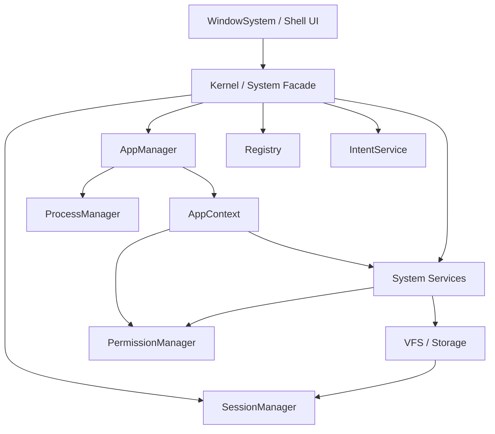

# ESKit 開発計画

> [← README に戻る](README.md) | [API リファレンス (API.md) →](API.md)

このドキュメントは **ESKit の設計方針・ADR（設計判断記録）・Phase 7 以降の実装計画** をまとめた計画書です。  
完了済みの Phase 1〜6 の詳細メモは後半の折りたたみ（`<details>`）に保存しています。

---

## 目次

- [1. 全体サマリーとコンセプト](#1-全体サマリーとコンセプト)
- [2. 現状棚卸しとコードとのギャップ](#2-現状棚卸しとコードとのギャップ)
- [3. ADR 台帳（設計判断記録）](#3-adr-台帳設計判断記録)
- [4. 改善後のアーキテクチャと移行方針](#4-改善後のアーキテクチャと移行方針)
- [5. 今後のロードマップ（Phase 7〜12）](#5-今後のロードマップphase-712)
  - [Phase 7: 棚卸し・ADR・Boot Recovery](#phase-7-architecture-inventory--adr--棚卸しと契約管理)
  - [Phase 8: Core 分離・AppContext・Scoped Permissions](#phase-8-core--cooperative-permissions--core-分離と-appcontext)
  - [Phase 9: Intent / Lifecycle・kitstrap2 同期・URL 登録・Native テスト](#phase-9-existing-capabilities--quality--既存機能の発展)
  - [Phase 10: System Services](#phase-10-system-services--ブラウザで可能な-os-サービス)
  - [Phase 11: 軽量 eskpt / Store / ESKish 連携](#phase-11-lightweight-eskpt--store--eskish--軽量レジストリ連携)
  - [Phase 12: Developer Experience（Portal・サンプル・AI 資料）](#phase-12-developer-experience--portalサンプルai向け資料)
- [6. 完了済み履歴（Phase 1〜6 の設計メモ）](#6-完了済み履歴phase-16-の設計メモ)
- [7. リポジトリ境界と予定ディレクトリ構成](#7-リポジトリ境界と予定ディレクトリ構成)

---

## 1. 全体サマリーとコンセプト

### 進捗概要

| Phase | テーマ | 状態 | 備考 |
|-------|--------|------|------|
| Phase 1〜6 | コア基盤・Window・シェル UI・Hamon・マルチユーザー・ESKish・Icon・各種サービス・PWA・サンプルアプリ | ✅ 実装済み | 現行 `develop` ブランチに反映済み |
| Phase 7 | 棚卸し・ADR 基盤・Manifest v1 契約・Boot Recovery | 📋 次期最優先 | 7.2 Boot Recovery を Core 分離前に先行導入推奨 |
| Phase 8 | Core / Manager / AppContext 分離・Scoped Permissions & VFS | 📋 計画中 | 隔離 Runtime（Phase 8.3 案）は不採用 |
| Phase 9 | Intent / Lifecycle・kitstrap2 同期・URL 登録/PWA 強化・Browser Native テスト | 📋 計画中 | 9.2 / 9.4 は並行着手可能 |
| Phase 10 | System Services（Storage / Audio / Power / Clipboard 等） | 📋 計画中 | 利用ケースごとに段階導入 |
| Phase 11 | 軽量 `eskpt` レジストリ / Store / ESKish 連携 | 📋 提案中 | 旧アーカイブ配布案を軽量 URL 登録へ更新 |
| Phase 12 | `eskit-docs` ポータル・サンプル・AI 向け資料 | 📋 提案中 | 採択・実装済み契約から順次整備 |

### 基本方針・技術スタック

- **ビルド不要・npm 非依存:** ブラウザネイティブの ES Modules・Import Maps のみ。`package.json` や `node_modules` を持ち込まない。
- **対象ブラウザ:** Evergreen 最新版（Popover API, View Transitions API, CSS Anchor Positioning, Shadow DOM, `crypto.randomUUID()` 等）。
- **永続化:**
  - VFS (`ESKitFileSystem`) → IndexedDB (`eskit-fs` / バージョン 1 固定、開発中の破壊的変更を許容)
  - テーマ・言語・外部アプリ登録情報 → VFS（ユーザーごとの `.config/` 等）
  - ユーザー・セッション・権限決定 → `localStorage`
- **実行・信頼モデル:** 組み込み・外部アプリとも **同一 JavaScript Realm** で実行する。権限モデルやマルチユーザー ACL は協調的な制御であり、悪意あるコードの隔離境界ではない。
- **UI:** `Hamon` を公式の軽量リアクティブ選択肢としつつ、Vanilla JS・Web Components・他フレームワークも許容する。
- **テスト:** Browser Native のみ（Vanilla JS + Native ESM + ブラウザ標準 API）。Node / Playwright 等は導入しない。
- **ドキュメント:** 日本語で記述し、API 仕様は [API.md](API.md) に集約する。

---

## 2. 現状棚卸しとコードとのギャップ

Phase 1〜6 の実装は動作ベースで揃っている一方、Phase 8〜9 に向けた整理対象が以下に残っています。

| 領域 | 現状 | 主な課題・次の改善先 |
|------|------|----------------------|
| **起動・Lifecycle** | 部分整理 | `loadApp()` は `initialize()` を `await` せず、`closeApp()` は同期処理。Window のフォーカス・最小化フックも `ESKitApp` へ未接続（→ 8.1 / 9.1） |
| **ファイル配送** | 実装済み | `openFile()` → `onOpenFile()` は動作するが、一般 Intent・既定 Handler 選択は未実装（→ 9.1） |
| **起動失敗の診断** | 未実装 | `index.html` → `main.js` で直接起動するため、boot 例外時の独立 Recovery 画面がない（→ 7.2） |
| **URL 登録・Manifest** | 部分実装 | `registerFromUrl()` は `define.json` を検証・VFS 保存するが、ID 衝突の上書きや `schemaVersion` 契約が未整備（→ 7.1 / 9.3） |
| **権限と VFS スコープ** | 部分実装 | `fs.read` / `fs.write` はあるが、`fs.read.all` / `fs.write.all` / `fs.shared` 等のパススコープ制御が未完成（→ 8.2） |
| **PWA (`sw.js`)** | 部分実装 | 事前キャッシュ失敗の扱いや、activate 時の他キャッシュ削除範囲の整理が必要（→ 9.3） |
| **品質保証** | 部分実装 | OS 内 `apps/test/` は存在するが、独立した `tests/index.html` 契約テストハーネスは未実装（→ 9.4） |
| **Core 再編 / 新サービス / Store** | 未実装 | `ESKitSystem` からの Manager 分離、追加 System Services、Store / `eskpt` / `eskit-docs` は未着手（→ 8 / 10 / 11 / 12） |

> **ドキュメント同期状況:** `README.md` と `API.md` は現行 `develop`（Phase 1〜6）の実コードに合わせて同期済みです。Phase 7 以降の計画仕様は本書の契約実装時に順次 `API.md` へ反映します。

---

## 3. ADR 台帳（設計判断記録）

ADR は **「背景 / 決定 / 理由 / 代替案 / 制約・リスク / 影響 Issue / 移行 / 検証」** を持ちます。全 ADR の採択を待って着手するゲートは置かず、必要な判断から順次採択します。

### 一覧

| ADR ID | 状態 | 要旨・影響範囲 |
|--------|------|----------------|
| **ADR-INSTALL-001** | ✅ **採択済み** | 軽量 URL 登録方式。独立 PackageManager 非採用、既存 Registry を発展（→ 9.3 / 11 / 12） |
| **ADR-RUNTIME-001** | ✅ **採択済み** | 同一 Realm 実行・隔離 Runtime 非採用。協調的 Permissions + 信頼済み外部コード前提（→ 8.1 / 8.2 / 9.3 / 12） |
| **ADR-TEST-001** | ✅ **採択済み** | Browser Native テストのみ。Node / npm / Playwright 非採用（→ 9.4 / 全 Phase） |
| **ADR-RECOVERY-001** | ✅ **採択済み（基本方針）** | OS 非依存の独立 Boot Recovery（読み取り診断 + 明示確認付き修復）。Core 分離前に導入（→ 7.2 / 8.1 / 9.3 / 9.4） |
| ADR-CORE-001 | 提案中 | Service 依存、主体情報、AppContext 最小契約、Facade 移行（→ 8.1） |
| ADR-FS-001 | 提案中 | スコープ形式、共有・特権、許可取消、アプリ専用保存領域（→ 8.2） |
| ADR-MANIFEST-001 | 提案中 | Manifest v1 正規化、互換性表記、未知フィールド、Handler 宣言（→ 7.1 / 9.1 / 9.3） |
| ADR-LIFECYCLE-001 | 提案中 | 状態遷移・終了取消・`singleInstance`・起動引数（→ 8.1 / 9.1） |
| ADR-CSS-001 | 提案中 | CSS 契約刷新、Layers、Reset、tokens、Modifier 移行（→ 9.2） |
| ADR-URL-001 | 提案中 | Manifest URL / ディレクトリ互換、entry・redirect・URL 範囲・衝突/更新（→ 9.3） |
| ADR-CSP-001 | 提案中 | 信頼ソース許可方針、ESKish `eval` / `blob` CLI 共存、XSS 対策（→ 9.3） |
| ADR-ESKPT-001 | 提案中 | 軽量レジストリの技術構成、認証・データモデル・公開 API（→ 11） |
| ADR-DOCS-001 | 提案中 | `eskit-docs`（Blume / Astro 等）の実現性・Portal 構成・Playground（→ 12） |
| 旧固定資産配布・署名案 | 🔄 **置換済み** | ADR-INSTALL-001 で置換（実装・試験対象から除外） |
| 旧隔離 Runtime 案 | ❌ **不採用** | ADR-RUNTIME-001 で置換（sandbox iframe / 別 Origin / RPC 隔離は対象外） |

### 採択済み ADR の要点

- **ADR-INSTALL-001（軽量 URL 登録）:**
  - HTTPS 上の `define.json` と ES Modules を登録・検証して保存する（`System.registry` を発展）。
  - 自動依存解決・アーカイブ展開・ハッシュ/署名検証・原子的ロールバック・独自 Module Loader は実装しない。
  - 外部ホストの停止やブラウザ Module キャッシュによる更新遅延は仕様として許容する。
- **ADR-RUNTIME-001（同一 Realm 実行）:**
  - ビルド不要・小さい実装を優先し、組み込み・外部アプリとも同一 JS Realm で実行する。
  - `AppContext` は API 統一・DX のための境界であり、セキュリティ境界ではない（外部コードも同一 Origin API に到達可能）。
  - 信頼できるソースのみ登録する設計とし、登録・起動時の説明と確認 UI を重視する。
- **ADR-TEST-001（Browser Native テスト）:**
  - OS 内対話診断 (`apps/test/`) に加え、独立した反復契約テスト (`tests/index.html`) を Vanilla JS で整備する。
  - `package.json` / `node_modules` / Playwright 等は導入しない。
- **ADR-RECOVERY-001（独立 Boot Recovery）:**
  - スキーマ不整合や起動例外時に、通常 OS を起動せず診断・修復できる独立画面 (`recovery.html` 等) を設ける。
  - 診断は読み取り専用を原則とし、データ削除や初期化は影響範囲を明示した確認を必須とする。

---

## 4. 改善後のアーキテクチャと移行方針

### 改善後の責務と依存方向



### `AppContext` 最小契約と段階移行

- アプリには `userId` / `appId` / `uuid` を起動時に捕捉した `AppContext` を提供し、ログアウトやユーザー切替後も進行中の非同期処理が別ユーザーの領域を参照しないようにします。
- 既存の `ESKitApp`（`this.fs`, `this.showNotification`, `this.sendMessage`, `this.listProcesses` 等）や `System.loadApp` / `openFile` / `registerFromUrl` は互換 Adapter として維持しつつ、新 Manager / Context へ段階的に委譲します。

<details>
<summary>AppContext 提供 API と既存 API 移行マッピング（詳細）</summary>

| Context API | 役割 |
|------------|------|
| `context.app` | `appId`, `uuid`, `manifest`, `launchData`, `setTitle`, `onBeforeClose`, `onTerminate` |
| `context.session` | 起動時の `userId` / `isAdmin` 読み取り情報、現在の正当性確認 |
| `context.fs` | 専用保存領域・選択ファイル・許可済み共有領域に対するスコープ付き VFS |
| `context.permissions` | 自アプリの権限照会・要求・取消通知 |
| `context.ipc` / `context.intents` | 明示的宛先 IPC、アクション委譲・結果・キャンセル |
| `context.notifications` / `context.audio` | アプリ情報付き通知、Audio Session |

| 既存 API / データ | 段階移行方針 |
|------------------|-------------|
| `System.loadApp` / `closeApp` / `listProcesses` | `Registry` で ID 解決後 `AppManager` / `ProcessManager` へ委譲 |
| `System.openFile` / `this.onOpenFile` | `IntentService` (`open`) の Adapter として維持し、二重配送を解消 |
| `ESKitApp` 各メソッド | `AppContext` へ委譲する互換ラッパーとして維持 |
| `System.registry.registerFromUrl` | 旧ディレクトリ入力を互換維持しつつ Manifest URL 直接受付へ統一 |
| 生の `window.System` | 信頼コードからは引き続き参照可能だが、アプリ向け推奨安定 API は `AppContext` に統一 |

</details>

---

## 5. 今後のロードマップ（Phase 7〜12）

**推奨着手順:** `7.0 棚卸し` & `7.1 必要 ADR` → **`7.2 Boot Recovery`（先行導入）** → `8.1 Core 分離` → `8.2 / 9.1 / 9.3` → `10 System Services` → `11 eskpt / Store` → `12 eskit-docs`（`9.2` / `9.4` は並行着手可）。

---

### Phase 7: Architecture Inventory & ADR — 棚卸しと契約管理

#### 7.0 現行実装の棚卸し（最優先）
- **目的:** 既存コードの正確な公開 API・イベント・保存形式を確定し、起動失敗・保存失敗・ファイル配送・PWA 冷起動の再現手順付き Issue を起こす。
- **完了条件:** 実装済み／部分実装／未実装の根拠と重複実装を避けたバックログが揃うこと。

#### 7.1 ADR 基盤・Manifest v1 最小契約（最優先）
- **目的:** 未決定 ADR と後続 Issue を紐付け、`define.json` の正規契約（`schemaVersion: 1`）を定める。
- **主な契約:** 現行 `define.json` は legacy として v1 へ正規化、未知の `schemaVersion` は明示エラー、`window` / `launch` / `intents` / `compatibility` を段階拡張（npm 型 semver 解決は行わない）。

<details>
<summary>Manifest v1 設計案（JSON 例と全フィールド方針）</summary>

```json
{
  "schemaVersion": 1,
  "id": "com.example.app",
  "name": { "ja": "サンプルアプリ", "en": "Sample App" },
  "description": { "ja": "説明", "en": "Description" },
  "version": "1.0.0",
  "entry": "main.js",
  "icon": { "type": "set", "set": "lucide", "name": "app-window" },
  "i18n": "./i18n/",
  "compatibility": { "eskit": ">=0.1.0" },
  "permissions": [],
  "window": { "defaultWidth": 640, "defaultHeight": 480, "resizable": true },
  "launch": { "singleInstance": false },
  "fileAssociations": [".txt"],
  "intents": []
}
```

| 契約項目 | 方針・完了条件 |
|---------|--------------|
| `schemaVersion` | 未指定は legacy として v1 正規化。未知バージョンは明示エラー |
| `id` / `name` / `description` | 既存短 ID 維持（新規は逆ドメイン推奨）。文字列・多言語オブジェクト両対応 |
| `entry` / `icon` / `i18n` | 相対パス解決と型検証（URL ポリシーは 9.3 と共通） |
| `permissions` | 文字列配列を受理。スコープ表現・特権は 8.2 と共有 |
| `window` / `launch` | `640x480` 既定値継承、`singleInstance` 再利用時引数契約を定義 |
| `fileAssociations` / `intents` | 既存拡張子配列を維持しつつ MIME / action / URI scheme を `intents` へ拡張 |
| 検証の範囲 | 入力形式の妥当性確認のみ（コード安全性・署名・ハッシュは対象外） |

</details>

#### 7.2 Boot Recovery & Diagnostics — 起動失敗時の診断・修復環境（最優先・Core 分離前推奨）
- **目的:** `eskit-fs` 不整合やブート例外時に、通常 OS を起動せず診断・バックアップ・修復できる独立入口を提供する。
- **対象ファイル（新規）:** `index.html` / `main.js`（最小 Bootstrap 化）および独立 `recovery.html` / `recovery.js` / `recovery.css`。
- **基本原則:**
  - `recovery.*` は ESKitSystem・Hamon・VFS 初期化・認証・テーマ・kitstrap2 に依存しない。
  - 読み取り診断では IndexedDB の新規作成や自動 upgrade を行わない（`onupgradeneeded` は即 abort）。
  - 削除・初期化は対象と喪失範囲を示した明示確認を必須とし、無関係な Origin 内データを消さない。
  - `sw.js` の最小事前キャッシュに Recovery 一式を含め、通常 `index.html` フォールバックとは分離する。

<details>
<summary>7.2 Boot Recovery 詳細仕様（ブートステージ・診断テーブル・修復操作・テストシナリオ）</summary>

1. **ブートステージ記録:** `bootstrap → entry-import → system-create → vfs-open → users/session → base/user-dirs → settings → registry → ui → ready`。秘密情報（パスワード/ファイル内容/トークン）は記録しない。
2. **読み取り診断対象:**
   - **IndexedDB `eskit-fs`:** `indexedDB.databases()` で存在・version 確認後、version 指定せず open（`onupgradeneeded` は必ず abort）。`files` ストア・`parent` インデックスを readonly で確認。
   - **Storage API:** `navigator.storage.estimate()` / `persisted()`（診断で `persist()` しない）。
   - **localStorage:** 既知 ESKit キーのみ読み取り確認（設定値・認証情報は展開しない）。
   - **CacheStorage / Service Worker:** ESKit 所有のキャッシュ・registration のみ照会（新規作成や `unregister` しない）。
3. **修復操作（すべて明示確認必須・直列実行）:**
   - **データバックアップ:** 読める DB スキーマ・レコード・バイナリと選択設定をブラウザからダウンロード（元データ非変更）。
   - **Cache 削除 / SW 解除:** ESKit 所有の Cache・registration のみ対象。
   - **VFS 初期化:** `eskit-fs` のみ削除（`blocked` 時は他タブ終了を案内）。
   - **設定初期化:** 選択ユーザーの `.config/theme.json` / `i18n.json`・許可キーのみ削除。
   - **完全リセット:** ESKit 所有の DB・localStorage/sessionStorage キー・Cache・SW のみ個別列挙して削除（`localStorage.clear()` は禁止）。
4. **テストシナリオ:** import 失敗、DB 不存在/version 差異、IDB/Storage 拒否、部分バックアップ、確認キャンセル、`deleteDatabase` の `blocked` 待機、キャッシュ済みオフライン Recovery。

</details>

---

### Phase 8: Core & Cooperative Permissions — Core 分離と AppContext

> **スコープ注記:** Phase 8.3「隔離 Runtime（iframe / 別 Origin / RPC 隔離）」は **不採用**（ADR-RUNTIME-001）。

#### 8.1 Core・AppContext・Manager 分離（最優先）
- **目的:** `ESKitSystem` の肥大化を解消し、`AppManager` / `ProcessManager` / `SessionManager` / `AppContext` へ責務を分離する。
- **主な作業:**
  - `initialize()` の `await` 対応、初期化失敗時の Window・権限・Scope の確実なクリーンアップ。
  - `userId` / `appId` / `uuid` を捕捉した `AppContext` の導入と、既存 `ESKitApp` API の段階的委譲。
  - セッション切替時の進行中処理中断と Registry 復元。

#### 8.2 Scoped Permissions・VFS（最優先〜次点）
- **目的:** `permissions.js` / `filesystem.js` / `file-picker` を連携させ、アプリのアクセス範囲とユーザー同意を明確化する。
- **保存領域モデル:**
  - `/home/{userId}/.local/share/{appId}/` — アプリ専用保存領域（`user/app` 単位で共有）
  - `/home/{userId}/documents/` 等 — ユーザー所有ファイル（ファイルピッカー選択により許可）
  - `/shared/` — 共有領域（ユーザー ACL + `fs.shared` 同意）
- **主な作業:** 許可判定（宣言 × 同意/スコープ × ユーザー VFS ACL）の統合、`..` 等を含むパス正規化、`fs.read.all` / `fs.write.all` のシステム管理者アプリ限定化、権限取消時の通知・操作停止。

---

### Phase 9: Existing Capabilities & Quality — 既存機能の発展

#### 9.1 IntentService・Lifecycle（次点）
- **目的:** `openFile` を一般化し、`open / view / edit / share / pick / save` の Intent と `App` ライフサイクルを統一する。
- **主な作業:**
  - `openFile()` 二重配送の解消、複数候補・既定 Handler 選択 UI の整備。
  - `onLaunch / onActivate / onDeactivate / onSuspend / onResume / onBeforeClose / onTerminate / onCrash` と `<eskit-window>` イベントの接続（`onBeforeClose` による終了キャンセル対応）。

#### 9.2 kitstrap2 同期・CSS 契約刷新・Theme 統合（次点・並行可）
- **目的:** 上流 `kitstrap2` の配布 CSS を固定版・checksum 付きで取り込み、Shadow DOM 共有 CSS と `--kit-*` / `--eskit-*` トークン契約・アクセシビリティを整備する。
- **主な作業:** 配布 CSS 取得失敗時の最小ローカル fallback、`!important` 削減・CSS Layers 整理、`reduced-motion` / `forced-colors` / `focus-visible` / Switch のキーボード操作改善。

#### 9.3 軽量アプリ登録・配布連携と PWA（次点）
- **目的:** URL 登録の安全性・透明性と本体 PWA のオフライン信頼性を高める。
- **主な作業:**
  - `registerFromUrl()` で Manifest URL 直接指定を受付可能にし、`new URL()` による厳格な URL / `entry` 検証を実装。
  - 確認ダイアログでの提供元 host・要求権限・同一 Realm リスク表示、明示更新（ID 衝突の黙殺禁止）。
  - 本体 PWA の事前キャッシュ対象整理、ESKit 専用キャッシュのみを削除する安全な更新・削除制御。

#### 9.4 Browser Native 品質保証（次点・早期着手可）
- **目的:** OS 内部の `apps/test/` とは別に、HTTP 配信で単体実行できる契約テストスイート `tests/index.html` / `tests/harness.js` を整備する。
- **主な作業:** Vanilla JS 製の同期/非同期 assert ハーネス、専用 DB/fixture 分離による Manifest・VFS・権限・Hamon・Lifecycle・URL 登録・Boot Recovery の契約テスト、PWA/CORS/複数ブラウザの手動検証手順書。

---

### Phase 10: System Services — ブラウザで可能な OS サービス

利用ケースごとに優先度順で `AppContext` 配下のサービスとして段階導入し、能力照会・拒否・非対応・終了クリーンアップを統一契約化します。

| 優先度 | サービス | 概要・Web API 依存 |
|--------|----------|-------------------|
| **P1** | **Storage / Audio / Power / Clipboard** | アプリ専用 KV (`context.storage`)、音声セッション (`Web Audio`)、画面ロック・WakeLock・OS 再読込 (`Screen Wake Lock`)、権限付きクリップボード (`Async Clipboard`) |
| **P2** | **Network / Input / Display** | 接続診断・通信方針 (`fetch` / `online`)、グローバルショートカット (`Keyboard Events`)、画面・可視性情報 (`Screen` / `matchMedia`) |
| **P3** | **Device / Background** | Gamepad / MIDI / USB / Bluetooth（機能検出・非対応許容）、協調的バックグラウンドタスク（SW 連携） |

---

### Phase 11: Lightweight eskpt / Store / ESKish — 軽量レジストリ連携

- **目的:** 独立レジストリ `eskpt` と ESKit の `apps/store/`・`apps/eskish/`・`?install=<Manifest URL>` を共通 Registry API で接続する。
- **設計方針:** `eskpt` はアプリ実体をホストせず、メタデータ・検索・Manifest URL のみ管理する（SSRF 対策・所有権管理付き）。Store / ESKish の `update` はユーザー操作による Manifest 再取得であり、自動更新や依存解決は行わない。

<details>
<summary>11.1 eskpt 技術選定の比較項目 と 旧 Phase 7（当初構想）の履歴</summary>

#### 11.1 `eskpt` 技術選定候補（未決定・役割別に比較）
- **API / 実行環境:** Void server routes + deploy vs Hono + Cloudflare Workers 直接運用
- **DB / Storage:** Void DB/KV vs Cloudflare D1（R2 はスクリーンショット等が必要な場合のみ）
- **Validation / Frontend:** Zod 等の軽量検証、最小構成のカタログ・登録 UI（ESKit 本体にビルド依存を持ち込まない）

---

**履歴注記:** 以下の旧 Phase 7 は当初構想の記録です。「パッケージ」「検証ステータス」は軽量アプリ情報として再定義され、外部アプリのオフライン保証・Void 固定・即時コード再読込は現在の確定要件ではありません。

### 旧Phase 7: eskpt Registry Service & Client Integration — 当初構想

**目的:** Void.cloud (`https://void.cloud/`) を活用して ESKit 専用の分散型パッケージレジストリサービス「eskpt」を開発し、ESKit クライアント（ESKish / GUI Store / Web連携）と統合する。  
**完了条件:** 開発者が外部ホスティングしたアプリ/テーマ/CLIを eskpt にインデックス登録でき、ESKish や GUI App Store から検索・1クリックインストールできる。

### 設計方針・決定事項
- **リポジトリ:** `eskpt` (独立リポジトリ, Void.cloud / Vite ベース)
- **インデックス型レジストリ (分散ホスティング):**
  - パッケージ実体（コード・画像・スタイル）は開発者自身の GitHub Pages / Cloudflare Pages / Vercel 等にホスト。
  - eskpt サービスはパッケージのメタデータ（`define.json` / `theme.json`）、バージョン、カテゴリ、検証ステータス、URL をインデックス（Void DB/KV）として管理・検索APIを提供。
  - ホスティングのストレージ負荷や著作権・バイナリ管理の負担を抑え、極めて軽量かつ堅牢なエコシステムを実現。
- **パッケージ種別:**
  1. `app`: ESKit アプリケーション
  2. `theme`: ESKit テーマ
  3. `cli`: ESKish 拡張コマンド
- **ロード方式 (ハイブリッド):**
  - 基本はホスティング URL を `registerFromUrl` で動的 `import()`
  - PWA Service Worker によりキャッシュされ、オフラインでも起動可能

### `eskpt` サービス仕様 (Void.cloud)
- **API エンドポイント:**
  - `GET /api/v1/packages`: パッケージ一覧・カテゴリ別フィルタ
  - `GET /api/v1/packages/:id`: パッケージ詳細・最新バージョン・マニフェスト情報
  - `GET /api/v1/search?q=...`: パッケージ名・キーワード・タグ検索
  - `POST /api/v1/packages`: パッケージ登録・更新リクエスト (URL を送信 → サーバー側でマニフェスト取得・スキーマ検証・インデックス登録)
- **Web UI (Void フロントエンド):**
  - パッケージカタログ・検索画面
  - パッケージ詳細ページ (README, スクリーンショット, 要求権限一覧, 「Install to ESKit」ボタン)
  - パッケージ登録フォーム

### ESKit クライアント統合
1. **ESKish 組み込みコマンド `eskpt`:**
   - `eskpt search <query>`: レジストリを検索
   - `eskpt info <pkgId>`: パッケージ詳細・権限・URL 表示
   - `eskpt install <pkgId|url>`: レジストリから URL を解決して `registerFromUrl` を実行
   - `eskpt uninstall <pkgId>`: インストール済みパッケージを解除
   - `eskpt list`: インストール済みパッケージ一覧
   - `eskpt update [pkgId]`: パッケージの更新チェック・再読み込み
2. **GUI パッケージマネージャーアプリ (`apps/store/`):**
   - Hamon テンプレートで構築された「App Store」風 GUI アプリ
   - おすすめ、カテゴリ別一覧 (アプリ / テーマ / ツール)、検索バー
   - パッケージカード、詳細モーダル、1クリック「インストール」「開く」「アンインストール」ボタン
3. **URL プロトコル・インストール連携:**
   - Web リンクからのインストール受付: `https://eskit.local/?install=<url>` パラメータにより、開いた瞬間にインストール確認ダイアログを自動ポップアップ。

**関連ファイル (ESKit 側):** `apps/eskish/` (eskpt コマンド追加), `apps/store/` (新規 GUI アプリ), `system/system.js` (起動時 install パラメータハンドリング)

</details>

---

### Phase 12: Developer Experience — Portal・サンプル・AI向け資料

- **12.1 ガイド・API・サンプル:** `eskit-docs` 上で `AppContext`、Manifest v1、同一 Realm 信頼モデル、kitstrap2 トークン、Hamon / Vanilla / 外部フレームワーク境界のサンプル、AI 向け `llms.txt` を整備する。
- **12.2 Portal・Playground:** 実現性・維持コストを ADR-DOCS-001 で評価したうえで、コンポーネントギャラリーと「信頼済みコード向け開発 Playground」を段階導入する（第三者コードの安全サンドボックスとしては扱わない）。

<details>
<summary>旧 Phase 8（Blume Developer Portal 当初構想）の履歴</summary>

**履歴注記:** 以下は当初の Blume・Astro Islands・iframe・AI 機能の構想を保存したものです。「サンドボックス」は第三者アプリ隔離の意味では採用しません。

### 旧Phase 8: Blume Developer Portal & Live Playground — 当初構想

**目的:** Blume (`https://useblume.dev/`) を用いて、ドキュメント・チュートリアル・コンポーネントカタログ・Live Playground・eskpt ショーケースを統合した総合開発者ポータルを構築する。  
**完了条件:** ブラウザ上で ESKit / Hamon アプリをライブ編集・検証できる Playground、および AI 向け `llms.txt`、API リファレンスが完備されたポータルが公開される。

### 設計方針・決定事項
- **リポジトリ:** `eskit-docs` (独立リポジトリ, Blume / Astro + Vite ベース)
- **対象読者:** ESKit を使ってアプリ・テーマを開発したいエンジニア & AI コーディングエージェント

### ポータル構成コンテンツ
1. **開発者ガイド & チュートリアル:**
   - **入門:** ESKit のコンセプト（ビルド不要・ブラウザネイティブ ESM）、クイックスタート
   - **アプリ開発ガイド:** `ESKitApp` ライフサイクル、マニフェスト (`define.json`) 設計、権限モデル
   - **Hamon ガイド:** シグナル (`signal`, `computed`, `effect`)、タグ付きテンプレート (`hamon` タグ)、ディレクティブ (`kit-if`, `list`)、イベント/プロパティバインディング
   - **テーマ・外観ガイド:** kitstrap2 CSS 変数、`theme.json` 作成、Lucide アイコンの利用
   - **配布・公開ガイド:** GitHub Pages へのデプロイと `eskpt` への登録手順
2. **API リファレンス:**
   - コア API (`System.*`, `this.fs.*`, `this.sendMessage`, `this.showNotification` 等) の完全リファレンス
   - Web Components 仕様 (`<eskit-icon>`, `<eskit-dialog>`, `<eskit-window>` 等)
3. **コンポーネントギャラリー (kitstrap2 & Elements):**
   - kitstrap2 のボタンスタイル、フォーム、カード、ダイアログ等のインタラクティブなプレビュー
4. **Live Playground / サンドボックス:**
   - Blume の Astro Islands / iframe 連携を利用し、ブラウザ内で ESKit またはスタンドアロンの Hamon 実行環境を埋め込み
   - 左側にコードエディタ、右側にリアルタイム描画プレビューを配置し、インストール不要でアプリ開発を試作可能に
5. **AI アシスタント & エージェント最適化:**
   - Blume 標準の `llms.txt` / `llms-full.txt` を整備し、Cursor / Gemini / Claude 等の AI エージェントが ESKit アプリコードを一発生成できるようにプロンプト・API 仕様を凝縮配信
   - Blume の「Ask AI」アシスタント有効化
6. **eskpt ショーケース & 1クリックインストール連携:**
   - eskpt レジストリの人気アプリ・テーマをポータル上で紹介
   - 「Install to ESKit」ボタンで、ユーザーの起動中 ESKit インスタンスにダイレクト連携

</details>

---

## 6. 完了済み履歴（Phase 1〜6 の設計メモ）

Phase 1〜6 は実装済みです。当時の設計判断やファイル別の経緯は、以下の折りたたみ内に記録として保持しています（現行の正確な API 仕様は [API.md](API.md) を参照してください）。

- **イベント一覧 / 権限一覧:** 重複を避けるため [API.md — システムイベント一覧](API.md#36-systemevents--イベントバス--システムイベント一覧) と [API.md — 権限モデル](API.md#15-権限モデル) を正本としています。

<details>
<summary>Phase 2: Window Management — ウィンドウ管理 ✅（詳細実装メモ）</summary>

**調査注記:** 以下は当初の実装記録。Windowの操作実装は存在するが、ESKitAppのfocus/blur/minimize等へのLifecycle配送は9.1で整理・検証する。

**目的:** デスクトップ OS らしいウィンドウ操作を実現する。  
**完了条件:** 複数ウィンドウのドラッグ・リサイズ・最小化・最大化・復元・スナップ・Z-order が動作する。  
**ステータス:** 実装済み

### `system/elements/window/main.js` — ESKitWindowElement 強化

**状態機械:**
```
normal ↔ minimized
normal ↔ maximized
(snapped は normal の一種、_prevRect で復元)
```

**追加メソッド:**
```js
class ESKitWindowElement extends HTMLElement {
  _state:    "normal" | "minimized" | "maximized"
  _prevRect: { left, top, width, height } | null

  focus(): void        // z-index 最前面 + .focused クラス
  minimize(): void
  maximize(): void
  restore(): void
  snap(side: "left" | "right"): void
}
```

**タイトルバー構造:**
```html
<div class="app-header">
  <span class="app-title">…</span>
  <div class="app-controls">
    <button class="btn-minimize">–</button>
    <button class="btn-maximize">□</button>
    <button class="btn-close">✕</button>
  </div>
</div>
```

**ドラッグ:** `.app-header` の `pointerdown/pointermove/pointerup` + `setPointerCapture`

**リサイズ:** 8 方向ハンドル (`.resize-n/s/e/w/ne/nw/se/sw`) + pointer events。`MIN_W=220, MIN_H=120`

**スナップ:** `pointerup` 時の `clientX/Y` で判定:
- `y <= 8` → `maximize()`
- `x <= 8` → `snap("left")`
- `x >= innerWidth - 8` → `snap("right")`

### `system/window.js` — ESKitWindowSystem 変更

- `open(uuid)`: カスケード配置 (offset `30 + 28 * n`)、`appElement.focus()` で前面に
- `getAllElements()`: 全ウィンドウ要素取得 (タスクバーから利用)

**関連ファイル:** `system/elements/window/main.js`, `system/elements/window/style.js`, `system/window.js`

---

</details>

<details>
<summary>Phase 3: Desktop Shell — シェル UI ✅（詳細実装メモ）</summary>

**目的:** コンテキストメニュー・スポットライト検索・クイック設定・ウィンドウアニメーションを追加し、モダン OS らしいシェル体験を実現する。  
**完了条件:** 右クリックメニュー・Ctrl+Space 検索・クイック設定パネル・ウィンドウ開閉アニメーションが動作する。  
**ステータス:** 実装済み

> **Note:** タスクバー (`eskit-taskbar`) とランチャー UI 刷新 (`eskit-launcher`) は Phase 1 で実装済み。

### `system/elements/context-menu/` (新規)

**ESKitContextMenuElement:**
```js
show(x: number, y: number, items: MenuItem[]): void
hide(): void
// MenuItem: { label: string, action: () => void } | { separator: true }
```
- デスクトップ右クリックでデフォルトメニューを表示:
  - 「ランチャーを開く」→ `launcher:toggle` 発行
  - 「シェルモード切替」→ `System.setShellMode()`
  - 区切り線 + 将来の拡張 (壁紙変更・設定を開く 等)
- `contextmenu` イベントを `window.js` の `#initContextMenu()` でハンドル
- Popover API で表示 (`popover="manual"`)、画面端でポジション自動補正
- 他クリック (`pointerdown` outside) / Escape キーで `hide()`

### `system/elements/beacon/` (新規)

**ESKitBeaconElement** — グローバル検索オーバーレイ:
```js
show(): void
hide(): void
// Ctrl+Space / Cmd+Space でトグル
```
- `position: fixed; inset: 0; z-index: 20000` のオーバーレイ
- 上部中央に検索バー (`<input>`) を配置。フォーカス自動付与
- `System.registry.search(query)` でアプリ候補をリアルタイム表示
- 候補クリック → `System.loadApp(manifest._dir)` → `hide()`
- Enter キーで最上位候補を起動
- `keydown` を `window` でキャプチャ: `Ctrl+Space` でトグル、`Escape` で閉じる
- 将来的に VFS ファイル検索も統合 (Phase 6)

### `system/elements/quick-settings/` (新規)

**ESKitQuickSettingsElement** — タスクバーのシステムトレイから展開するパネル:
```js
show(anchorEl: HTMLElement): void
hide(): void
toggle(anchorEl: HTMLElement): void
```
- CSS Anchor Positioning で時計ボタンの直上に `position-area: top span-right` 配置
- パネル内容:
  - **シェルモード:** desktop / mobile の切替トグル
  - **明暗テーマ:** OS に連動 (`prefers-color-scheme`) / ライト / ダーク の 3 択 (Phase 5 テーマ実装後に有効化)
  - **システム情報:** 起動中プロセス数、FS 使用量 (Phase 5 連携)
- `ESKitTaskbarElement` が時計要素 (`#clock`) のクリックイベントで `toggle()` を呼ぶ
- 外側クリック / Escape で `hide()`

### ウィンドウ開閉アニメーション

**`system/elements/window/style.js` 追加:**
- `@starting-style` + `transition` でウィンドウのスケール・フェードイン (`scale(0.92)` → `scale(1)`)
- `prefers-reduced-motion: reduce` でアニメーション無効化 (アクセシビリティ)

### `system/system.js` — `initUI()` 実装

- コンテキストメニュー・スポットライト・クイック設定の初期化
- グローバルキーバインド (`Ctrl+Space`) の登録
- `system:ready` イベント後に実行

**関連ファイル:** `system/elements/context-menu/main.js`, `style.js` (新規), `system/elements/beacon/main.js`, `style.js` (新規), `system/elements/quick-settings/main.js`, `style.js` (新規), `system/elements/window/style.js` (変更), `system/elements/desktop/main.js` (変更), `system/elements/taskbar/main.js` (変更), `system/system.js` (変更)

---

</details>

<details>
<summary>Phase 3.5: Hamon — リアクティブテンプレートエンジン ✅（詳細実装メモ）</summary>

**目的:** ESKit アプリ開発における以下の課題を解決するリアクティブテンプレートエンジン「Hamon」を導入する。  
**完了条件:** Hamon テンプレートで記述したアプリが、シグナル変更で自動 DOM 更新・イベント自動登録/解除・条件分岐のリアクティブ切替を行える。既存の文字列テンプレートアプリも変更なしで動作する (後方互換)。  
**ステータス:** 実装済み

### 解決する課題

1. **イベントリスナーの手動 add / remove** — `@click` 属性構文で自動登録、スコープ dispose で自動解除
2. **状態変化に合わせた手動 DOM 更新** — シグナルに依存する DOM ノードを直接・最小限に更新
3. **条件分岐・リスト描画の煩雑な命令的記述** — `kit-if` / `kit-else` ディレクティブ、`list()` ヘルパー

### 設計方針・決定事項

- **リアクティビティ:** シグナル方式 (VDOM なし)。各シグナルに依存する DOM ノードを直接更新する (SolidJS に近い方式)
- **テンプレート:** タグ付きテンプレートリテラル `hamon` + `kit-` ディレクティブ
- **イベント:** `@click` 形式 (属性構文)
- **属性バインド:** `:value` 形式
- **条件分岐:** `kit-if` / `kit-else` 属性ディレクティブ
- **リスト描画:** `list(itemsFn, renderFn)` ヘルパー関数
- **単一ファイル:** `system/hamon.js` に全実装を収める (ビルド不要哲学)
- **後方互換:** 文字列テンプレートは従来どおり `innerHTML` でマウント

### `system/hamon.js` — リアクティブプリミティブ (新規)

**signal(initial):**
```js
const count = signal(0);
count.value;      // 0 (get — 実行中 effect があれば依存登録)
count.value = 1;  // set — 依存する effect を再実行
count.peek();     // 依存追跡なしで値を読む
```

**computed(fn):**
```js
const double = computed(() => count.value * 2);
double.value; // 2 (読み取り専用、依存元が変われば自動再計算)
```

**effect(fn):**
```js
const dispose = effect(() => {
  console.log(count.value); // count が変わるたびに再実行
  return () => { /* クリーンアップ */ };
});
dispose(); // 手動解除
```

**HamonScope:**
```js
const scope = new HamonScope();
const s = scope.signal(0);
scope.effect(() => console.log(s.value));
scope.onDispose(() => { /* 任意のクリーンアップ */ });
scope.dispose(); // スコープ内の全 effect を一括解除
```

### `system/hamon.js` — テンプレートエンジン

**`hamon` タグ付きテンプレートリテラル:**
```js
import hamon, { signal } from "system/hamon.js";

const count = signal(0);
const fragment = hamon`
  <button @click=${() => count.value++}>
    Count: ${() => count.value}
  </button>
  <input :value=${() => count.value} :disabled=${() => count.value > 10}>
  <p kit-if=${() => count.value > 5}>High!</p>
  <p kit-else>Low</p>
`;
// fragment: リアクティブな DocumentFragment
// fragment._scope: HamonScope (dispose で全バインディング解除)
```

**テキスト補間:**
- `${value}` — 静的値をそのまま挿入
- `${() => expr}` — 関数: effect で自動更新される Text ノード (戻り値が Node/Fragment なら DOM 挿入)
- `${signal}` — Signal の `.value` をバインド

**イベントバインディング `@event`:**
- `@click=${handler}` → `addEventListener("click", handler)`
- scope dispose 時に自動 `removeEventListener`

**属性バインディング `:attr`:**
- `:value=${signal}` / `:disabled=${() => bool}` / `:class=${() => str}`
- `value`, `checked`, `selected`, `disabled` は DOM プロパティ直接設定
- その他は `setAttribute` / `removeAttribute`

### `system/hamon.js` — ディレクティブ

**`kit-if` / `kit-else`:**
```html
<div kit-if=${() => show.value}>表示</div>
<div kit-else>非表示</div>
```
- Comment ノードをアンカーとして位置を記憶
- 条件の真偽で DOM 挿入/除去 (ノード実体は保持し再生成しない)
- `kit-else` は直前の `kit-if` 要素の兄弟要素として連動

**`list()` リスト描画ヘルパー:**
```js
const items = signal(["A", "B", "C"]);
hamon`
  <ul>
    ${list(() => items.value, (item, i) => hamon`<li>${item}</li>`)}
  </ul>
`;
```
- 配列シグナルの変化に応じてリスト部を再レンダー（現状は全体再構築）
- 将来的には各アイテムの Fragment `_scope` を追跡し、除去時に dispose する差分更新に対応予定

### ESKitApp 統合

**`system/app.js` 変更:**
- `this.hamon` プロパティ: `HamonScope` の遅延生成ゲッター
- テンプレートに `hamon` タグ関数の戻り値 (DocumentFragment) を設定可能

**`system/window.js` 変更:**
- `open()` メソッド内でテンプレートの型判定:
  - `DocumentFragment` → `templateEl.appendChild(fragment)` (Hamon パス)
  - `string` → `templateEl.innerHTML = template` (後方互換パス)
- Hamon テンプレートの `_scope` をアプリインスタンスに紐付け

**`system/system.js` 変更:**
- `closeApp()` 内で `app._hamonScope?.dispose()` を呼び出し、全 effect を一括解除

### Hamon を使ったアプリの例 (before / after)

**Before (手動 DOM 操作):**
```js
export default class CounterApp extends ESKitApp {
  static template = html`<button id="btn">Count: 0</button>`;
  initialize() {
    let count = 0;
    const btn = this.querySelector("#btn");
    btn.addEventListener("click", () => {
      count++;
      btn.textContent = `Count: ${count}`;
    });
  }
}
```

**After (Hamon):**
```js
import hamon, { signal } from "system/hamon.js";
export default class CounterApp extends ESKitApp {
  constructor() {
    super();
    const count = signal(0);
    this.template = hamon`
      <button @click=${() => count.value++}>
        Count: ${() => count.value}
      </button>
    `;
  }
}
```

※ `WindowSystem.open()` は `initialize()` より前に `template` をマウントするため、Hamon テンプレートは constructor（または static `template`）で設定する。`initialize()` はマウント後のイベント購読・初期データ取得などに引き続き利用する。

### 将来の拡張 (Phase 3.5 スコープ外)

- **`kit-model` 双方向バインド:** `:value` + `@input` の頻出パターン用ショートハンド
- **テンプレートキャッシュ:** tagged template の `strings` 参照同一性を利用した WeakMap キャッシュ
- **既存システム要素の Hamon 化:** taskbar, launcher 等の段階的移行 (オプトイン)

**関連ファイル:** `system/hamon.js` (新規), `system/app.js` (変更), `system/window.js` (変更), `system/system.js` (変更)

---

</details>

<details>
<summary>Phase 4: Multi-User Foundation — ユーザー概念導入 ✅（詳細実装メモ）</summary>

**調査注記:** 以下の「分離」はESKit API経由の通常操作におけるACLを指す。同一Realm・Originの悪意あるコードからの隔離ではない。現行コードには空パスワードの既定管理者を自動作成・ログインする経路があり、当初の初回ログイン案とは異なる。

**目的:** ユーザー概念を導入し、ログインセッション・ホームディレクトリ分離・所有者/モードに基づくアクセス制御を実現する。  
**完了条件:** 管理者作成・ログイン・ユーザー切替・ユーザーごとの権限分離・`/home/{userId}` 分離が動作し、`/home/user` 依存が除去される。  
**ステータス:** 完了

### 決定事項

- **パス規約:** `/home/user` は廃止し、`/home/{userId}` に統一
- **認証:** ローカル完結のパスワードハッシュ (Web Crypto / PBKDF2)
- **ロール:** 管理者 1 名 + 一般ユーザー
- **共有領域:** `/shared` を導入し、アクセス制御対象に含める
- **権限分離:** 同一アプリでもユーザーごとに runtime 権限を独立管理
- **カーネル API とアプリファサードの分離:** `System.fs` 等の直接呼出しはカーネル・システム内部専用とし、アプリからは `this.fs` (FS), `this.sendMessage` (IPC), `this.listProcesses` (System Info) 等の権限検証ファサードの利用を規約化
- **特権保護:** 管理者作成 (`isAdmin: true`) およびユーザー削除は管理者セッションを必須化
- **ディレクトリ階層整合性:** ディレクトリの `rename` 時に配下の子孫エントリを同一トランザクションで再帰的更新

### `system/users.js` (新規)

**ESKitUsers** — ユーザー管理・セッション管理:
```js
class ESKitUsers {
  async init(): Promise<void>
  list(): User[]
  getCurrent(): User | null
  async create({ id, name, password, isAdmin }): Promise<User>
  async delete(id: string): Promise<void>
  async login(id: string, password: string): Promise<User>
  logout(): void
}
```

**User モデル:**
```ts
type User = {
  id: string;
  name: string;
  isAdmin: boolean;
  passwordHash: string;
  salt: string;
  createdAt: number;
  disabled?: boolean;
};
```

- ストレージ: `localStorage` (ユーザー一覧 / 現在セッション)
- ハッシュ: PBKDF2 (SHA-256) + ランダム salt
- 初回起動時は管理者ユーザー（パスワードなし）を自動作成して自動ログイン
- ユーザー ID: 1〜31 文字の英小文字開始文字列 (`/^[a-z][a-z0-9_-]{0,30}$/`)
- 管理者保護: 初回以降の `isAdmin: true` 作成および `delete()` は管理者セッションを必須化

### `system/system.js` — 起動シーケンス変更

```text
ESKitSystem.constructor()
  └─ #boot() [async]
       ├─ fs.init()
       ├─ users.init()
       ├─ #initBaseDirs()         /home, /shared, /system, /apps
       ├─ #ensureDefaultAdmin()   デフォルト管理者自動作成（自動ログイン）
       ├─ #ensureLogin()          ログイン（初回は自動ログインで通過）
       ├─ #initCurrentUserDirs()  /home/{userId}/desktop など
       ├─ new ESKitWindowSystem
       ├─ #registerBuiltinApps()
       ├─ initUI()
       └─ events.emit("system:ready")
```

### `system/filesystem.js` — owner/mode 導入

**エントリ形式拡張:**
```js
{ path, parent, type, content, owner, mode, createdAt, modifiedAt }
```

- デフォルト mode: ESKit 独自の可読オブジェクト形式
  - file: `{ owner: {read:true, write:true}, others: {read:false, write:false} }`
  - dir:  `{ owner: {read:true, write:true}, others: {read:true, write:false} }`
- `stat()` 返却に `owner`, `mode` を追加
- `read/write/readdir/remove/rename` でアクセス制御を実施
  - 一般ユーザー: 自身のホーム中心
  - 管理者: システムポリシー上許可された範囲で横断アクセス可
- ディレクトリ `rename()` は子孫エントリを再帰的にパス更新

### ログイン UI / 切替 UI

- `system/elements/login-screen/` (新規): ログイン画面
- `system/elements/quick-settings/` (変更): 現在ユーザー表示 / ログアウト / 切替
- `system/elements/drawer/` (変更): モバイル導線の追加

### マイグレーションと互換

- 旧 `/home/user` 依存コードは段階的に `/home/{userId}` へ置換
- 旧権限キーはユーザー単位キーへ移行 (`userId` を含む)
- 破壊的変更を許容する開発方針に従い、必要時は初期化リセットを許容

**関連ファイル:** `system/users.js` (新規), `system/system.js` (変更), `system/filesystem.js` (変更), `system/permissions.js` (変更), `system/app.js` (変更), `system/elements/login-screen/` (新規), `system/elements/quick-settings/` (変更), `system/elements/drawer/` (変更), `apps/test/` (変更)

---

</details>

<details>
<summary>Phase 4.5: ESKish — ターミナルアプリ ✅（詳細実装メモ）</summary>

**調査注記:** 以下の権限一覧は当初案。現行define.jsonは `user.info` を含み、`user.manage` は含まない。evalとVFS内CLI拡張は信頼済みコードを実行する開発機能。既存install/uninstall連携をPhase 11で再利用する。

**目的:** ESKit のマルチユーザー・権限モデル・ファイルシステム・プロセス管理をコマンドラインから操作・検証できる標準ターミナルアプリ「ESKish」を導入する。  
**完了条件:** ターミナルウィンドウからファイル操作・プロセス管理・ユーザー確認・JS式評価を実行でき、コマンド履歴・カレントディレクトリ表示が動作する。  
**ステータス:** 完了

> 詳細は [API.md](API.md#41-eskish--標準ターミナル環境) を参照

### 設計方針・決定事項

- **実行モデル:** Unix 風シェル体系に特化しつつ、コマンド名は **EcmaScript / ESKit API 風の独自命名** (`readFile`, `writeFile`, `readDir`, `makeDir`, `remove`, `rename`, `changeDir`, `listProcesses`, `loadApp`, `closeApp`, `currentUser`, `eval` 等) を採用
- **JavaScript 実行:** `eval <code...>` コマンドに限定し、現在ログイン中のユーザー権限（`this`, `this.fs`, `System`）で実行
- **CWD (作業ディレクトリ):** 初期値は `/home/{userId}`。相対パスおよび `~` (ホーム展開) をサポート
- **プロンプト形式:** `{userId}@eskit:{path}$ ` (ホーム配下は `~` で短縮表示)
- **UI 構造:** プレーンテキスト主体の軽量ターミナル (テキストログ、`↑`/`↓` コマンド履歴、自動スクロール)
- **組み込み登録:** `system/system.js` の `#registerBuiltinApps()` に `"apps/eskish/"` として常備

### `apps/eskish/` (新規)

- `define.json`: マニフェスト (要求権限: `fs.read`, `fs.write`, `system.info`, `notifications`, `ipc`, `user.info`, `user.manage`)
- `main.js`: `ESKishApp` クラス (CWD 管理、パス解決、コマンドパーサー、履歴管理)
- `style.js`: ターミナル UI スタイル (ダークモノスペーステーマ)

**関連ファイル:** `apps/eskish/define.json` (新規), `apps/eskish/main.js` (新規), `apps/eskish/style.js` (新規), `system/system.js` (変更)

---

</details>

<details>
<summary>Phase 4.8: Icon System — アイコンセットと Lucide Icons 統合（詳細実装メモ）</summary>

**目的:** 絵文字や記号文字に依存していたシステム UI（ウィンドウ操作、コンテキストメニュー、Beacon、タスクバー、ランチャー、ドロワー、クイック設定、ログイン画面等）およびアプリのアイコン表示を刷新し、**アイコンセット (Icon Set)** の概念に基づいた一貫性のある Lucide Icons 基盤を導入する。  
**完了条件:** `<eskit-icon set="..." name="...">` Web Component および `icon(set, name, options)` ヘルパーが動作し、`System.icons` レジストリによりセット単位でアイコンが管理・描画され、`define.json` マニフェストの `icon` オブジェクト指定が解釈・表示される。  
**ステータス:** 完了

### 設計方針・決定事項

- **アイコンセット (Icon Set) モデル:** アイコンは単一の `name` ではなく、**`set` (アイコンセット名) と `name` (アイコン名)** の 2 つのキーで常に明示的に解決する（`<eskit-icon set="lucide" name="search">`）。
- **ビルド不要・完全ローカル自己完結:** 外部 CDN や npm ビルドに一切依存せず、`system/icons.js` に標準の `"lucide"` アイコンセットの SVG 定義を同期マップとして保持する。
- **Web Component `<eskit-icon>`:**
  - 属性: `set`, `name`, `size`, `stroke-width`, `color`
  - スタイル: `display: inline-flex`, `vertical-align: middle`, `color: currentColor`, デフォルトサイズ `1em`。CSS 変数 `--eskit-icon-size`, `--eskit-icon-stroke-width` によるオーバーライドに対応。
- **ヘルパー関数 `icon(set, name, options)`:**
  - Hamon テンプレートや動的 DOM 生成向けに、`<eskit-icon>` 要素または SVG ノードを返す関数を提供。
- **マニフェスト (`define.json`) 形式:**
  - `icon` フィールドはオブジェクト形式 `{ type: "set" | "image", ... }` で統一:
    - アイコンセット: `{ "type": "set", "set": "lucide", "name": "terminal" }`
    - 画像ファイル: `{ "type": "image", "src": "icon.png" }`

### `system/icons.js` — アイコンレジストリ (新規)

**ESKitIcons:**
```js
class ESKitIcons {
  registerSet(setId: string, icons: Record<string, string>): void
  get(setId: string, name: string): string | null
  has(setId: string, name?: string): boolean
  listSets(): string[]
  listIcons(setId: string): string[]
}
```

- **組み込みセット (`lucide`):**
  - OS 起動時に `system/icons.js` 内の主要 Lucide アイコン（約50〜100種: ウィンドウ制御、検索、設定、ファイル、ターミナル、電源、ユーザー、テーマ、各種状態表示等）を `"lucide"` セットとして同期登録。
- **アプリによる拡張:**
  - アプリやプラグインは `System.icons.registerSet("my-app-set", { icon1: "<svg...>...", ... })` により独自のアイコンセットを登録可能。

### `system/elements/icon/` (新規)

**ESKitIconElement (`eskit-icon`):**
```html
<eskit-icon set="lucide" name="search" size="18"></eskit-icon>
```
- Shadow DOM 内で SVG を描画。`currentColor` に追従。
- `observedAttributes`: `["set", "name", "size", "stroke-width", "color"]`
- `set` または `name` 変更時に `System.icons.get(set, name)` を再取得して描画。存在しない場合はフォールバック表示。

### 既存 UI / アプリの Lucide アイコン置換スコープ

| コンポーネント | 対象箇所 | 置換前 | 置換後 (`set="lucide"`) |
|--------------|---------|-------|------------------------|
| `eskit-window` | タイトルバー操作ボタン | `–`, `□`, `✕` | `minus`, `square` / `maximize-2`, `x` |
| `eskit-context-menu` | デフォルトメニュー項目 | `💠`, `🔍`, `🔄` | `monitor-smartphone`, `search`, `refresh-cw` |
| `eskit-beacon` | 検索バー・結果フォールバック | `🔍`, `🪄` | `search`, `sparkles` |
| `eskit-launcher` | ランチャーボタン・アプリアイコン | `🪄` | マニフェストの `icon` または `sparkles` |
| `eskit-drawer` | ドロワーアプリアイコン | `🪄` | マニフェストの `icon` または `sparkles` |
| `eskit-quick-settings` | モード、テーマ、システム項目 | 文字/記号 | `monitor-smartphone`, `sun`, `moon`, `cpu`, `hard-drive` |
| `eskit-login-screen` | 入力欄・ボタン | 文字 | `user`, `lock`, `arrow-right` |
| `apps/eskish/` | マニフェスト `icon` | `"icon.png"` | `{ "type": "set", "set": "lucide", "name": "terminal" }` |
| `apps/welcome/` | マニフェスト `icon` | `"icon.png"` | `{ "type": "set", "set": "lucide", "name": "sparkles" }` |
| `apps/test/` | 検証状態アイコン | `⏳`, `✅`, `❌` | `clock`, `check-circle-2`, `x-circle` |

**関連ファイル:** `system/icons.js` (新規), `system/elements/icon/main.js` (新規), `system/elements/icon/style.js` (新規), `system/manifest.js` (変更), `system/window.js` (変更), `system/system.js` (変更), 各種既存要素・アプリ (変更)

---

</details>

<details>
<summary>Phase 5: System Services — システムサービス ✅（詳細実装メモ）</summary>

**調査注記:** 以下は当初設計の履歴。テーマと言語設定の現在の保存先は `/home/{userId}/.config/theme.json` / `i18n.json` のVFSであり、localStorage案を置換している。組み込みテーマ・壁紙は `system/themes/presets.js`。旧light/darkファイル案とAPI例の差異は9.2と将来のAPI資料更新で整理する。

**目的:** テーマシステム、通知、i18n、設定アプリの基盤サービスを実装する。  
**完了条件:** 組み込み・外部テーマの切替で OS 全体の見た目が即座に変わり、通知が表示・自動消去され、言語切替が反映される。  
**ステータス:** 完了

### `system/theme.js` — テーマエンジン (新規)

**設計基盤:** kitstrap2 の CSS 変数システム上に構築する。`system/main.css` で `--eskit-*` 変数を `var(--kit-*)` にブリッジ済みのため、`--kit-*` 変数を上書きするだけで Shadow DOM を含む全要素に即時反映される。

**テーマオブジェクト形式:**

```json
{
  "id": "catppuccin-mocha",
  "name": "Catppuccin Mocha",
  "dark": true,
  "vars": {
    "--kit-color-primary": "#cba6f7",
    "--kit-fg":            "#cdd6f4",
    "--kit-bg":            "#1e1e2e",
    "--kit-bg-secondary":  "#181825"
  },
  "wallpaper": "linear-gradient(135deg, #1e1e2e, #181825)"
}
```

**API:**

```js
class ESKitTheme {
  get current(): string                // 現在のテーマ ID
  get list(): ThemeMeta[]              // 利用可能なテーマ一覧
  apply(id: string): void              // 組み込みテーマを適用
  applyVars(
    vars: Record<string, string>,
    dark?: boolean
  ): void                              // 変数セットを直接適用 (カスタムテーマ)
  async load(url: string): Promise<ThemeMeta>  // 外部 URL から theme.json を fetch・登録
  reset(): void                        // システムデフォルトに戻す
  setWallpaper(value: string): void    // 壁紙 CSS 値 (url() / gradient)
  export(): string                     // 現在のテーマを JSON 文字列でエクスポート
}
```

- 組み込みテーマ: `system/themes/light.js`, `system/themes/dark.js` という静的 JS モジュールとして定義し、ES Modules の `import` で読み込む（ブート時の fetch を抑え、キャッシュを最大活用）。
- `localStorage` にテーマ ID とカスタム vars を永続化。起動時に自動復元
- 適用時に `system:theme-changed` イベントを発行
- 壁紙: `--eskit-wallpaper` CSS 変数 → `eskit-desktop` の `background` に反映

**外部テーマのインポートフロー (`System.theme.load(url)`):**

1. URL を受け取り `theme.json` を fetch
2. JSON スキーマバリデーション (必須: `id`, `name`, `vars`)
3. ユーザー確認ダイアログ: テーマ名・作者・変更変数数を提示（新設する汎用確認ダイアログ `eskit-dialog` を利用）
4. `applyVars()` で即時適用 → `localStorage` に保存
5. `ThemeMeta` を返却 (リストに追加)

**セキュリティ:**
- HTTPS URL のみ許可 (`http://` は即拒否)
- `vars` のキーは `--kit-*` または `--eskit-*` のみ許可 (任意プロパティ注入を防止)
- 外部テーマ読み込みには設定アプリ経由のユーザー操作を必須とする

### `system/elements/dialog/` (新規)

**ESKitDialogElement (`eskit-dialog`):**
- システム全体で利用できる汎用的な確認・メッセージ用ダイアログ要素。
- Popover API を用いて表示し、テーマのインポート確認やその他のシステム確認処理で再利用する。

### `system/i18n.js` — 多言語対応 (新規)

```js
class ESKitI18n {
  locale: Signal<string>                   // 現在の言語コード（Hamon シグナル）
  async load(lang: string): Promise<void>  // system/i18n/{lang}.json を fetch
  t(key: string, vars?: Record<string, string>): string  // テンプレート補間対応
  get current(): string                    // 現在の言語コード
  get available(): string[]
  extend(appId: string, lang: string, dict: Record<string, string>): void  // アプリ独自辞書マージ
  async loadAppDictionary(appDir: string, appId: string, i18nPath?: string): Promise<void>  // アプリ個別辞書の動的ロード
  getAppName(manifest: Manifest): string   // 多相型マニフェスト名解決
  getAppDescription(manifest: Manifest): string
  getPermissionDescription(permCode: string): string
  formatTime(dateOrTimestamp?: Date|number, options?: Intl.DateTimeFormatOptions): string
  formatDate(dateOrTimestamp?: Date|number, options?: Intl.DateTimeFormatOptions): string
}
```
- コア言語パック: `system/i18n/ja.json`, `system/i18n/en.json` (システム共通・OSメッセージ)
- アプリ個別言語パック: 各アプリの `i18n/{lang}.json` から起動時および言語切替時に動的オンデマンド取得
- `navigator.language` で起動時自動選択 → `localStorage` (`/home/{userId}/.config/i18n.json`) で永続化
- **リアクティブ UI 更新:** `locale` を Hamon のシグナルとして実装し、Hamon テンプレート内の `${() => System.i18n.t('key')}` のように参照することで、言語切替時に依存関係の自動追跡により UI が即座に自動更新される。
- 言語変更完了時には `system:locale-changed` イベントも発行する。

### `system/elements/notification/` (新規)

**ESKitNotificationContainerElement (`eskit-notification-container`):**
- 画面右上固定の通知用コンテナ要素。

**ESKitNotificationElement (`eskit-notification`):**
- `System.events.on("notification:show", handler)` で自動表示され、`eskit-notification-container` 内に順次追加される。
- トーストが縦に積み重なる（スタックする）設計。
- `@starting-style` + `transition` でスライドイン/アウト。
- クリックまたは `duration` 経過で自動的にコンテナから消去される。

### `apps/settings/` — 設定アプリ (新規)

**実装方針:** 新規の Hamon テンプレートエンジンを全面的に使用し、宣言的かつリアクティブに実装する。

タブ構成:
- **外観:** 組み込みテーマ選択グリッド・URL からテーマをインポート (`System.theme.load`)・壁紙グリッド (プリセット + VFS 画像選択 + カスタム壁紙サムネイル)・現在のテーマを JSON でエクスポート
- **言語:** `System.i18n.available` からドロップダウン選択
- **システム:** 実行中プロセス数・登録アプリ数
- **権限:** インストール済みアプリの権限一覧 + 個別取り消し UI

**関連ファイル:** `system/theme.js`, `system/themes/light.js`, `system/themes/dark.js`, `system/i18n.js`, `system/i18n/ja.json`, `system/i18n/en.json`, `system/elements/dialog/`, `system/elements/notification/`, `system/system.js`, `apps/settings/`

---

</details>

<details>
<summary>Phase 6: PWA & Sample Apps & Base Extensibility — PWA化と拡張基盤 ✅（詳細実装メモ）</summary>

**調査注記:** ✅・「完了」は当初の記録。コードは存在するが、本体PWAの事前キャッシュ範囲は部分実装で、今回はインストール・冷起動オフライン・SystemVerifier全PASSを確認していない。現行アイコンはSVGであり、下記の192/512画像は当初仕様。外部アプリのオフライン起動は保証しない。9.3・9.4で本体の受入条件を検証する。

**目的:** ESKit 本体を PWA 化してオフライン対応・アプリ化を実現し、外部アプリ/テーマのインストール基盤を完成させ、標準サンプルアプリ 4 種を整備し、全システムおよびアプリの完全な多言語対応 (i18n) 基盤を確立する。  
**完了条件:**
1. PWA としてブラウザにインストール可能でオフラインでも動作する。
2. 外部 URL からのアプリ/テーマ登録 (`registerFromUrl`, `theme.load`) が動作し、確認ダイアログが多言語表示される。
3. マニフェスト (`define.json`) が多相型多言語 (`string | { ja, en }`) および辞書パス宣言 (`i18n`) に対応している。
4. 全サンプルアプリ（Notepad, Calculator, Clock, FileManager）が個別辞書 (`apps/*/i18n/`) を備え、ハードコード文字列なしで動作する。
5. 言語切替時にウィンドウタイトル・タスクバー・アプリ内表示が即座に連動更新される。
6. SystemVerifier (`apps/test`) に Phase 6 テストスイートが追加され、全自動検証が PASS する。  
**ステータス:** 完了

### PWA 化仕様
- **キャッシュ戦略:** Network-First (フォールバックで Cache)
  - オンライン時は常に最新リソースを直接取得（開発時の即時反映・キャッシュ事故防止）
  - 通信不可時は Service Worker のキャッシュからレスポンス
- **構成ファイル:**
  - `manifest.webmanifest`: アプリ名、アイコン定義、`display: "standalone"`, `theme_color`, `background_color`
  - `sw.js`: Service Worker (コアシステム、CSS、アイコン、組み込みアプリ、アプリ個別辞書の事前キャッシュ + 動的フェッチキャッシュ)
  - `system/pwa.js`: Service Worker 登録 & 更新監視
  - `icons/`: PWA 用マニフェストアイコン (192x192, 512x512, maskable)

### マニフェスト (`define.json`) 多言語仕様
- **多相型 (Polymorphic) プロパティ:**
  - `name`: `string` または `{ "en": "...", "ja": "..." }`
  - `description`: `string` または `{ "en": "...", "ja": "..." }`
- **辞書パス宣言 (オプション):**
  - `"i18n": "./i18n/"` (未指定時は `./i18n/` をデフォルト探索)

### アプリ個別辞書 & 動的ローダー (`System.i18n.loadAppDictionary`)
- 各アプリディレクトリ配下に `i18n/ja.json`, `i18n/en.json` を配置。
- `System.loadApp()` 時に自動ロードし `System.i18n.extend()` にマージ。
- 言語切替 (`System.i18n.setLocale()`) 時に登録済み・実行中アプリの該当言語辞書を遅延取得・自動マージし、UI を即座にリアクティブ更新。

### `ESKitApp` ウィンドウタイトル自動同期
- アプリが個別タイトル（編集中ファイル名など）を設定しない限り、`ESKitApp` 基底クラスがマニフェストの多言語名（`System.i18n.getAppName`）を自動追従。
- `setTitle(title)` は文字列に加えて Signal や関数・i18n キーを受け入れ可能。
- `app:opened` イベントに `manifest: app._manifest` を含め、タスクバー側でも言語切替時にアプリ表示名を同期更新。

### サンプルアプリ (新規 4 アプリ)

| アプリ | 機能 | 利用 API | 宣言権限 | i18n 辞書 |
|--------|------|---------|---------|----------|
| `apps/notepad/` | テキストエディタ、仮想 FS へ保存/読込 | `this.fs.writeFile/readFile`, `this.showNotification` | `fs.read`, `fs.write`, `notifications` | `apps/notepad/i18n/{ja,en}.json` |
| `apps/calculator/` | 四則演算電卓 (キーボード入力対応) | `this.querySelector` | (なし) | `apps/calculator/i18n/{ja,en}.json` |
| `apps/clock/` | 時計 / ストップウォッチ / タイマー | `this.showNotification`, `System.i18n.formatDate/formatTime` | `notifications` | `apps/clock/i18n/{ja,en}.json` |
| `apps/filemanager/` | 仮想 FS ブラウザ、ファイル作成・削除・リネーム・PC 入出力 | `this.fs.*` 全 API | `fs.read`, `fs.write`, `notifications` | `apps/filemanager/i18n/{ja,en}.json` |

### システムメッセージ & 初期ファイル多言語化
- `system/registry.js`: 外部 URL インストール確認ダイアログを `System.i18n.t()` 化。
- `system/permissions.js`: 権限要求ダイアログのアプリアイコン・名前解決を多言語対応。
- 初期ユーザーディレクトリ作成: `/home/{userId}/desktop/Welcome.txt` および `documents/GettingStarted.md` を日英併記 (Bilingual) で生成。

**関連ファイル:** `manifest.webmanifest`, `sw.js`, `icons/`, `system/manifest.js`, `system/i18n.js`, `system/app.js`, `system/system.js`, `system/permissions.js`, `system/registry.js`, `apps/notepad/`, `apps/calculator/`, `apps/clock/`, `apps/filemanager/`, `apps/test/`

---

</details>

---

## 7. リポジトリ境界と予定ディレクトリ構成

### マルチリポジトリ境界

| リポジトリ | 所有する作業 | 他リポジトリとの受渡し |
|------------|--------------|------------------------|
| **ESKit** (本リポジトリ) | Bootstrap / Recovery、Kernel / Managers / Context、Registry / Manifest、VFS / Permissions、Intent / Lifecycle、Services、Store / ESKish、PWA、Browser Native テスト | 固定 CSS 取り込み、eskpt HTTP API、docs 向け公開 API |
| **kitstrap2** | SCSS・Vite ビルド・配布 CSS、汎用 tokens / components / utilities / reset / dark / a11y | 固定版・commit・checksum・license を ESKit へ同期 |
| **eskpt** | メタデータ・検索・公開者認証・Manifest URL・HTTP API・カタログ UI | Registry に渡す Manifest URL と表示情報 |
| **eskit-docs** | Portal・チュートリアル・API・サンプル・Playground・AI 資料 | 実装版・ADR リンク・トークン仕様 |

### 今後追加予定の主なファイル（ESKit 本体）

現在のファイル構成は [README.md](README.md#ディレクトリ構成) を参照してください。Phase 7〜11 で以下を追加予定です。

```text
recovery.html            (Phase 7.2 - 未実装: OS 非依存の診断・修復入口)
recovery.js              (Phase 7.2 - 未実装: Native API による診断・確認付き修復)
recovery.css             (Phase 7.2 - 未実装: 独立した最小スタイル)
tests/                   (Phase 9.4 - 未実装: Browser Native 契約テスト)
  ├── index.html
  └── harness.js
apps/store/              (Phase 11  - 未実装: 軽量 Registry API を呼ぶ GUI Store)
```
